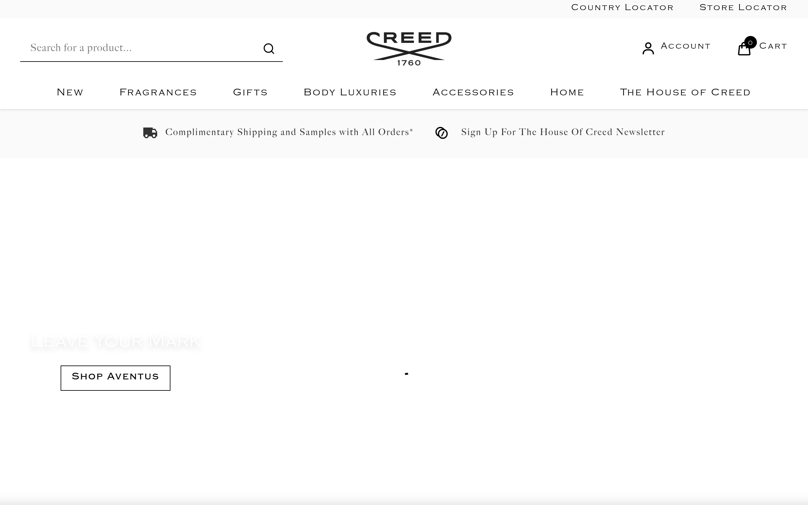
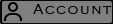
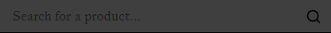
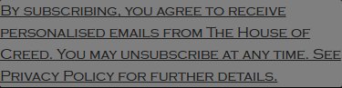

# creed-design Design System

You are building UI for **creed-design**. Dark-themed, cool palette, monospace typography (Copperplate), compact density on a 4px grid, expressive motion.

## Visual Reference

**IMPORTANT**: Study ALL screenshots below before writing any UI. Match colors, typography, spacing, layout, and motion exactly as shown.

### Homepage



### Scroll Journey (Cinematic Visual States)

> These screenshots capture the website at different scroll depths. The design changes dramatically as you scroll — each frame shows a different cinematic state. Replicate these exact visual transitions.

#### 0% — Hero / Above the fold


#### 17% — Mid-page at 17% scroll


#### 33% — Mid-page at 33% scroll


#### 50% — Mid-page at 50% scroll


#### 67% — Mid-page at 67% scroll


#### 83% — Mid-page at 83% scroll


#### 100% — Footer / End of page


### Video Backgrounds (First Frames)


> Read `references/DESIGN.md` for full token details. Read `references/ANIMATIONS.md` for motion specs. Read `references/LAYOUT.md` for layout structure. Read `references/COMPONENTS.md` for component patterns.

## Ultra Reference Files

This package includes extended documentation. **Read these files before implementing:**

| File | Contents |
|------|----------|
| `references/DESIGN.md` | Full design system tokens, colors, typography, spacing |
| `references/VISUAL_GUIDE.md` | **START HERE** — Master visual guide with all screenshots embedded |
| `references/ANIMATIONS.md` | CSS keyframes, scroll triggers, motion library stack, video specs |
| `references/LAYOUT.md` | Flex/grid containers, page structure, spacing relationships |
| `references/COMPONENTS.md` | DOM component patterns, HTML structure, class fingerprints |
| `references/INTERACTIONS.md` | Hover/focus states with before/after style diffs |
| `screens/scroll/` | 7 scroll journey screenshots showing cinematic states |

### Animation Stack Detected

- **Web Animations API (1 active)** — animation

## Design Philosophy

- **Layered depth** — use shadow tokens to create a sense of physical layering. Each elevation level has a specific shadow.
- **Gradient accents** — gradients are used thoughtfully for emphasis, not decoration.
- **Single typeface** — Copperplate carries all text. Hierarchy comes from size, weight, and color — never font mixing.
- **compact density** — 4px base grid. Every dimension is a multiple of 4.
- **cool palette** — the color temperature runs cool, matching the monospace typography.
- **Restrained accent** — `#3275b4` is the only pop of color. Used exclusively for CTAs, links, focus rings, and active states.
- **Expressive motion** — animations are an integral part of the experience. Use spring physics and layout animations.

## Color System

### Core Palette

| Role | Token | Hex | Use |
|------|-------|-----|-----|
| Background | `--background` | `#000000` | Page/app background |
| Surface | `--surface` | `#333333` | Cards, panels, modals |
| Text Primary | `--text-primary` | `#ffffff` | Headings, body text |
| Text Muted | `--text-muted` | `#666666` | Captions, placeholders |
| Accent | `--accent` | `#3275b4` | CTAs, links, focus rings |
| Border | `--border` | `#4a5158` | Dividers, card borders |

### Status Colors

| Status | Hex | Use |
|--------|-----|-----|
| Success | `#2e8442` | Confirmations, positive trends |
| Warning | `#fff4e8` | Caution states, pending items |
| Danger | `#c22f3d` | Errors, destructive actions |

### Extended Palette

- **color-border:** `#e5e5e5` — Light surface or highlight color
- `#17171a` — Deep background layer or shadow color
- **color-neutral:** `#f2f2f2` — Light surface or highlight color
- `#2c3e50`
- `#d4d4d4`
- `#3860be`
- `#6b7280`
- `#767676`

### CSS Variable Tokens

```css
--color-primary: oklch(43%.0147 248.17);
--color-secondary: oklch(67%.15 250);
--color-primary-500: oklch(from var(--color-primary) l c h);
--color-primary-dark: var(--color-primary-950);
--color-primary-hover: var(--color-primary-600);
--accordion-border: none;
--alert-border-default: none;
--alert-border-radius: var(--radius-site);
--btn-border-width: 0px;
--btn-bordered-border-width: 3px;
--btn-border-width: var(--btn-bordered-border-width);
--input-border-width: 1px;
--input-border-width-active: 2px;
--input-border-width-invalid: 2px;
--input-error-border-color: var(--color-error);
--dropdown-border-width: 1px;
--dropdown-border-width-active: 2px;
--dropdown-error-border-color: var(--color-error);
--breadcrumb-icon-border-top: 1px;
--breadcrumb-icon-border-right: 1px;
```

## Typography

### Font Stack

- **Copperplate** — Heading 1, Heading 2, Heading 3
- **SFMono-Regular** — Body, Caption, Code

### Font Sources

```css
@font-face {
  font-family: "Copperplate";
  src: url("fonts/Copperplate-300.woff") format("woff");
  font-weight: 300;
}
@font-face {
  font-family: "BigCaslon";
  src: url("fonts/BigCaslon-Regular.woff") format("woff");
  font-weight: 400;
}
@font-face {
  font-family: "BigCaslon";
  src: url("fonts/BigCaslon-700.woff") format("woff");
  font-weight: 700;
}
@font-face {
  font-family: "Pinyon Script";
  src: url("fonts/PinyonScript-Regular.ttf") format("truetype");
  font-weight: 400;
}
```

### Type Scale

| Role | Family | Size | Weight |
|------|--------|------|--------|
| Heading 1 | Copperplate | 300px | 700 |
| Heading 2 | Copperplate | 42px | 700 |
| Heading 3 | Copperplate | var(--text-desktop-xl,32px) | 700 |
| Body | SFMono-Regular | 1rem | 400 |
| Caption | SFMono-Regular | 16px | 400 |
| Code | SFMono-Regular | 14px | 400 |

### Typography Rules

- All text uses **Copperplate** — never add another font family
- Max 3-4 font sizes per screen
- Headings: weight 600-700, body: weight 400
- Use color and opacity for text hierarchy, not additional font sizes
- Line height: 1.5 for body, 1.2 for headings

## Spacing & Layout

### Base Grid: 4px

Every dimension (margin, padding, gap, width, height) must be a multiple of **4px**.

### Spacing Scale

`2, 4, 6, 8, 10, 12, 14, 16, 20, 24, 26, 28` px

### Spacing as Meaning

| Spacing | Use |
|---------|-----|
| 4-8px | Tight: related items (icon + label, avatar + name) |
| 12-16px | Medium: between groups within a section |
| 24-32px | Wide: between distinct sections |
| 48px+ | Vast: major page section breaks |

### Border Radius

Scale: `.25rem, .3125rem, .375rem, .5rem, 1px, 2px, 4px, 5px, 8px, 12px, 17px, 20px, 50px`
Default: `4px`

### Container

Max-width: `80rem`, centered with auto margins.

### Breakpoints

| Name | Value |
|------|-------|
| sm | 40rem |
| md | 48rem |
| lg | 64rem |
| xl | 80rem |
| 2xl | 96rem |
| sm | 599px |
| sm | 600px |
| sm | 639px |
| sm | 640px |
| md | 767px |
| md | 768px |
| lg | 1023px |
| lg | 1024px |
| xl | 1200px |
| xl | 1280px |
| 2xl | 1440px |

Mobile-first: design for small screens, layer on responsive overrides.

## Component Patterns

### Card

```css
.card {
  background: #333333;
  border: 1px solid #4a5158;
  border-radius: 4px;
  padding: 16px;
  box-shadow: var(--modal-box-shadow);
}
```

```html
<div class="card">
  <h3>Card Title</h3>
  <p>Card content goes here.</p>
</div>
```

### Button

```css
/* Primary */
.btn-primary {
  background: #3275b4;
  color: #ffffff;
  border-radius: 4px;
  padding: 8px 16px;
  font-weight: 500;
  transition: opacity 150ms ease;
}
.btn-primary:hover { opacity: 0.9; }

/* Ghost */
.btn-ghost {
  background: transparent;
  border: 1px solid #4a5158;
  color: #ffffff;
  border-radius: 4px;
  padding: 8px 16px;
}
```

```html
<button class="btn-primary">Get Started</button>
<button class="btn-ghost">Learn More</button>
```

### Input

```css
.input {
  background: #000000;
  border: 1px solid #4a5158;
  border-radius: 4px;
  padding: 8px 12px;
  color: #ffffff;
  font-size: 14px;
}
.input:focus { border-color: #3275b4; outline: none; }
```

```html
<input class="input" type="text" placeholder="Search..." />
```

### Badge / Chip

```css
.badge {
  display: inline-flex;
  align-items: center;
  padding: 4px 8px;
  border-radius: 9999px;
  font-size: 12px;
  font-weight: 500;
  background: #333333;
  color: #666666;
}
```

```html
<span class="badge">New</span>
<span class="badge">Beta</span>
```

### Modal / Dialog

```css
.modal-backdrop { background: rgba(0, 0, 0, 0.6); }
.modal {
  background: #333333;
  border: 1px solid #4a5158;
  border-radius: 50px;
  padding: 24px;
  max-width: 480px;
  width: 90vw;
  box-shadow: 0-6px 12px -4px #0000001a;
}
```

```html
<div class="modal-backdrop">
  <div class="modal">
    <h2>Dialog Title</h2>
    <p>Dialog content.</p>
    <button class="btn-primary">Confirm</button>
    <button class="btn-ghost">Cancel</button>
  </div>
</div>
```

### Table

```css
.table { width: 100%; border-collapse: collapse; }
.table th {
  text-align: left;
  padding: 8px 12px;
  font-weight: 500;
  font-size: 12px;
  color: #666666;
  text-transform: uppercase;
  letter-spacing: 0.05em;
  border-bottom: 1px solid #4a5158;
}
.table td {
  padding: 12px;
  border-bottom: 1px solid #4a5158;
}
```

```html
<table class="table">
  <thead><tr><th>Name</th><th>Status</th><th>Date</th></tr></thead>
  <tbody>
    <tr><td>Item One</td><td>Active</td><td>Jan 1</td></tr>
    <tr><td>Item Two</td><td>Pending</td><td>Jan 2</td></tr>
  </tbody>
</table>
```

### Navigation

```css
.nav {
  display: flex;
  align-items: center;
  gap: 8px;
  padding: 12px 16px;
  border-bottom: 1px solid #4a5158;
}
.nav-link {
  color: #666666;
  padding: 8px 12px;
  border-radius: 4px;
  transition: color 150ms;
}
.nav-link:hover { color: #ffffff; }
.nav-link.active { color: #3275b4; }
```

```html
<nav class="nav">
  <a href="/" class="nav-link active">Home</a>
  <a href="/about" class="nav-link">About</a>
  <a href="/pricing" class="nav-link">Pricing</a>
  <button class="btn-primary" style="margin-left: auto">Get Started</button>
</nav>
```

### Extracted Components

These components were found in the codebase:

**Button** (`html`)

**Input** (`html`)

**Card** (`html`)
- Variants: `light`, `status`

**Navigation** (`html`)

**Modal** (`html`)

## Page Structure

The following page sections were detected:

- **Navigation** — Top navigation bar (64 items)
- **Hero** — Hero/banner section with headline and CTAs
- **Faq** — FAQ/accordion section
- **Footer** — Page footer with links and info (37 items)
- **Cta** — Call-to-action section
- **Cards** — Grid of 47 card elements (47 items)

When building pages, follow this section order and structure.

## Animation & Motion

This project uses **expressive motion**. Animations are part of the design language.

### CSS Animations

- `skeleton-loading`
- `chatbot-sparkle`
- `spin`
- `pulse`
- `slide-up`

### Motion Tokens

- **Duration scale:** `0s`, `.1s`, `.15s`, `.2s`, `.3s`, `.5s`, `.7s`, `50ms`, `200ms`, `250ms`, `300ms`, `500ms`
- **Easing functions:** `ease-in-out`, `ease`, `ease-out`, `cubic-bezier(.32,.72,0,1)`

### Motion Guidelines

- **Duration:** Use values from the duration scale above. Short (0s) for micro-interactions, long (500ms) for page transitions
- **Easing:** Use `ease-in-out` as the default easing curve
- **Direction:** Elements enter from bottom/right, exit to top/left
- **Reduced motion:** Always respect `prefers-reduced-motion` — disable animations when set

## Depth & Elevation

### Shadow Tokens

- Subtle: `inset 0 0 0 2px var(--color-border-hover)`
- Subtle: `0 1px 2px #00000080`
- Raised (cards, buttons): `var(--modal-box-shadow)`
- Raised (cards, buttons): `var(--modal-mobile-shadow)`
- Raised (cards, buttons): `inset 0 0 0 var(--input-border-width) var(--color-border)`
- Raised (cards, buttons): `inset 0 0 0 var(--input-border-width-invalid) var(--input-error-border-color)`

### Z-Index Scale

`0, 1, 2, 3, 4, 5, 10, 20, 30, 40, 41, 50, 55, 60, 100, 101, 999, 1000, 9000, 9999, 50000, 99999, 999999`

Use these exact values — never invent z-index values.

## Anti-Patterns (Never Do)

- **No blur effects** — no backdrop-blur, no filter: blur()
- **No zebra striping** — tables and lists use borders for separation
- **No invented colors** — every hex value must come from the palette above
- **No arbitrary spacing** — every dimension is a multiple of 4px
- **No extra fonts** — only Copperplate and SFMono-Regular are allowed
- **No arbitrary border-radius** — use the scale: .25rem, .3125rem, .375rem, .5rem, 1px, 2px, 4px, 5px, 8px, 12px
- **No opacity for disabled states** — use muted colors instead

## Workflow

1. **Read** `references/DESIGN.md` before writing any UI code
2. **Pick colors** from the Color System section — never invent new ones
3. **Set typography** — Copperplate, SFMono-Regular only, using the type scale
4. **Build layout** on the 4px grid — check every margin, padding, gap
5. **Match components** to patterns above before creating new ones
6. **Apply elevation** — use shadow tokens
7. **Validate** — every value traces back to a design token. No magic numbers.

## Brand Spec

- **Favicon:** `/ssr-assets/creed/favicon.png`
- **Site URL:** `https://www.creedfragrance.com/`
- **Brand color:** `#3275b4`
- **Brand typeface:** Copperplate

## Quick Reference

```
Background:     #000000
Surface:        #333333
Text:           #ffffff / #666666
Accent:         #3275b4
Border:         #4a5158
Font:           Copperplate
Spacing:        4px grid
Radius:         4px
Components:     11 detected
```

## When to Trigger

Activate this skill when:
- Creating new components, pages, or visual elements for creed-design
- Writing CSS, Tailwind classes, styled-components, or inline styles
- Building page layouts, templates, or responsive designs
- Reviewing UI code for design consistency
- The user mentions "creed-design" design, style, UI, or theme
- Generating mockups, wireframes, or visual prototypes

---

# Full Reference Files

> Every output file is embedded below. Claude has full design system context from /skills alone.

## Design System Tokens (DESIGN.md)

# creed-design DESIGN.md

> Auto-generated design system — reverse-engineered via static analysis by skillui.
> Frameworks: None detected
> Colors: 20 · Fonts: 2 · Components: 11
> Icon library: not detected · State: not detected
> Primary theme: dark · Dark mode toggle: no · Motion: expressive

## Visual Reference

**Match this design exactly** — study colors, fonts, spacing, and component shapes before writing any UI code.


---

## 1. Visual Theme & Atmosphere

This is a **dark-themed** interface with a cool tone. Depth is expressed through layered shadows and subtle surface color variation. Typography uses **Copperplate** throughout — a technical, developer-focused choice that maintains consistency. Spacing follows a **4px base grid** (compact density), with scale: 2, 4, 6, 8, 10, 12, 14, 16px. The accent color **#3275b4** anchors interactive elements (buttons, links, focus rings). Motion is expressive — spring physics, layout animations, and staggered reveals are part of the visual language.

---

## 2. Color Palette & Roles

| Token | Hex | Role | Use |
|---|---|---|---|
| color-black | `#000000` | background | Page background, darkest surface |
| surface | `#333333` | surface | Card and panel backgrounds |
| tw-ring-offset-color | `#ffffff` | text-primary | Headings and body text |
| text-muted | `#666666` | text-muted | Captions, placeholders, secondary info |
| tw-ring-color | `#4a5158` | border | Dividers, card borders, outlines |
| accent | `#3275b4` | accent | CTAs, links, focus rings, active states |
| color-error | `#c22f3d` | danger | Error states, destructive actions |
| color-success | `#2e8442` | success | Success states, positive indicators |
| warning | `#fff4e8` | warning | Warning states, caution indicators |
| info | `#3860be` | info | Informational highlights |
| color-border | `#e5e5e5` | unknown | Palette color |
| unknown | `#17171a` | unknown | Palette color |
| color-neutral | `#f2f2f2` | unknown | Palette color |
| unknown | `#2c3e50` | unknown | Palette color |
| unknown | `#d4d4d4` | unknown | Palette color |
| unknown | `#6b7280` | unknown | Palette color |
| unknown | `#767676` | unknown | Palette color |
| color-info | `#4e72c6` | unknown | Palette color |
| unknown | `#c8c8c8` | unknown | Palette color |
| unknown | `#bbbbbb` | unknown | Palette color |

### CSS Variable Tokens

```css
--tw-border-style: solid;
--color-primary: oklch(43%.0147 248.17);
--color-secondary: oklch(67%.15 250);
--color-primary-500: oklch(from var(--color-primary) l c h);
--color-primary-dark: var(--color-primary-950);
--color-primary-hover: var(--color-primary-600);
--accordion-border: none;
--alert-border-default: none;
--alert-border-radius: var(--radius-site);
--btn-border-width: 0px;
--btn-bordered-border-width: 3px;
--btn-border-width: var(--btn-bordered-border-width);
--input-border-width: 1px;
--input-border-width-active: 2px;
--input-border-width-invalid: 2px;
--input-error-border-color: var(--color-error);
--dropdown-border-width: 1px;
--dropdown-border-width-active: 2px;
--dropdown-error-border-color: var(--color-error);
--breadcrumb-icon-border-top: 1px;
```


---

## 3. Typography Rules

**Font Stack:**
- **Copperplate** — Heading 1, Heading 2, Heading 3
- **SFMono-Regular** — Body, Caption, Code

**Font Sources:**

```css
@font-face {
  font-family: "Copperplate";
  src: url("fonts/Copperplate-300.woff") format("woff");
  font-weight: 300;
}
@font-face {
  font-family: "BigCaslon";
  src: url("fonts/BigCaslon-Regular.woff") format("woff");
  font-weight: 400;
}
@font-face {
  font-family: "BigCaslon";
  src: url("fonts/BigCaslon-700.woff") format("woff");
  font-weight: 700;
}
@font-face {
  font-family: "Pinyon Script";
  src: url("fonts/PinyonScript-Regular.ttf") format("truetype");
  font-weight: 400;
}
```

| Role | Font | Size | Weight |
|---|---|---|---|
| Heading 1 | Copperplate | 300px | 700 |
| Heading 2 | Copperplate | 42px | 700 |
| Heading 3 | Copperplate | var(--text-desktop-xl,32px) | 700 |
| Body | SFMono-Regular | 1rem | 400 |
| Caption | SFMono-Regular | 16px | 400 |
| Code | SFMono-Regular | 14px | 400 |

**Typographic Rules:**
- Use **Copperplate** for all text — do not mix font families
- Maintain consistent hierarchy: no more than 3-4 font sizes per screen
- Headings use bold (600-700), body uses regular (400)
- Line height: 1.5 for body text, 1.2 for headings
- Use color and opacity for secondary hierarchy, not additional font sizes


---

## 4. Component Stylings

### Layout (1)

**Footer** — `html`

### Navigation (1)

**Navigation** — `html`

### Data Display (3)

**Card** — `html`
- Variants: `light`, `status`

**Badge** — `html`

**List** — `html`

### Data Input (2)

**Button** — `html`
- Animation: 

**Input** — `html`
- State: :focus, :placeholder

### Overlay (1)

**Modal** — `html`

### Media (3)

**Image** — `html`

**Icon** — `html`

**Map/Canvas** — `html`


---

## 5. Layout Principles

- **Base spacing unit:** 4px
- **Spacing scale:** 2, 4, 6, 8, 10, 12, 14, 16, 20, 24, 26, 28
- **Border radius:** .25rem, .3125rem, .375rem, .5rem, 1px, 2px, 4px, 5px, 8px, 12px, 17px, 20px, 50px
- **Max content width:** 80rem

**Spacing as Meaning:**
| Spacing | Use |
|---|---|
| 4-8px | Tight: related items within a group |
| 12-16px | Medium: between groups |
| 24-32px | Wide: between sections |
| 48px+ | Vast: major section breaks |


---

## 6. Depth & Elevation

### Flat — subtle depth hints

- `inset 0 0 0 2px var(--color-border-hover)`
- `0 1px 2px #00000080`

### Raised — cards, buttons, interactive elements

- `var(--modal-box-shadow)`
- `var(--modal-mobile-shadow)`
- `inset 0 0 0 var(--input-border-width) var(--color-border)`

### Floating — dropdowns, popovers, modals

- `0-6px 12px -4px #0000001a`
- `0 2px 10px #0000001a`

### Z-Index Scale

`0, 1, 2, 3, 4, 5, 10, 20, 30, 40, 41, 50, 55, 60, 100, 101, 999, 1000, 9000, 9999, 50000, 99999, 999999`


---

## 7. Animation & Motion

This project uses **expressive motion**. Animations are an integral part of the experience.

### CSS Animations

- `@keyframes skeleton-loading`
- `@keyframes chatbot-sparkle`
- `@keyframes spin`
- `@keyframes pulse`
- `@keyframes slide-up`

### Animated Components

- **Button**: 

### Motion Guidelines

- Duration: 150-300ms for micro-interactions, 300-500ms for page transitions
- Easing: `ease-out` for enters, `ease-in` for exits
- Always respect `prefers-reduced-motion`


---

## 8. Do's and Don'ts

### Do's

- Use `#3275b4` for interactive elements (buttons, links, focus rings)
- Use `#000000` as the primary page background
- Use **Copperplate** for all UI text
- Follow the **4px** spacing grid for all margins, padding, and gaps
- Use the defined shadow tokens for elevation — see Section 6
- Use border-radius from the scale: .25rem, .3125rem, .375rem, .5rem, 1px
- Reuse existing components from Section 4 before creating new ones

### Don'ts

- Don't introduce colors outside this palette — extend the design tokens first
- Don't mix font families — use Copperplate consistently
- Don't use arbitrary spacing values — stick to multiples of 4px
- Don't create custom box-shadow values outside the system tokens
- Don't use arbitrary border-radius values — pick from the defined scale
- Don't duplicate component patterns — check Section 4 first
- Don't use backdrop-blur or blur effects

### Anti-Patterns (detected from codebase)

- No blur or backdrop-blur effects
- No zebra striping on tables/lists


---

## 9. Responsive Behavior

| Name | Value | Source |
|---|---|---|
| sm | 40rem | css |
| md | 48rem | css |
| lg | 64rem | css |
| xl | 80rem | css |
| 2xl | 96rem | css |
| sm | 599px | css |
| sm | 600px | css |
| sm | 639px | css |
| sm | 640px | css |
| md | 767px | css |
| md | 768px | css |
| lg | 1023px | css |
| lg | 1024px | css |
| xl | 1200px | css |
| xl | 1280px | css |
| 2xl | 1440px | css |

**Approach:** Use `@media (min-width: ...)` queries matching the breakpoints above.


---

## 10. Agent Prompt Guide

Use these as starting points when building new UI:

### Build a Card

```
Background: #333333
Border: 1px solid #4a5158
Radius: 4px
Padding: 16px
Font: Copperplate
Use shadow tokens from Section 6.
```

### Build a Button

```
Primary: bg #3275b4, text white
Ghost: bg transparent, border #4a5158
Padding: 8px 16px
Radius: 4px
Hover: opacity 0.9 or lighter shade
Focus: ring with #3275b4
```

### Build a Page Layout

```
Background: #000000
Max-width: 80rem, centered
Grid: 4px base
Responsive: mobile-first, breakpoints from Section 9
```

### Build a Stats Card

```
Surface: #333333
Label: #666666 (muted, 12px, uppercase)
Value: #ffffff (primary, 24-32px, bold)
Status: use success/warning/danger from Section 2
```

### Build a Form

```
Input bg: #000000
Input border: 1px solid #4a5158
Focus: border-color #3275b4
Label: #666666 12px
Spacing: 16px between fields
Radius: 4px
```

### General Component

```
1. Read DESIGN.md Sections 2-6 for tokens
2. Colors: only from palette
3. Font: Copperplate, type scale from Section 3
4. Spacing: 4px grid
5. Components: match patterns from Section 4
6. Elevation: shadow tokens
```

## Visual Guide — Screenshots (VISUAL_GUIDE.md)

# creed-design — Visual Guide

> Master visual reference. Study every screenshot carefully before implementing any UI.
> Match colors, layout, typography, spacing, and motion states exactly.

**Motion Stack:** **Web Animations API (1 active)**

## Scroll Journey

The page has cinematic scroll animations. Each screenshot below shows the exact visual state at that scroll depth.
**Replicate these transitions precisely** — the design changes dramatically as you scroll.

### Hero — Above the fold

*Scroll position: 0px of 4851px total*


### 17% scroll depth

*Scroll position: 672px of 4851px total*


### 33% scroll depth

*Scroll position: 1304px of 4851px total*


### 50% scroll depth

*Scroll position: 1976px of 4851px total*


### 67% scroll depth

*Scroll position: 2647px of 4851px total*


### 83% scroll depth

*Scroll position: 3279px of 4851px total*


### Footer — End of page

*Scroll position: 3951px of 4851px total*


## Video Backgrounds

These videos play as background elements. Use first-frame as poster image while video loads.

### Video 1 (background)

*Source: `https://s1.thcdn.com/video/original/2026/05/2ca7f7cc-f0ab-491f-bb4d-8197416a90bd...`*


## Full Page Screenshots

### Creed Fragrances | Luxury Fragrance & Perfume

*URL: `https://www.creedfragrance.com/`*


### Country Locator

*URL: `https://www.creedfragrance.com/c/country-locator/`*


### Find Your Nearest Store

*URL: `https://www.creedfragrance.com/store-locator`*


### Login | Creed

*URL: `https://www.creedfragrance.com/account/login/?returnTo=%2F`*


### Register | Creed

*URL: `https://www.creedfragrance.com/account/register/`*


## Section Screenshots

Clipped sections showing individual components in context.

### Section 1 — `section`

*1376×720px*


### Section 1 — `section`

*1376×456px*


### Section 3 — `main > div`

*1440×683px*


### Section 2 — `main > div`

*1440×1004px*


### Section 3 — `[class*="section"]`

*1376×392px*


## Animations & Motion (ANIMATIONS.md)

# Animation Reference

> Cinematic motion design extracted from live DOM. Follow these specs exactly to recreate the experience.

## Motion Technology Stack

| Library | Type | Notes |
|---------|------|-------|
| **Web Animations API (1 active)** | animation |  |

## Scroll Journey

The page is **4.851px** tall. Each frame below shows what the user sees at that scroll depth.

> **Use these screenshots to understand WHAT animates, WHEN it animates, and HOW it moves.**

### 0% — Top / Hero
Scroll position: 0px


### 17% — Opening Section
Scroll position: 672px


### 33% — First Feature Section
Scroll position: 1.304px


### 50% — Mid-Page
Scroll position: 1.976px


### 67% — Lower Content
Scroll position: 2.647px


### 83% — Near Footer
Scroll position: 3.279px


### 100% — Bottom / Footer
Scroll position: 3.951px


## Video Elements

| # | Role | Autoplay | Loop | Muted | Size | First Frame |
|---|------|----------|------|-------|------|-------------|
| 1 | background | ✓ | — | ✓ | 1440×720 | [view](../screens/scroll/video-1-frame.png) |

**Video 1 first frame:**


- **Source:** `https://s1.thcdn.com/video/original/2026/05/2ca7f7cc-f0ab-491f-bb4d-8197416a90bd-Creed_Aventus_Hero_Movie_30s_16-9_VA-02`

## Scroll Animation Patterns

| Pattern | Library | Element Count | Duration | Delay | Easing |
|---------|---------|---------------|----------|-------|--------|
| parallax / sticky scroll | CSS | 2 | — | — | — |

### CSS Implementation

## CSS Keyframes (5 extracted)

### `@keyframes skeleton-loading`

Duration: `1.5s` · Easing: `ease` · Delay: `0s` · Iteration: `infinite` · Fill: `none`

Used by: `.skeleton`

```css
@keyframes skeleton-loading {
  0% {
    background-position-x: 200%;
    background-position-y: 0px;
  }
  100% {
    background-position-x: -200%;
    background-position-y: 0px;
  }
}
```

> Background color/gradient shift · Background position (shimmer/scroll)

### `@keyframes chatbot-sparkle`

Duration: `2.5s` · Easing: `ease-in-out` · Delay: `0s` · Iteration: `infinite` · Fill: `none`

Used by: `.chatbot-animated-border svg`

```css
@keyframes chatbot-sparkle {
  0%, 100% {
    opacity: 1;
    transform: scale(1);
  }
  50% {
    opacity: 0.6;
    transform: scale(0.9);
  }
}
```

> Fade + motion enter animation

### `@keyframes slide-up`

Duration: `1s` · Easing: `ease` · Delay: `0s` · Iteration: `1` · Fill: `forwards`

Used by: `.slide-up[data-astro-cid-yjgbfhnf]`

```css
@keyframes slide-up {
  0% {
    transform: translateY(110vh);
  }
  100% {
    transform: translateY(0px);
  }
}
```

> Transform/motion animation

### `@keyframes spin`

```css
@keyframes spin {
  100% {
    transform: rotate(360deg);
  }
}
```

> Transform/motion animation

### `@keyframes pulse`

```css
@keyframes pulse {
  50% {
    opacity: 0.5;
  }
}
```

> Opacity fade

## Motion Tokens (CSS Variables)

### Duration Tokens

```css
--modal-animation-duration: .3s;
--duration-speed-default: .2s;
--carousel-animation-speed: .3s;
--default-transition-duration: .15s;
--duration-speed-quick: .1s;
--duration-speed-slow: .3s;
--drawer-animation-speed: .3s;
```

### Easing Tokens

```css
--ease-in: cubic-bezier(.4,0,1,1);
--default-transition-timing-function: cubic-bezier(.4,0,.2,1);
--ease-out: cubic-bezier(0,0,.2,1);
--ease-in-out: cubic-bezier(.4,0,.2,1);
```

### Other Tokens

```css
--accordion-icon-transition: all .1s/**/ease-in;
--color-promotion-200: oklch(from oklch(from oklch(from oklch(from oklch(63% .2577 29.23)l c h) calc(1 - ((1 - l)*.6)) calc(c*.8) h) calc(1 - ((1 - l)*.6)) calc(c*.8) h) calc(1 - ((1 - l)*.6)) calc(c*.8) h);
--control-pip-swap-transition: .3s;
--control-pip-transition: .2s;
--color-promotion-100: oklch(from oklch(from oklch(from oklch(from oklch(from oklch(63% .2577 29.23)l c h) calc(1 - ((1 - l)*.6)) calc(c*.8) h) calc(1 - ((1 - l)*.6)) calc(c*.8) h) calc(1 - ((1 - l)*.6)) calc(c*.8) h) calc(1 - ((1 - l)*.6)) calc(c*.8) h);
--color-promotion-950: oklch(from oklch(from oklch(from oklch(from oklch(from oklch(from oklch(63% .2577 29.23)l c h) calc(l*.8) calc(c*1.1) h) calc(l*.8) calc(c*1.1) h) calc(l*.8) calc(c*1.1) h) calc(l*.8) calc(c*1.1) h) calc(l*.8) calc(c*1.1) h);
--color-promotion-800: oklch(from oklch(from oklch(from oklch(from oklch(63% .2577 29.23)l c h) calc(l*.8) calc(c*1.1) h) calc(l*.8) calc(c*1.1) h) calc(l*.8) calc(c*1.1) h);
--color-promotion-700: oklch(from oklch(from oklch(from oklch(63% .2577 29.23)l c h) calc(l*.8) calc(c*1.1) h) calc(l*.8) calc(c*1.1) h);
--color-promotion-500: oklch(from oklch(63% .2577 29.23)l c h);
--color-promotion-400: oklch(from oklch(from oklch(63% .2577 29.23)l c h) calc(1 - ((1 - l)*.6)) calc(c*.8) h);
--color-promotion-600: oklch(from oklch(from oklch(63% .2577 29.23)l c h) calc(l*.8) calc(c*1.1) h);
--color-promotion-300: oklch(from oklch(from oklch(from oklch(63% .2577 29.23)l c h) calc(1 - ((1 - l)*.6)) calc(c*.8) h) calc(1 - ((1 - l)*.6)) calc(c*.8) h);
--color-promotion-50: oklch(from oklch(from oklch(from oklch(from oklch(from oklch(from oklch(63% .2577 29.23)l c h) calc(1 - ((1 - l)*.6)) calc(c*.8) h) calc(1 - ((1 - l)*.6)) calc(c*.8) h) calc(1 - ((1 - l)*.6)) calc(c*.8) h) calc(1 - ((1 - l)*.6)) calc(c*.8) h) calc(1 - ((1 - l)*.6)) calc(c*.8) h);
--color-promotion-900: oklch(from oklch(from oklch(from oklch(from oklch(from oklch(63% .2577 29.23)l c h) calc(l*.8) calc(c*1.1) h) calc(l*.8) calc(c*1.1) h) calc(l*.8) calc(c*1.1) h) calc(l*.8) calc(c*1.1) h);
--color-promotion: oklch(63% .2577 29.23);
```

## Global Transition Declarations

These `transition` values were extracted from CSS rules across the site:

```css
transition: max-height 0.3s ease-in-out, padding 0.3s ease-in-out;
transition: top 0.3s ease-in-out;
transition: transform var(--transition-duration)var(--transition-easing);
transition: left 0.3s, right 0.3s;
transition: background-color 0.3s;
transition: transform 0.3s ease-in-out;
transition: opacity;
transition: all var(--duration-speed-slow) ease;
transition: background-color;
transition: transform var(--duration-speed-quick) ease;
transition: transform 0.3s;
transition: color 0.2s;
```

## How to Recreate This Motion Design

### Step 1 — Install Dependencies

```bash
```

### Step 2 — Scroll-Reveal Pattern

Elements that animate into view follow this pattern:

```css
/* Initial hidden state */
.reveal {
  opacity: 0;
  transform: translateY(40px);
  transition: opacity .3s cubic-bezier(.4,0,1,1),
              transform .3s cubic-bezier(.4,0,1,1);
}
.reveal.visible {
  opacity: 1;
  transform: translateY(0);
}
```

### Step 3 — Key Motion Principles

- **Video backgrounds** — use `<video autoplay loop muted playsinline>` for background videos. Always include a poster image fallback
- **Duration scale:** `.3s` · `.2s` · `.15s` · `.1s` · `0.3s` — use these values, never invent new durations
- **Always add** `@media (prefers-reduced-motion: reduce) { * { animation-duration: 0.01ms !important; transition-duration: 0.01ms !important; } }`

### Step 4 — Scroll Journey Reference

Match what happens at each scroll position:

- **0%** (`0px`) → `screens/scroll/scroll-000.png`
- **17%** (`672px`) → `screens/scroll/scroll-017.png`
- **33%** (`1304px`) → `screens/scroll/scroll-033.png`
- **50%** (`1976px`) → `screens/scroll/scroll-050.png`
- **67%** (`2647px`) → `screens/scroll/scroll-067.png`
- **83%** (`3279px`) → `screens/scroll/scroll-083.png`
- **100%** (`3951px`) → `screens/scroll/scroll-100.png`

## Layout & Grid (LAYOUT.md)

# Layout Reference

> Auto-extracted from live DOM. Use this to understand how the site is structured spatially.

## Spacing System

**Base grid:** 4px

**Scale:** `2, 4, 6, 8, 10, 12, 14, 16, 20, 24, 26, 28, 30, 32, 36` px

| Spacing | Semantic Use |
|---------|-------------|
| 4px | Tight — within a component |
| 8px | Medium — between sibling items |
| 16px | Wide — between sections |
| 32px | Vast — major section breaks |

## Flex Layouts

| Element | Direction | Justify | Align | Gap | Children |
|---------|-----------|---------|-------|-----|----------|
| `body.skin.flex` | column | — | — | — | 15 |
| `footer#site-footer.skin-footer.skin-footer-wrapper` | column | — | — | — | 4 |
| `div.container.mx-auto` | row | — | center | 48px | 2 |
| `div.skin-footer.link-sections` | row | — | start | — | 3 |
| `div.skin-footer.skin-footer-payment-icons` | column | — | — | 32px | 2 |
| `div.header-order.relative` | row | space-between | center | — | 4 |
| `div.responsiveUsp_slider.scrollbar-hide` | row | center | center | 24px | 2 |
| `div.email-signup.flex` | row | — | — | 16px | 2 |
| `div.footer-logo.flex` | column | — | start | — | 2 |
| `div.flex.flex-col-reverse` | row | space-between | — | 32px | 2 |
| `div.header-logo.hidden` | row | center | center | — | 1 |
| `div.header-search.flex` | row | start | center | 32px | 3 |
| `ul.navigation-items-list.flex` | row | center | center | — | 7 |
| `a.responsiveUsp_link.usp-item` | row | center | center | 12px | 2 |
| `div.payment-options.flex` | row | — | center | 32px | 1 |

## Grid Layouts

| Element | Template Columns | Gap | Children |
|---------|-----------------|-----|----------|
| `div.desktop-footer-wrapper.hidden` | `275px 275px 275px 275px` | — | 4 |

## Structural Containers

### `<main>` (`main#main-content.flex-grow`)

```
display:          block
padding:          173px 0px 0px
children:         3
```

### `<footer>` (`footer#site-footer.skin-footer.skin-footer-wrapper`)

```
display:          flex
flex-direction:   column
justify-content:  —
align-items:      —
padding:          16px 0px 0px
children:         4
```

### `<header>` (`header#site-header.skin-header`)

```
display:          block
children:         1
```

### `<section>` (`section.skip-link.text-center`)

```
display:          block
padding:          16px
children:         1
```

### `<nav>` (`nav#main-nav.skin-navigation.text-body`)

```
display:          block
children:         1
```

### `<section>` (`section.widgets.mb-10`)

```
display:          block
children:         3
```

### `<section>` (`section.widgets`)

```
display:          block
children:         3
```

### `<section>` (`section.widgets`)

```
display:          block
children:         3
```

### `<section>` (`section.widgets.mb-10`)

```
display:          block
children:         5
```

### `<section>` (`section.widgets.mb-10`)

```
display:          block
children:         2
```

### `<section>` (`section.widgets.mb-10`)

```
display:          block
children:         2
```

### `<section>` (`section.widgets`)

```
display:          block
children:         3
```

## Layout Rules

- **Container max-width:** `1400px` — always center with `margin: auto`
- Primary layout system: **Flexbox**
- Secondary layout system: **CSS Grid** (used for card grids and multi-column layouts)
- Every spacing value must be a multiple of **4px**
- Never use arbitrary margin/padding values outside the spacing scale

## Component Patterns (COMPONENTS.md)

# Component Reference

> Repeated DOM patterns detected by structural analysis. Each component appeared 3+ times.

## Detected Components

| Component | Category | Instances | Key Classes |
|-----------|----------|-----------|-------------|
| **Flex** | card | 33× | `.flex`, `.interactive`, `.items-center` |
| **Flex** | card | 19× | `.flex`, `.font-bold`, `.interactive` |
| **Cursor Pointer** | card | 7× | `.cursor-pointer`, `.flex`, `.items-center` |
| **Desktop Nav Text** | unknown | 7× | `.desktop-nav-text`, `.truncate` |
| **Cursor Pointer** | list-item | 6× | `.cursor-pointer`, `.flex`, `.flex-grow` |
| **Cursor Pointer** | unknown | 6× | `.cursor-pointer`, `.flex`, `.focus-within:outline-2` |
| **Absolute** | unknown | 6× | `.absolute`, `.cursor-default`, `.group/megamenu` |
| **Outline Offset 8** | unknown | 6× | `.-outline-offset-8`, `.group-focus-visible/megamenu:not-focus-visible:outline-2`, `.outline-radius-8` |
| **Flex** | unknown | 6× | `.flex`, `.max-w-[1304px]`, `.mx-auto` |
| **Flex 1** | unknown | 6× | `.flex-1`, `.min-w-0`, `.my-6` |
| **Absolute** | unknown | 6× | `.absolute`, `.bg-black`, `.bottom-[-100vh]` |
| **Overflow Hidden** | unknown | 6× | `.overflow-hidden` |
| **Gutter** | unknown | 4× | `.gutter` |
| **2xl:[  Carousel Item Width:Calc(25% (24px*3/4))]** | card | 4× | `.2xl:[--carousel-item-width:calc(25%-(24px*3/4))]`, `.[--carousel-item-width:100%]`, `.carousel-item` |
| **H Full** | card | 4× | `.h-full`, `.product-card` |
| **Flex** | unknown | 4× | `.flex`, `.flex-col`, `.h-full` |
| **Block** | unknown | 4× | `.block`, `.relative` |
| **Gap 4** | unknown | 3× | `.gap-4`, `.grid` |
| **Widgets** | unknown | 3× | `.widgets` |
| **Break Words** | card | 3× | `.break-words`, `.flex`, `.flex-col` |

## Cards

### Flex

**Instances found:** 33

**CSS classes:** `.flex` `.interactive` `.items-center` `.justify-between` `.navigation-mega-menu-text-item` `.px-2`

**HTML structure:**

```html
<a class="skin-navigation-text-item flex w-full items-center justify-between px-2 py-1 navigation-mega-menu-text-item interactive rounded-site" data-astro-prefetch="false" data-mega-menu-link="true" href="/p/absolu-aventus/16281794?variation=16281796">Absolu Aventus</a>
```

**Base styles (from design tokens):**

```css
.flex {
  background: #333333;
  border: 1px solid #4a5158;
  border-radius: 4px;
  padding: 8px;
}```

### Flex

**Instances found:** 19

**CSS classes:** `.flex` `.font-bold` `.interactive` `.items-center` `.justify-between` `.mb-2`

**HTML structure:**

```html
<a class="skin-navigation-text-item flex w-full items-center justify-between px-2 mb-2 font-bold py-2 navigation-mega-menu-text-item-heading interactive rounded-site" data-astro-prefetch="false" data-mega-menu-link="true" href="/c/fragrances/mens/">All Men's Fragrances</a>
```

**Base styles (from design tokens):**

```css
.flex {
  background: #333333;
  border: 1px solid #4a5158;
  border-radius: 4px;
  padding: 8px;
}```

### Cursor Pointer

**Instances found:** 7

**CSS classes:** `.cursor-pointer` `.flex` `.items-center` `.nav-link` `.py-1` `.relative`

**HTML structure:**

```html
<a id="nav-link-0" class="nav-link relative flex w-full cursor-pointer items-center py-1 focus:outline-none" target="_self" rel="" aria-label="New" data-nav-link="nav-link-0" data-astro-prefetch="hover" data-astro-cid-zafnspx5="true" href="/c/new/"> <span class="desktop-nav-text truncate" data-astro-cid-zafnspx5="">New</span> </a>
```

**Base styles (from design tokens):**

```css
.cursor-pointer {
  background: #333333;
  border: 1px solid #4a5158;
  border-radius: 4px;
  padding: 8px;
}```

### 2xl:[  Carousel Item Width:Calc(25% (24px*3/4))]

**Instances found:** 4

**CSS classes:** `.2xl:[--carousel-item-width:calc(25%-(24px*3/4))]` `.[--carousel-item-width:100%]` `.carousel-item` `.duration-300` `.flex` `.flex-col`

**HTML structure:**

```html
<li class="carousel-item flex-none snap-start p-2 [--carousel-item-width:100%] sm:[--carousel-item-width:calc(50%-(24px*1/2))] lg:[--carousel-item-width:calc(1/3*100%-(24px*2/3))] 2xl:[--carousel-item-width:calc(25%-(24px*3/4))] flex min-h-full flex-col gap-4 overflow-visible transition-all duration-300 responsive-product-block-carousel-item"><div class="product-card h-full " data-testid="product-item"><div class="flex h-full w-full flex-col justify-start"><div class="product-item-image group relative flex aspect-square w-full flex-col "><a href="/p/aventus/12870029/" class="relative block" ar
```

**Base styles (from design tokens):**

```css
.2xl:[--carousel-item-width:calc(25%-(24px*3/4))] {
  background: #333333;
  border: 1px solid #4a5158;
  border-radius: 4px;
  padding: 8px;
}```

### H Full

**Instances found:** 4

**CSS classes:** `.h-full` `.product-card`

**HTML structure:**

```html
<div class="product-card h-full " data-testid="product-item"><div class="flex h-full w-full flex-col justify-start"><div class="product-item-image group relative flex aspect-square w-full flex-col "><a href="/p/aventus/12870029/" class="relative block" aria-hidden="true" tabindex="-1"><div class="overflow-hidden"><picture><source srcset="/images?url=https://static.thcdn.com/productimg/original/12870029-1145337306138828.jpg&amp;format=webp&amp;auto=avif&amp;width=500&amp;height=500&amp;fit=cover&amp;v=2" media="(max-width: 640px)"><source srcset="/images?url=https://static.thcdn.com/productimg/
```

**Base styles (from design tokens):**

```css
.h-full {
  background: #333333;
  border: 1px solid #4a5158;
  border-radius: 4px;
  padding: 8px;
}```

### Break Words

**Instances found:** 3

**CSS classes:** `.break-words` `.flex` `.flex-col` `.gap-3` `.items-center` `.mb-5`

**HTML structure:**

```html
<div class="text-center mb-5 md:mb-10 flex flex-col gap-3 items-center px-4 sm:px-6 md:px-0 break-words overflow-wrap-break-word simple-widgets-container" data-astro-cid-vkoinrso=""> <div class="simple-widgets-header" data-astro-cid-vkoinrso=""> </div> <div class="simple-text-widget-content simple-widgets-content break-words" data-astro-cid-vkoinrso=""> <h2><em>The House of Creed</em> is an authentic perfume house dedicated to the creation of highly original, artisan fragrances, made from the finest ingredients the world has to offer. <br></h2> <p></p> </div> </div>
```

**Base styles (from design tokens):**

```css
.break-words {
  background: #333333;
  border: 1px solid #4a5158;
  border-radius: 4px;
  padding: 8px;
}```

## List Items

### Cursor Pointer

**Instances found:** 6

**CSS classes:** `.cursor-pointer` `.flex` `.flex-grow` `.flex-shrink` `.focus-within:bg-[var(--color-background-hover)]` `.focus-within:text-[var(--color-foreground-hover)]`

**HTML structure:**

```html
<li id="nav-item-1" class="interactive group/heading static flex h-full min-w-0 flex-shrink flex-grow items-center focus-within:bg-[var(--color-background-hover)] focus-within:text-[var(--color-foreground-hover)] cursor-pointer" data-nav-item="nav-item-1" data-astro-cid-zafnspx5=""> <div id="nav-container-1" class="group/container nav-container relative flex h-12 w-full min-w-0 items-center py-2 focus-within:outline-2 focus-within:outline-offset-[-4px] cursor-pointer" data-nav-container="nav-container-1" data-astro-cid-zafnspx5=""> <a id="nav-link-1" class="nav-link relative flex w-full cursor
```

**Base styles (from design tokens):**

```css
.cursor-pointer {
  padding: 4px 0;
  border-bottom: 1px solid #4a5158;
}```

## Other Components

### Desktop Nav Text

**Instances found:** 7

**CSS classes:** `.desktop-nav-text` `.truncate`

**HTML structure:**

```html
<span class="desktop-nav-text truncate" data-astro-cid-zafnspx5="">New</span>
```

**Base styles (from design tokens):**

```css
.desktop-nav-text {
  background: #333333;
  padding: 4px;
}```

### Cursor Pointer

**Instances found:** 6

**CSS classes:** `.cursor-pointer` `.flex` `.focus-within:outline-2` `.focus-within:outline-offset-[-4px]` `.group/container` `.h-12`

**HTML structure:**

```html
<div id="nav-container-1" class="group/container nav-container relative flex h-12 w-full min-w-0 items-center py-2 focus-within:outline-2 focus-within:outline-offset-[-4px] cursor-pointer" data-nav-container="nav-container-1" data-astro-cid-zafnspx5=""> <a id="nav-link-1" class="nav-link relative flex w-full cursor-pointer items-center py-1 focus:outline-none" target="_self" rel="" aria-label="Fragrances" data-nav-link="nav-link-1" data-astro-prefetch="hover" data-astro-cid-zafnspx5="true" href="/c/all-fragrances/"> <span class="desktop-nav-text truncate" data-astro-cid-zafnspx5="">Fragrances<
```

**Base styles (from design tokens):**

```css
.cursor-pointer {
  background: #333333;
  padding: 4px;
}```

### Absolute

**Instances found:** 6

**CSS classes:** `.absolute` `.cursor-default` `.group/megamenu` `.left-0` `.max-w-[1356px]` `.mega-menu-container`

**HTML structure:**

```html
<div id="mega-menu-1-container" class="mega-menu-container group/megamenu pointer-events-auto absolute top-[100%] right-0 left-0 w-[100%] max-w-[1356px] origin-top cursor-default focus:outline-none" data-mega-menu-container="mega-menu-1-container" data-state="closed" tabindex="-1" data-mega-menu="mega-menu-1" data-parent-nav="nav-item-1" aria-label="Fragrances menu. Press the escape key to close the menu" data-astro-cid-zafnspx5=""> <div id="mega-menu-1a2fb2d9-487d-4a14-8194-c45b27b0c7b8-inner-container" class="w-full skin-mega-menu-light overflow-x-hidden px-6 rounded-b-site shadow-site group
```

**Base styles (from design tokens):**

```css
.absolute {
  background: #333333;
  padding: 4px;
}```

### Outline Offset 8

**Instances found:** 6

**CSS classes:** `.-outline-offset-8` `.group-focus-visible/megamenu:not-focus-visible:outline-2` `.outline-radius-8` `.overflow-x-hidden` `.px-6` `.rounded-b-site`

**HTML structure:**

```html
<div id="mega-menu-1a2fb2d9-487d-4a14-8194-c45b27b0c7b8-inner-container" class="w-full skin-mega-menu-light overflow-x-hidden px-6 rounded-b-site shadow-site group-focus-visible/megamenu:not-focus-visible:outline-2 -outline-offset-8 outline-radius-8" data-menu-type="TEXT"> <div id="mega-menu-1a2fb2d9-487d-4a14-8194-c45b27b0c7b8-content" class="space-6 mx-auto flex max-w-[1304px]"> <div id="mega-menu-1a2fb2d9-487d-4a14-8194-c45b27b0c7b8-main" role="group" class="my-6 min-w-0 flex-1"> <ul> <div class="grid gap-4" style="grid-template-columns: repeat(6, minmax(0, 1fr))"> <li id="mega-menu-1a2fb2d
```

**Base styles (from design tokens):**

```css
.-outline-offset-8 {
  background: #333333;
  padding: 4px;
}```

### Flex

**Instances found:** 6

**CSS classes:** `.flex` `.max-w-[1304px]` `.mx-auto` `.space-6`

**HTML structure:**

```html
<div id="mega-menu-1a2fb2d9-487d-4a14-8194-c45b27b0c7b8-content" class="space-6 mx-auto flex max-w-[1304px]"> <div id="mega-menu-1a2fb2d9-487d-4a14-8194-c45b27b0c7b8-main" role="group" class="my-6 min-w-0 flex-1"> <ul> <div class="grid gap-4" style="grid-template-columns: repeat(6, minmax(0, 1fr))"> <li id="mega-menu-1a2fb2d9-487d-4a14-8194-c45b27b0c7b8-main-item-0"> <div id="mega-menu-1a2fb2d9-487d-4a14-8194-c45b27b0c7b8-main-section-0"> <div> <a class="skin-navigation-text-item flex w-full items-center justify-between px-2 mb-2 font-bold py-2 navigation-mega-menu-text-item-heading interactiv
```

**Base styles (from design tokens):**

```css
.flex {
  background: #333333;
  padding: 4px;
}```

### Flex 1

**Instances found:** 6

**CSS classes:** `.flex-1` `.min-w-0` `.my-6`

**HTML structure:**

```html
<div id="mega-menu-1a2fb2d9-487d-4a14-8194-c45b27b0c7b8-main" role="group" class="my-6 min-w-0 flex-1"> <ul> <div class="grid gap-4" style="grid-template-columns: repeat(6, minmax(0, 1fr))"> <li id="mega-menu-1a2fb2d9-487d-4a14-8194-c45b27b0c7b8-main-item-0"> <div id="mega-menu-1a2fb2d9-487d-4a14-8194-c45b27b0c7b8-main-section-0"> <div> <a class="skin-navigation-text-item flex w-full items-center justify-between px-2 mb-2 font-bold py-2 navigation-mega-menu-text-item-heading interactive rounded-site" data-astro-prefetch="false" data-mega-menu-link="true" href="/c/fragrances/mens/">All Men's Fr
```

**Base styles (from design tokens):**

```css
.flex-1 {
  background: #333333;
  padding: 4px;
}```

### Absolute

**Instances found:** 6

**CSS classes:** `.absolute` `.bg-black` `.bottom-[-100vh]` `.left-[50%]` `.opacity-20` `.pointer-events-none`

**HTML structure:**

```html
<div class="pointer-events-none absolute top-0 bottom-[-100vh] left-[50%] z-[-1] w-[calc(var(--vw,1vw)*100)] translate-x-[-50%] bg-black opacity-20" data-astro-cid-zafnspx5=""></div>
```

**Base styles (from design tokens):**

```css
.absolute {
  background: #333333;
  padding: 4px;
}```

### Overflow Hidden

**Instances found:** 6

**CSS classes:** `.overflow-hidden`

**HTML structure:**

```html
<div class="overflow-hidden"><picture><source srcset="/images?url=https://static.thcdn.com/productimg/original/12870029-1145337306138828.jpg&amp;format=webp&amp;auto=avif&amp;width=500&amp;height=500&amp;fit=cover&amp;v=2" media="(max-width: 640px)"><source srcset="/images?url=https://static.thcdn.com/productimg/original/12870029-1145337306138828.jpg&amp;format=webp&amp;auto=avif&amp;width=450&amp;height=450&amp;fit=cover&amp;v=2" media="(max-width: 1024px)"><source srcset="/images?url=https://static.thcdn.com/productimg/original/12870029-1145337306138828.jpg&amp;format=webp&amp;auto=avif&amp;
```

**Base styles (from design tokens):**

```css
.overflow-hidden {
  background: #333333;
  padding: 4px;
}```

### Gutter

**Instances found:** 4

**CSS classes:** `.gutter`

**HTML structure:**

```html
<div class="gutter" data-astro-cid-vnpofkb5=""> <div class="container mx-auto flex items-center justify-end gap-6 py-1 text-sm" data-astro-cid-vnpofkb5=""> <div class="interactive mr-4" data-feature="hasSessionSettingsTrigger" data-astro-cid-vnpofkb5=""> <a class="flex h-auto cursor-pointer items-center justify-center" aria-label="Your settings, EUR currency selected" tab-index="0" data-astro-cid-vnpofkb5="true" href="/c/country-locator/"> <span class="session-settings-navigation-options-text" data-astro-cid-vnpofkb5=""> Country Locator </span> </a> </div> <a href="/store-locator" class="store
```

**Base styles (from design tokens):**

```css
.gutter {
  background: #333333;
  padding: 4px;
}```

### Flex

**Instances found:** 4

**CSS classes:** `.flex` `.flex-col` `.h-full` `.justify-start` `.w-full`

**HTML structure:**

```html
<div class="flex h-full w-full flex-col justify-start"><div class="product-item-image group relative flex aspect-square w-full flex-col "><a href="/p/aventus/12870029/" class="relative block" aria-hidden="true" tabindex="-1"><div class="overflow-hidden"><picture><source srcset="/images?url=https://static.thcdn.com/productimg/original/12870029-1145337306138828.jpg&amp;format=webp&amp;auto=avif&amp;width=500&amp;height=500&amp;fit=cover&amp;v=2" media="(max-width: 640px)"><source srcset="/images?url=https://static.thcdn.com/productimg/original/12870029-1145337306138828.jpg&amp;format=webp&amp;au
```

**Base styles (from design tokens):**

```css
.flex {
  background: #333333;
  padding: 4px;
}```

### Block

**Instances found:** 4

**CSS classes:** `.block` `.relative`

**HTML structure:**

```html
<a href="/p/aventus/12870029/" class="relative block" aria-hidden="true" tabindex="-1"><div class="overflow-hidden"><picture><source srcset="/images?url=https://static.thcdn.com/productimg/original/12870029-1145337306138828.jpg&amp;format=webp&amp;auto=avif&amp;width=500&amp;height=500&amp;fit=cover&amp;v=2" media="(max-width: 640px)"><source srcset="/images?url=https://static.thcdn.com/productimg/original/12870029-1145337306138828.jpg&amp;format=webp&amp;auto=avif&amp;width=450&amp;height=450&amp;fit=cover&amp;v=2" media="(max-width: 1024px)"><source srcset="/images?url=https://static.thcdn.c
```

**Base styles (from design tokens):**

```css
.block {
  background: #333333;
  padding: 4px;
}```

### Gap 4

**Instances found:** 3

**CSS classes:** `.gap-4` `.grid`

**HTML structure:**

```html
<div class="grid gap-4" style="grid-template-columns: repeat(6, minmax(0, 1fr))"> <li id="mega-menu-1a2fb2d9-487d-4a14-8194-c45b27b0c7b8-main-item-0"> <div id="mega-menu-1a2fb2d9-487d-4a14-8194-c45b27b0c7b8-main-section-0"> <div> <a class="skin-navigation-text-item flex w-full items-center justify-between px-2 mb-2 font-bold py-2 navigation-mega-menu-text-item-heading interactive rounded-site" data-astro-prefetch="false" data-mega-menu-link="true" href="/c/fragrances/mens/">All Men's Fragrances</a> </div> <ul> <li id="mega-menu-1a2fb2d9-487d-4a14-8194-c45b27b0c7b8-main-item-0-child-0"> <div> <
```

**Base styles (from design tokens):**

```css
.gap-4 {
  background: #333333;
  padding: 4px;
}```

### Widgets

**Instances found:** 3

**CSS classes:** `.widgets`

**HTML structure:**

```html
<section class="widgets " data-id="4591095" data-widget="simpletextwidgetwithh1" data-track-type="click" data-track="widgetClick" data-component="simpletextwidgetwithh1" data-description="Homepage Slot 2 Text" style="contain: layout style;"><div data-track="widgetTrack" data-track-type="impression" data-component="simpletextwidgetwithh1"></div><div class="text-center mb-5 md:mb-10 flex flex-col gap-3 items-center px-4 sm:px-6 md:px-0 break-words overflow-wrap-break-word simple-widgets-container" data-astro-cid-vkoinrso=""> <div class="simple-widgets-header" data-astro-cid-vkoinrso=""> </div> <
```

**Base styles (from design tokens):**

```css
.widgets {
  background: #333333;
  padding: 4px;
}```

## Component Rules

- Match class names exactly from the patterns above
- Each component instance must be visually identical to others of its type
- Do not add extra wrappers or change the DOM structure
- Use `#4a5158` for all dividers within components
- Use `#3275b4` for all interactive/active states

## Interactions & States (INTERACTIONS.md)

# Interaction Reference

> Micro-interactions extracted from live DOM. Recreate these exactly for authentic feel.

## Coverage

| Component Type | Count | States Captured |
|----------------|-------|----------------|
| Button | 3 | default, hover, focus |
| Link | 3 | default, hover, focus |
| Input | 2 | default, hover, focus |

## Transition System

These transition declarations were extracted from interactive elements:

```css
transition: all;
```

Apply these to all interactive elements. Never invent new durations or easings.

## Button Interactions

### Button 1 — `Submit search`

**States:**

- Default: `../screens/states/button-1-default.png`
- Hover: `../screens/states/button-1-hover.png`
- Focus: `../screens/states/button-1-focus.png`

**On focus:**

```css
/* outline: oklch(0 0 0) none 3px → */ outline: rgb(16, 16, 16) auto 1px;
/* outline-color: oklch(0 0 0) → */ outline-color: rgb(16, 16, 16);
```

**Transition:** `all`

### Button 2 — `Account`

**States:**

- Default: `../screens/states/button-2-default.png`
- Hover: `../screens/states/button-2-hover.png`
- Focus: `../screens/states/button-2-focus.png`

**On focus:**

```css
/* outline: oklch(0 0 0) none 3px → */ outline: rgb(16, 16, 16) auto 1px;
/* outline-color: oklch(0 0 0) → */ outline-color: rgb(16, 16, 16);
```

**Transition:** `all`

### Button 3 — `Enter Account Menu`

**States:**

- Default: `../screens/states/button-3-default.png`
- Hover: `../screens/states/button-3-hover.png`
- Focus: `../screens/states/button-3-focus.png`

**On focus:**

```css
/* outline: oklch(0 0 0) none 3px → */ outline: rgb(16, 16, 16) auto 1px;
/* outline-color: oklch(0 0 0) → */ outline-color: rgb(16, 16, 16);
```

**Transition:** `all`

## Link Interactions

### Link 1 — `Country Locator`

**States:**

- Default: `../screens/states/link-1-default.png`
- Hover: `../screens/states/link-1-hover.png`
- Focus: `../screens/states/link-1-focus.png`

**On focus:**

```css
/* color: oklch(0 0 0) → */ color: oklch(0.364544 0 0);
/* border-color: oklch(0 0 0) → */ border-color: oklch(0.364544 0 0);
/* outline: oklch(0 0 0) none 3px → */ outline: rgb(16, 16, 16) auto 1px;
/* outline-color: oklch(0 0 0) → */ outline-color: rgb(16, 16, 16);
/* text-decoration: none → */ text-decoration: underline;
```

**Transition:** `all`

### Link 2 — `Country Locator`

**States:**

- Default: `../screens/states/link-2-default.png`
- Hover: `../screens/states/link-2-hover.png`
- Focus: `../screens/states/link-2-focus.png`

**On focus:**

```css
/* outline: oklch(0 0 0) none 3px → */ outline: rgb(16, 16, 16) auto 1px;
/* outline-color: oklch(0 0 0) → */ outline-color: rgb(16, 16, 16);
```

**Transition:** `all`

### Link 3 — `Store Locator`

**States:**

- Default: `../screens/states/link-3-default.png`
- Hover: `../screens/states/link-3-hover.png`
- Focus: `../screens/states/link-3-focus.png`

**On focus:**

```css
/* background-color: oklch(0.985744 0 0) → */ background-color: oklch(0.991446 0 0);
/* color: oklch(0 0 0) → */ color: oklch(0.5696 0 0);
/* border-color: oklch(0.985744 0 0) → */ border-color: oklch(0.934 0 0);
/* outline: oklch(0 0 0) none 3px → */ outline: rgb(16, 16, 16) auto 1px;
/* outline-color: oklch(0 0 0) → */ outline-color: rgb(16, 16, 16);
```

**Transition:** `all`

## Input Interactions

### Input 1 — `email`

**States:**

- Default: `../screens/states/input-1-default.png`
- Hover: `../screens/states/input-1-hover.png`
- Focus: `../screens/states/input-1-focus.png`

**On focus:**

```css
/* box-shadow: none → */ box-shadow: rgba(0, 0, 0, 0) 0px 0px 0px 0px, rgba(0, 0, 0, 0) 0px 0px 0px 0px, rgb(255, 255, 255) 0px 0px 0px 2px, oklch(0 0 0) 0px 0px 0px 4px, rgba(0, 0, 0, 0) 0px 0px 0px 0px;
/* outline: oklch(0.364544 0 0) none 3px → */ outline: rgb(16, 16, 16) none 1px;
/* outline-color: oklch(0.364544 0 0) → */ outline-color: rgb(16, 16, 16);
```

**Transition:** `all`

### Input 2 — `Search for products`

**States:**

- Default: `../screens/states/input-2-default.png`
- Hover: `../screens/states/input-2-hover.png`
- Focus: `../screens/states/input-2-focus.png`

**On focus:**

```css
/* outline: oklch(0 0 0) none 3px → */ outline: rgb(16, 16, 16) auto 1px;
/* outline-color: oklch(0 0 0) → */ outline-color: rgb(16, 16, 16);
```

**Transition:** `all`

## Interaction Rules

- Accent color `#3275b4` is used for focus rings, active states, and hover highlights
- Focus states use **outline** (not box-shadow) — always match the extracted focus ring
- Always respect `prefers-reduced-motion` — set all transitions to `0s` when enabled

## Design Tokens — JSON Files

### tokens/colors.json
```json
{
  "$schema": "https://design-tokens.github.io/community-group/format/",
  "core": {
    "background": {
      "value": "#000000",
      "role": "background",
      "name": "color-black"
    },
    "text-primary": {
      "value": "#ffffff",
      "role": "text-primary",
      "name": "tw-ring-offset-color"
    },
    "text-muted": {
      "value": "#666666",
      "role": "text-muted"
    },
    "surface": {
      "value": "#333333",
      "role": "surface"
    },
    "border": {
      "value": "#4a5158",
      "role": "border",
      "name": "tw-ring-color"
    },
    "accent": {
      "value": "#3275b4",
      "role": "accent"
    }
  },
  "status": {
    "danger": {
      "value": "#c22f3d",
      "role": "danger",
      "name": "color-error"
    },
    "success": {
      "value": "#2e8442",
      "role": "success",
      "name": "color-success"
    },
    "warning": {
      "value": "#fff4e8",
      "role": "warning"
    }
  },
  "extended": {
    "color-border": {
      "value": "#e5e5e5",
      "role": "unknown",
      "name": "color-border"
    },
    "color-17171a": {
      "value": "#17171a",
      "role": "unknown"
    },
    "color-neutral": {
      "value": "#f2f2f2",
      "role": "unknown",
      "name": "color-neutral"
    },
    "color-2c3e50": {
      "value": "#2c3e50",
      "role": "unknown"
    },
    "color-d4d4d4": {
      "value": "#d4d4d4",
      "role": "unknown"
    },
    "color-3860be": {
      "value": "#3860be",
      "role": "info"
    },
    "color-6b7280": {
      "value": "#6b7280",
      "role": "unknown"
    },
    "color-767676": {
      "value": "#767676",
      "role": "unknown"
    },
    "color-info": {
      "value": "#4e72c6",
      "role": "unknown",
      "name": "color-info"
    },
    "color-c8c8c8": {
      "value": "#c8c8c8",
      "role": "unknown"
    },
    "color-bbbbbb": {
      "value": "#bbbbbb",
      "role": "unknown"
    }
  },
  "meta": {
    "theme": "dark",
    "extracted": "2026-08-26"
  }
}
```

### tokens/spacing.json
```json
{
  "base": {
    "value": "4px",
    "description": "Grid unit — all spacing must be multiples of this"
  },
  "unit": "px",
  "scale": {
    "xs": {
      "value": "2px",
      "px": 2
    },
    "sm": {
      "value": "4px",
      "px": 4
    },
    "md": {
      "value": "6px",
      "px": 6
    },
    "lg": {
      "value": "8px",
      "px": 8
    },
    "xl": {
      "value": "10px",
      "px": 10
    },
    "2xl": {
      "value": "12px",
      "px": 12
    },
    "3xl": {
      "value": "14px",
      "px": 14
    },
    "4xl": {
      "value": "16px",
      "px": 16
    },
    "5xl": {
      "value": "20px",
      "px": 20
    },
    "6xl": {
      "value": "24px",
      "px": 24
    }
  },
  "multipliers": {
    "1x": {
      "value": "4px",
      "raw": 4
    },
    "2x": {
      "value": "8px",
      "raw": 8
    },
    "3x": {
      "value": "12px",
      "raw": 12
    },
    "4x": {
      "value": "16px",
      "raw": 16
    },
    "5x": {
      "value": "20px",
      "raw": 20
    },
    "6x": {
      "value": "24px",
      "raw": 24
    },
    "7x": {
      "value": "28px",
      "raw": 28
    },
    "8x": {
      "value": "32px",
      "raw": 32
    },
    "9x": {
      "value": "36px",
      "raw": 36
    },
    "10x": {
      "value": "40px",
      "raw": 40
    },
    "11x": {
      "value": "44px",
      "raw": 44
    },
    "12x": {
      "value": "48px",
      "raw": 48
    },
    "13x": {
      "value": "52px",
      "raw": 52
    },
    "14x": {
      "value": "56px",
      "raw": 56
    },
    "15x": {
      "value": "60px",
      "raw": 60
    },
    "16x": {
      "value": "64px",
      "raw": 64
    }
  },
  "meta": {
    "totalValues": 15,
    "min": 2,
    "max": 36
  }
}
```

### tokens/typography.json
```json
{
  "families": [
    "Copperplate",
    "SFMono-Regular"
  ],
  "scale": {
    "heading-1": {
      "fontFamily": "Copperplate",
      "fontSize": "300px",
      "fontWeight": "700",
      "lineHeight": null,
      "source": "css"
    },
    "heading-2": {
      "fontFamily": "Copperplate",
      "fontSize": "42px",
      "fontWeight": "700",
      "lineHeight": null,
      "source": "css"
    },
    "heading-3": {
      "fontFamily": "Copperplate",
      "fontSize": "var(--text-desktop-xl,32px)",
      "fontWeight": "700",
      "lineHeight": null,
      "source": "css"
    },
    "body": {
      "fontFamily": "SFMono-Regular",
      "fontSize": "1rem",
      "fontWeight": "400",
      "lineHeight": null,
      "source": "css"
    },
    "caption": {
      "fontFamily": "SFMono-Regular",
      "fontSize": "16px",
      "fontWeight": "400",
      "lineHeight": null,
      "source": "css"
    },
    "code": {
      "fontFamily": "SFMono-Regular",
      "fontSize": "14px",
      "fontWeight": "400",
      "lineHeight": null,
      "source": "css"
    }
  },
  "fontFaces": [
    {
      "family": "Copperplate",
      "src": "https://static.thcdn.com/fe/fonts/creed/Copperplate-Light.woff",
      "format": "woff",
      "weight": "300"
    },
    {
      "family": "Copperplate",
      "src": "https://s1.thcdn.com/enterprise/fonts/Copperplate/Copperplate-Medium.woff",
      "format": "woff",
      "weight": "500"
    },
    {
      "family": "BigCaslon",
      "src": "https://s1.thcdn.com/enterprise/fonts/BigCaslon/BigCaslon-Regular.woff",
      "format": "woff",
      "weight": "400"
    },
    {
      "family": "BigCaslon",
      "src": "https://static.thcdn.com/fe/fonts/creed/Big%20Caslon%20Bold.woff",
      "format": "woff",
      "weight": "700"
    },
    {
      "family": "Pinyon Script",
      "src": "https://s1.thcdn.com/fe/fonts/creed/pinyon-script-v11-latin-regular.woff",
      "format": "woff",
      "weight": "400"
    }
  ],
  "rules": {
    "maxSizesPerScreen": 4,
    "headingWeightRange": "600-700",
    "bodyWeight": 400,
    "lineHeightBody": 1.5,
    "lineHeightHeading": 1.2
  }
}
```

## Bundled Fonts (fonts/)

The following font files are bundled in the `fonts/` directory:

- `fonts/BigCaslon-700.woff`
- `fonts/BigCaslon-Regular.woff`
- `fonts/Copperplate-300.woff`
- `fonts/Copperplate-500.woff`
- `fonts/PinyonScript-Regular.ttf`

Use these local font files in `@font-face` declarations instead of fetching from Google Fonts.

## Screenshots Inventory (screens/)

> Study all screenshots carefully before implementing any UI. Match every visual detail exactly.

### Scroll Journey (screens/scroll/)

*Cinematic scroll states — page visual at each scroll depth*


### Full Page Screenshots (screens/pages/)

*Full-page screenshots of each crawled URL*


### Section Clips (screens/sections/)

*Clipped individual sections and components*


### Interaction States (screens/states/)

*Hover, focus, and active state captures*











### Screenshot Index (screens/INDEX.md)

# Screenshot Index

## Scroll Journey

> Shows the cinematic state at each point of the page

| Scroll | Y Position | File |
|--------|-----------|------|
| 0% | 0px | `screens/scroll/scroll-000.png` |
| 17% | 672px | `screens/scroll/scroll-017.png` |
| 33% | 1304px | `screens/scroll/scroll-033.png` |
| 50% | 1976px | `screens/scroll/scroll-050.png` |
| 67% | 2647px | `screens/scroll/scroll-067.png` |
| 83% | 3279px | `screens/scroll/scroll-083.png` |
| 100% | 3951px | `screens/scroll/scroll-100.png` |

## Video First Frames

- Video 1 (background): `screens/scroll/video-1-frame.png`

## Pages

| Page | URL | File |
|------|-----|------|
| Creed Fragrances | Luxury Fragrance & Perfume | `https://www.creedfragrance.com/` | `screens/pages/home.png` |
| Country Locator | `https://www.creedfragrance.com/c/country-locator/` | `screens/pages/c-country-locator.png` |
| Find Your Nearest Store | `https://www.creedfragrance.com/store-locator` | `screens/pages/store-locator.png` |
| Login | Creed | `https://www.creedfragrance.com/account/login/?returnTo=%2F` | `screens/pages/account-login.png` |
| Register | Creed | `https://www.creedfragrance.com/account/register/` | `screens/pages/account-register.png` |

## Sections

| Page | Section | File |
|------|---------|------|
| home | #1 (section) | `screens/sections/home-section-1.png` |
| c-country-locator | #1 (section) | `screens/sections/c-country-locator-section-1.png` |
| c-country-locator | #3 (main > div) | `screens/sections/c-country-locator-section-3.png` |
| store-locator | #2 (main > div) | `screens/sections/store-locator-section-2.png` |
| store-locator | #3 ([class*="section"]) | `screens/sections/store-locator-section-3.png` |

## Homepage Screenshots (screenshots/)


