# hubio-design Design System

You are building UI for **hubio-design**. Dark-themed, neutral palette, sans-serif typography (Poppins), compact density on a 4px grid, expressive motion.

## Visual Reference

**IMPORTANT**: Study ALL screenshots below before writing any UI. Match colors, typography, spacing, layout, and motion exactly as shown.

### Homepage

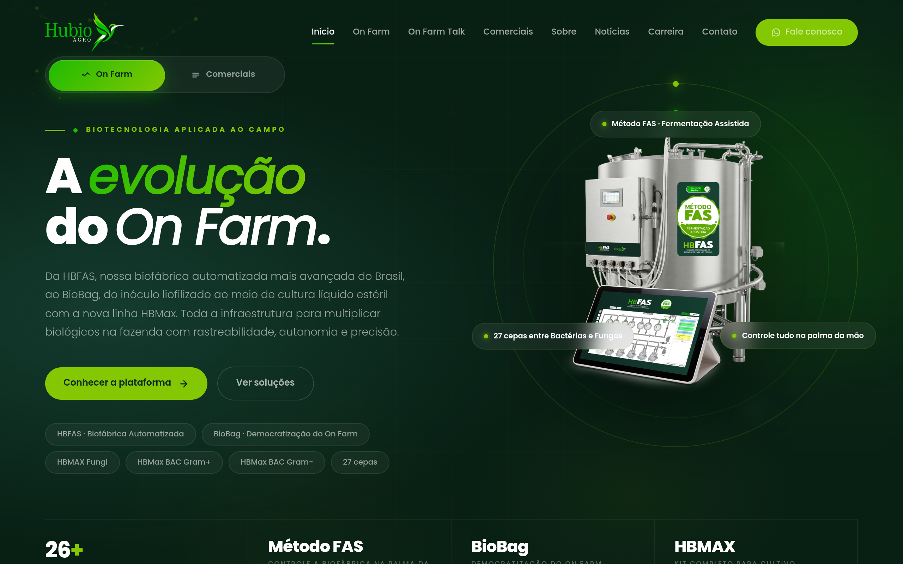

### Scroll Journey (Cinematic Visual States)

> These screenshots capture the website at different scroll depths. The design changes dramatically as you scroll — each frame shows a different cinematic state. Replicate these exact visual transitions.

#### 0% — Hero / Above the fold

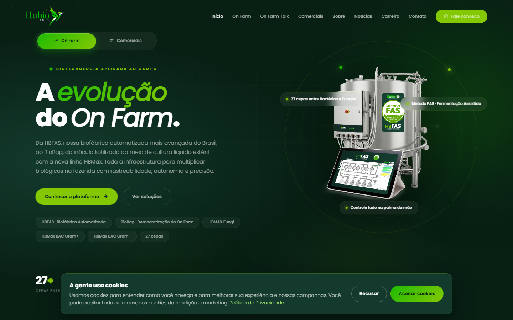

#### 17% — Mid-page at 17% scroll

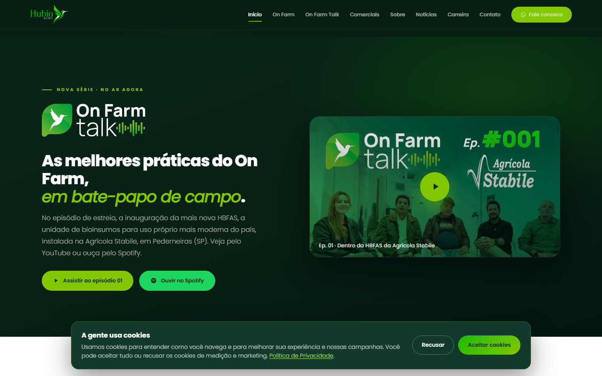

#### 33% — Mid-page at 33% scroll

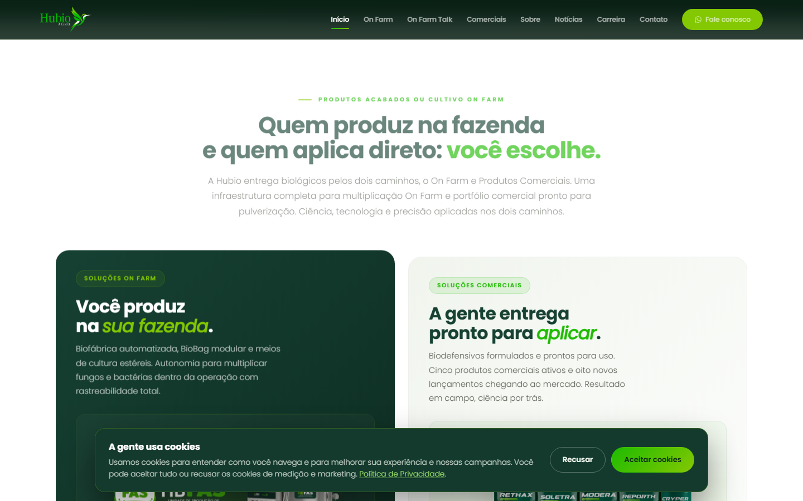

#### 50% — Mid-page at 50% scroll

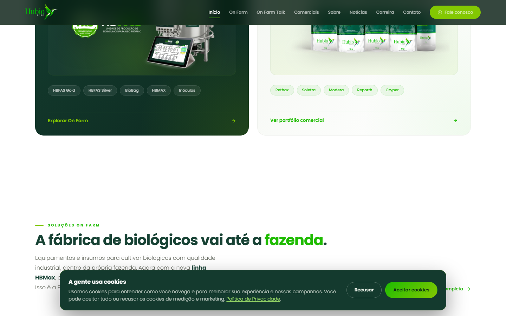

#### 67% — Mid-page at 67% scroll

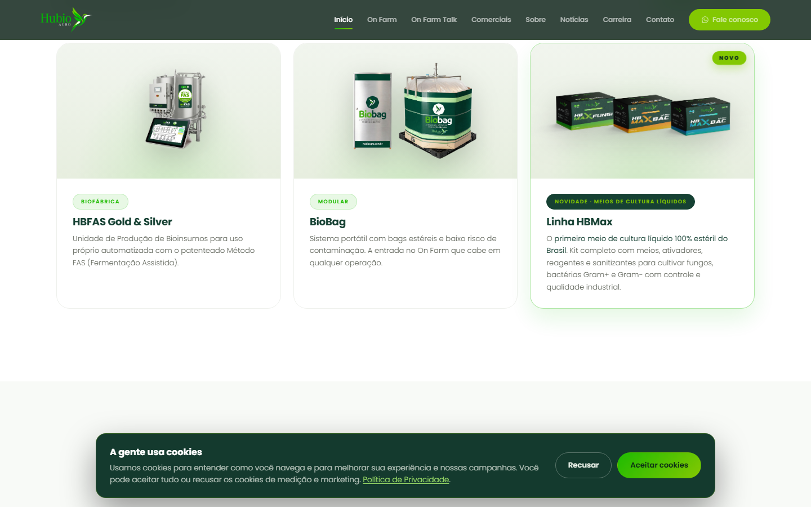

#### 83% — Mid-page at 83% scroll

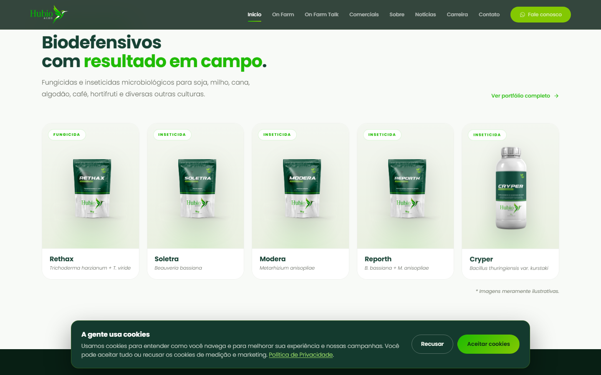

#### 100% — Footer / End of page


> Read `references/DESIGN.md` for full token details. Read `references/ANIMATIONS.md` for motion specs. Read `references/LAYOUT.md` for layout structure. Read `references/COMPONENTS.md` for component patterns.

## Ultra Reference Files

This package includes extended documentation. **Read these files before implementing:**

| File | Contents |
|------|----------|
| `references/DESIGN.md` | Full design system tokens, colors, typography, spacing |
| `references/VISUAL_GUIDE.md` | **START HERE** — Master visual guide with all screenshots embedded |
| `references/ANIMATIONS.md` | CSS keyframes, scroll triggers, motion library stack, video specs |
| `references/LAYOUT.md` | Flex/grid containers, page structure, spacing relationships |
| `references/COMPONENTS.md` | DOM component patterns, HTML structure, class fingerprints |
| `references/INTERACTIONS.md` | Hover/focus states with before/after style diffs |
| `screens/scroll/` | 7 scroll journey screenshots showing cinematic states |

### Animation Stack Detected

- **Web Animations API (10 active)** — animation

## Design Philosophy

- **Layered depth** — use shadow tokens to create a sense of physical layering. Each elevation level has a specific shadow.
- **Gradient accents** — gradients are used thoughtfully for emphasis, not decoration.
- **Single typeface** — Poppins carries all text. Hierarchy comes from size, weight, and color — never font mixing.
- **compact density** — 4px base grid. Every dimension is a multiple of 4.
- **neutral palette** — the color temperature runs neutral, matching the sans-serif typography.
- **Expressive motion** — animations are an integral part of the experience. Use spring physics and layout animations.

## Color System

### Core Palette

| Role | Token | Hex | Use |
|------|-------|-----|-----|
| Background | `--background` | `#1f221c` | Page/app background |
| Surface | `--surface` | `#164133` | Cards, panels, modals |
| Text Primary | `--text-primary` | `#ffffff` | Headings, body text |
| Text Muted | `--text-muted` | `#565b50` | Captions, placeholders |
| Border | `--border` | `#2a3a30` | Dividers, card borders |

### Status Colors

| Status | Hex | Use |
|--------|-----|-----|
| Success | `#1ebb01` | Confirmations, positive trends |
| Danger | `#b76318` | Errors, destructive actions |

### Extended Palette

- `#83c802`
- `#f1f5ee` — Light surface or highlight color
- `#dde1d8`
- `#0d2a20` — Deep background layer or shadow color
- `#081f14` — Deep background layer or shadow color
- `#000000` — Deep background layer or shadow color
- `#7a8073`
- `#9aa091`

## Typography

### Font Stack

- **Poppins** — Heading 1, Heading 2, Heading 3, Body, Caption

### Font Sources

```css
@font-face {
  font-family: "Poppins";
  src: url("fonts/Poppins-Bold.ttf") format("truetype");
  font-weight: 700;
}
@font-face {
  font-family: "Poppins";
  src: url("fonts/Poppins-Regular.ttf") format("truetype");
  font-weight: 400;
}
```

### Type Scale

| Role | Family | Size | Weight |
|------|--------|------|--------|
| Heading 1 | Poppins | 14rem | 700 |
| Heading 2 | Poppins | 9rem | 700 |
| Heading 3 | Poppins | clamp(3rem,6vw,4.6rem) | 700 |
| Body | Poppins | .68rem | 400 |
| Caption | Poppins | .8rem | 400 |

### Typography Rules

- All text uses **Poppins** — never add another font family
- Max 3-4 font sizes per screen
- Headings: weight 600-700, body: weight 400
- Use color and opacity for text hierarchy, not additional font sizes
- Line height: 1.5 for body, 1.2 for headings

## Spacing & Layout

### Base Grid: 4px

Every dimension (margin, padding, gap, width, height) must be a multiple of **4px**.

### Spacing Scale

`2, 4, 6, 8, 10, 12, 14, 16, 18, 20, 22, 24` px

### Spacing as Meaning

| Spacing | Use |
|---------|-----|
| 4-8px | Tight: related items (icon + label, avatar + name) |
| 12-16px | Medium: between groups within a section |
| 24-32px | Wide: between distinct sections |
| 48px+ | Vast: major page section breaks |

### Border Radius

Scale: `1px, 2px, 3px, 4px, 6px, 8px, 10px, 11px, 12px, 13px, 14px, 16px, 18px, 22px, 24px, 24px 24px 0px 0px, 28px, 30px, 32px, 100px, 100px 0px 0px 100px`
Default: `14px`

### Container

Max-width: `980px`, centered with auto margins.

### Breakpoints

| Name | Value |
|------|-------|
| xs | 400px |
| sm | 560px |
| sm | 600px |
| sm | 640px |
| md | 760px |
| lg | 900px |
| lg | 980px |
| xl | 1100px |

Mobile-first: design for small screens, layer on responsive overrides.

## Component Patterns

### Card

```css
.card {
  background: #164133;
  border: 1px solid #2a3a30;
  border-radius: 14px;
  padding: 16px;
  box-shadow: 0 0 0 0 rgba(30,187,1,.7);
}
```

```html
<div class="card">
  <h3>Card Title</h3>
  <p>Card content goes here.</p>
</div>
```

### Button

```css
/* Primary */
.btn-primary {
  background: #444444;
  color: #ffffff;
  border-radius: 14px;
  padding: 8px 16px;
  font-weight: 500;
  transition: opacity 150ms ease;
}
.btn-primary:hover { opacity: 0.9; }

/* Ghost */
.btn-ghost {
  background: transparent;
  border: 1px solid #2a3a30;
  color: #ffffff;
  border-radius: 14px;
  padding: 8px 16px;
}
```

```html
<button class="btn-primary">Get Started</button>
<button class="btn-ghost">Learn More</button>
```

### Input

```css
.input {
  background: #1f221c;
  border: 1px solid #2a3a30;
  border-radius: 14px;
  padding: 8px 12px;
  color: #ffffff;
  font-size: 14px;
}
.input:focus { border-color: var(--accent); outline: none; }
```

```html
<input class="input" type="text" placeholder="Search..." />
```

### Badge / Chip

```css
.badge {
  display: inline-flex;
  align-items: center;
  padding: 4px 8px;
  border-radius: 9999px;
  font-size: 12px;
  font-weight: 500;
  background: #164133;
  color: #565b50;
}
```

```html
<span class="badge">New</span>
<span class="badge">Beta</span>
```

### Modal / Dialog

```css
.modal-backdrop { background: rgba(0, 0, 0, 0.6); }
.modal {
  background: #164133;
  border: 1px solid #2a3a30;
  border-radius: 100px 0px 0px 100px;
  padding: 24px;
  max-width: 480px;
  width: 90vw;
  box-shadow: 0 0 16px var(--lm);
}
```

```html
<div class="modal-backdrop">
  <div class="modal">
    <h2>Dialog Title</h2>
    <p>Dialog content.</p>
    <button class="btn-primary">Confirm</button>
    <button class="btn-ghost">Cancel</button>
  </div>
</div>
```

### Table

```css
.table { width: 100%; border-collapse: collapse; }
.table th {
  text-align: left;
  padding: 8px 12px;
  font-weight: 500;
  font-size: 12px;
  color: #565b50;
  text-transform: uppercase;
  letter-spacing: 0.05em;
  border-bottom: 1px solid #2a3a30;
}
.table td {
  padding: 12px;
  border-bottom: 1px solid #2a3a30;
}
```

```html
<table class="table">
  <thead><tr><th>Name</th><th>Status</th><th>Date</th></tr></thead>
  <tbody>
    <tr><td>Item One</td><td>Active</td><td>Jan 1</td></tr>
    <tr><td>Item Two</td><td>Pending</td><td>Jan 2</td></tr>
  </tbody>
</table>
```

### Navigation

```css
.nav {
  display: flex;
  align-items: center;
  gap: 8px;
  padding: 12px 16px;
  border-bottom: 1px solid #2a3a30;
}
.nav-link {
  color: #565b50;
  padding: 8px 12px;
  border-radius: 14px;
  transition: color 150ms;
}
.nav-link:hover { color: #ffffff; }
```

```html
<nav class="nav">
  <a href="/" class="nav-link active">Home</a>
  <a href="/about" class="nav-link">About</a>
  <a href="/pricing" class="nav-link">Pricing</a>
  <button class="btn-primary" style="margin-left: auto">Get Started</button>
</nav>
```

### Extracted Components

These components were found in the codebase:

**Button** (`html`)
- Variants: `primary`, `prev`

**Card** (`html`)
- Variants: `top`, `big`, `figure`, `bottom`, `feats`

**Badge** (`html`)

## Page Structure

The following page sections were detected:

- **Navigation** — Top navigation bar (10 items)
- **Hero** — Hero/banner section with headline and CTAs
- **Footer** — Page footer with links and info (21 items)
- **Cta** — Call-to-action section
- **Stats** — Statistics/metrics display
- **Cards** — Grid of 43 card elements (43 items)
- **Features** — Feature/benefit cards grid (31 items)
- **Faq** — FAQ/accordion section

When building pages, follow this section order and structure.

## Animation & Motion

This project uses **expressive motion**. Animations are part of the design language.

### CSS Animations

- `flOrbit`
- `flOrbitRev`
- `hbmaxBadge`
- `ctaPulse`
- `fadeUp`

### Motion Tokens

- **Duration scale:** `90s`, `250ms`, `300ms`, `350ms`, `400ms`, `450ms`, `500ms`, `600ms`, `700ms`, `800ms`, `1500ms`
- **Animated properties:** `padding`, `background`, `backdrop-filter`

### Motion Guidelines

- **Duration:** Use values from the duration scale above. Short (90s) for micro-interactions, long (1500ms) for page transitions
- **Easing:** `ease-out` for enters, `ease-in` for exits
- **Direction:** Elements enter from bottom/right, exit to top/left
- **Reduced motion:** Always respect `prefers-reduced-motion` — disable animations when set

## Depth & Elevation

### Shadow Tokens

- Subtle: `0 0 0 2px rgba(30,187,1,.3)`
- Subtle: `rgba(131, 200, 2, 0.506) 0px 0px 0px 1.08104px`
- Subtle: `rgba(131, 200, 2, 0.55) 0px 0px 0px 0px`
- Subtle: `rgba(30, 187, 1, 0.5) 0px 0px 0px 0px`
- Subtle: `rgba(30, 187, 1, 0.41) 0px 0px 0px 1.45279px`
- Raised (cards, buttons): `0 0 0 0 rgba(30,187,1,.7)`

### Z-Index Scale

`0, 1, 2, 3, 20, 100`

Use these exact values — never invent z-index values.

## Anti-Patterns (Never Do)

- **No blur effects** — no backdrop-blur, no filter: blur()
- **No zebra striping** — tables and lists use borders for separation
- **No invented colors** — every hex value must come from the palette above
- **No arbitrary spacing** — every dimension is a multiple of 4px
- **No extra fonts** — only Poppins are allowed
- **No arbitrary border-radius** — use the scale: 1px, 2px, 3px, 4px, 6px, 8px, 10px, 11px, 12px, 13px
- **No opacity for disabled states** — use muted colors instead

## Workflow

1. **Read** `references/DESIGN.md` before writing any UI code
2. **Pick colors** from the Color System section — never invent new ones
3. **Set typography** — Poppins only, using the type scale
4. **Build layout** on the 4px grid — check every margin, padding, gap
5. **Match components** to patterns above before creating new ones
6. **Apply elevation** — use shadow tokens
7. **Validate** — every value traces back to a design token. No magic numbers.

## Brand Spec

- **Favicon:** `assets/favicon-32.png`
- **Site URL:** `https://www.hubioagro.com.br/`
- **Brand typeface:** Poppins

## Quick Reference

```
Background:     #1f221c
Surface:        #164133
Text:           #ffffff / #565b50
Accent:         (not extracted)
Border:         #2a3a30
Font:           Poppins
Spacing:        4px grid
Radius:         14px
Components:     10 detected
```

## When to Trigger

Activate this skill when:
- Creating new components, pages, or visual elements for hubio-design
- Writing CSS, Tailwind classes, styled-components, or inline styles
- Building page layouts, templates, or responsive designs
- Reviewing UI code for design consistency
- The user mentions "hubio-design" design, style, UI, or theme
- Generating mockups, wireframes, or visual prototypes

---

# Full Reference Files

> Every output file is embedded below. Claude has full design system context from /skills alone.

## Design System Tokens (DESIGN.md)

# hubio-design DESIGN.md

> Auto-generated design system — reverse-engineered via static analysis by skillui.
> Frameworks: None detected
> Colors: 20 · Fonts: 1 · Components: 10
> Icon library: not detected · State: not detected
> Primary theme: dark · Dark mode toggle: no · Motion: expressive

## Visual Reference

**Match this design exactly** — study colors, fonts, spacing, and component shapes before writing any UI code.


---

## 1. Visual Theme & Atmosphere

This is a **dark-themed** interface with a neutral tone. Depth is expressed through layered shadows and subtle surface color variation. Typography uses **Poppins** throughout — a clean, modern choice that maintains consistency. Spacing follows a **4px base grid** (compact density), with scale: 2, 4, 6, 8, 10, 12, 14, 16px. Motion is expressive — spring physics, layout animations, and staggered reveals are part of the visual language.

---

## 2. Color Palette & Roles

| Token | Hex | Role | Use |
|---|---|---|---|
| background | `#1f221c` | background | Page background, darkest surface |
| surface | `#164133` | surface | Card and panel backgrounds |
| text-primary | `#ffffff` | text-primary | Headings and body text |
| text-muted | `#565b50` | text-muted | Captions, placeholders, secondary info |
| border | `#2a3a30` | border | Dividers, card borders, outlines |
| danger | `#b76318` | danger | Error states, destructive actions |
| success | `#1ebb01` | success | Success states, positive indicators |
| info | `#1f5a8a` | info | Informational highlights |
| unknown | `#83c802` | unknown | Palette color |
| unknown | `#f1f5ee` | unknown | Palette color |
| unknown | `#dde1d8` | unknown | Palette color |
| unknown | `#0d2a20` | unknown | Palette color |
| unknown | `#081f14` | unknown | Palette color |
| unknown | `#000000` | unknown | Palette color |
| unknown | `#7a8073` | unknown | Palette color |
| unknown | `#9aa091` | unknown | Palette color |
| unknown | `#1ed760` | unknown | Palette color |
| unknown | `#98e003` | unknown | Palette color |
| unknown | `#e7eedf` | unknown | Palette color |
| unknown | `#9fe26a` | unknown | Palette color |


---

## 3. Typography Rules

**Font Stack:**
- **Poppins** — Heading 1, Heading 2, Heading 3, Body, Caption

**Font Sources:**

```css
@font-face {
  font-family: "Poppins";
  src: url("fonts/Poppins-Bold.ttf") format("truetype");
  font-weight: 700;
}
@font-face {
  font-family: "Poppins";
  src: url("fonts/Poppins-Regular.ttf") format("truetype");
  font-weight: 400;
}
```

| Role | Font | Size | Weight |
|---|---|---|---|
| Heading 1 | Poppins | 14rem | 700 |
| Heading 2 | Poppins | 9rem | 700 |
| Heading 3 | Poppins | clamp(3rem,6vw,4.6rem) | 700 |
| Body | Poppins | .68rem | 400 |
| Caption | Poppins | .8rem | 400 |

**Typographic Rules:**
- Use **Poppins** for all text — do not mix font families
- Maintain consistent hierarchy: no more than 3-4 font sizes per screen
- Headings use bold (600-700), body uses regular (400)
- Line height: 1.5 for body text, 1.2 for headings
- Use color and opacity for secondary hierarchy, not additional font sizes


---

## 4. Component Stylings

### Layout (1)

**Footer** — `html`

### Navigation (1)

**Navigation** — `html`

### Data Display (3)

**Card** — `html`
- Variants: `top`, `big`, `figure`, `bottom`, `feats`

**Badge** — `html`

**List** — `html`

### Data Input (2)

**Button** — `html`
- Variants: `primary`, `prev`
- Animation: 

**Input** — `html`
- State: :focus, :placeholder

### Media (3)

**Image** — `html`

**Icon** — `html`

**Map/Canvas** — `html`


---

## 5. Layout Principles

- **Base spacing unit:** 4px
- **Spacing scale:** 2, 4, 6, 8, 10, 12, 14, 16, 18, 20, 22, 24
- **Border radius:** 1px, 2px, 3px, 4px, 6px, 8px, 10px, 11px, 12px, 13px, 14px, 16px, 18px, 22px, 24px, 24px 24px 0px 0px, 28px, 30px, 32px, 100px, 100px 0px 0px 100px
- **Max content width:** 980px

**Spacing as Meaning:**
| Spacing | Use |
|---|---|
| 4-8px | Tight: related items within a group |
| 12-16px | Medium: between groups |
| 24-32px | Wide: between sections |
| 48px+ | Vast: major section breaks |


---

## 6. Depth & Elevation

### Flat — subtle depth hints

- `0 0 0 2px rgba(30,187,1,.3)`
- `rgba(131, 200, 2, 0.506) 0px 0px 0px 1.08104px`
- `rgba(131, 200, 2, 0.55) 0px 0px 0px 0px`

### Raised — cards, buttons, interactive elements

- `0 0 0 0 rgba(30,187,1,.7)`
- `0 0 8px var(--lm)`
- `0 0 0 0 rgba(131,200,2,.55)`

### Floating — dropdowns, popovers, modals

- `0 0 16px var(--lm)`
- `0 0 14px var(--vr)`
- `0 6px 16px rgba(131,200,2,.32)`

### Overlay — full-screen overlays, top-level dialogs

- `0 10px 30px rgba(131,200,2,.32)`
- `0 14px 36px rgba(131,200,2,.32)`
- `0 6px 22px rgba(30,187,1,.32),inset 0 1px 0 rgba(255,255,255,.18)`

### Z-Index Scale

`0, 1, 2, 3, 20, 100`


---

## 7. Animation & Motion

This project uses **expressive motion**. Animations are an integral part of the experience.

### CSS Animations

- `@keyframes flOrbit`
- `@keyframes flOrbitRev`
- `@keyframes hbmaxBadge`
- `@keyframes ctaPulse`
- `@keyframes fadeUp`
- `@keyframes pulse`
- `@keyframes sbounce`
- `@keyframes rotate`

### Animated Components

- **Button**: 

### Motion Guidelines

- Duration: 150-300ms for micro-interactions, 300-500ms for page transitions
- Easing: `ease-out` for enters, `ease-in` for exits
- Always respect `prefers-reduced-motion`


---

## 8. Do's and Don'ts

### Do's

- Use `#1f221c` as the primary page background
- Use **Poppins** for all UI text
- Follow the **4px** spacing grid for all margins, padding, and gaps
- Use the defined shadow tokens for elevation — see Section 6
- Use border-radius from the scale: 1px, 2px, 3px, 4px, 6px
- Reuse existing components from Section 4 before creating new ones

### Don'ts

- Don't introduce colors outside this palette — extend the design tokens first
- Don't mix font families — use Poppins consistently
- Don't use arbitrary spacing values — stick to multiples of 4px
- Don't create custom box-shadow values outside the system tokens
- Don't use arbitrary border-radius values — pick from the defined scale
- Don't duplicate component patterns — check Section 4 first
- Don't use backdrop-blur or blur effects

### Anti-Patterns (detected from codebase)

- No blur or backdrop-blur effects
- No zebra striping on tables/lists


---

## 9. Responsive Behavior

| Name | Value | Source |
|---|---|---|
| xs | 400px | css |
| sm | 560px | css |
| sm | 600px | css |
| sm | 640px | css |
| md | 760px | css |
| lg | 900px | css |
| lg | 980px | css |
| xl | 1100px | css |

**Approach:** Use `@media (min-width: ...)` queries matching the breakpoints above.


---

## 10. Agent Prompt Guide

Use these as starting points when building new UI:

### Build a Card

```
Background: #164133
Border: 1px solid #2a3a30
Radius: 14px
Padding: 16px
Font: Poppins
Use shadow tokens from Section 6.
```

### Build a Button

```
Primary: bg var(--accent), text white
Ghost: bg transparent, border #2a3a30
Padding: 8px 16px
Radius: 14px
Hover: opacity 0.9 or lighter shade
Focus: ring with var(--accent)
```

### Build a Page Layout

```
Background: #1f221c
Max-width: 980px, centered
Grid: 4px base
Responsive: mobile-first, breakpoints from Section 9
```

### Build a Stats Card

```
Surface: #164133
Label: #565b50 (muted, 12px, uppercase)
Value: #ffffff (primary, 24-32px, bold)
Status: use success/warning/danger from Section 2
```

### Build a Form

```
Input bg: #1f221c
Input border: 1px solid #2a3a30
Focus: border-color var(--accent)
Label: #565b50 12px
Spacing: 16px between fields
Radius: 14px
```

### General Component

```
1. Read DESIGN.md Sections 2-6 for tokens
2. Colors: only from palette
3. Font: Poppins, type scale from Section 3
4. Spacing: 4px grid
5. Components: match patterns from Section 4
6. Elevation: shadow tokens
```

## Visual Guide — Screenshots (VISUAL_GUIDE.md)

# hubio-design — Visual Guide

> Master visual reference. Study every screenshot carefully before implementing any UI.
> Match colors, layout, typography, spacing, and motion states exactly.

**Motion Stack:** **Web Animations API (10 active)**

## Scroll Journey

The page has cinematic scroll animations. Each screenshot below shows the exact visual state at that scroll depth.
**Replicate these transitions precisely** — the design changes dramatically as you scroll.

### Hero — Above the fold

*Scroll position: 0px of 5677px total*


### 17% scroll depth

*Scroll position: 812px of 5677px total*


### 33% scroll depth

*Scroll position: 1576px of 5677px total*


### 50% scroll depth

*Scroll position: 2389px of 5677px total*


### 67% scroll depth

*Scroll position: 3201px of 5677px total*


### 83% scroll depth

*Scroll position: 3965px of 5677px total*


### Footer — End of page

*Scroll position: 4777px of 5677px total*


## Full Page Screenshots

### Hubio Agro · Biológicos On Farm e Soluções Comerciais

*URL: `https://www.hubioagro.com.br/`*


### Hubio Agro · Biológicos On Farm e Soluções Comerciais

*URL: `https://www.hubioagro.com.br/index.html`*


### Soluções On Farm · Hubio Agro

*URL: `https://www.hubioagro.com.br/on-farm.html`*


### On Farm Talk · A série da Hubio Agro sobre produção On Farm de biológicos

*URL: `https://www.hubioagro.com.br/on-farm-talk.html`*


### Soluções Comerciais · Hubio Agro

*URL: `https://www.hubioagro.com.br/comerciais.html`*


## Section Screenshots

Clipped sections showing individual components in context.

### Section 1 — `section`

*1440×900px*


### Section 9 — `[class*="hero"]`

*1240×592px*


### Section 1 — `section`

*1440×900px*


### Section 9 — `[class*="hero"]`

*1240×592px*


### Section 1 — `section`

*1440×986px*


### Section 8 — `[class*="hero"]`

*1240×756px*


### Section 1 — `section`

*1440×951px*


### Section 1 — `section`

*1440×609px*


### Section 2 — `section`

*1440×1200px*


## Animations & Motion (ANIMATIONS.md)

# Animation Reference

> Cinematic motion design extracted from live DOM. Follow these specs exactly to recreate the experience.

## Motion Technology Stack

| Library | Type | Notes |
|---------|------|-------|
| **Web Animations API (10 active)** | animation |  |
| Canvas (1 elements) | 2D Canvas | 2D canvas rendering |

## Scroll Journey

The page is **5.677px** tall. Each frame below shows what the user sees at that scroll depth.

> **Use these screenshots to understand WHAT animates, WHEN it animates, and HOW it moves.**

### 0% — Top / Hero
Scroll position: 0px


### 17% — Opening Section
Scroll position: 812px


### 33% — First Feature Section
Scroll position: 1.576px


### 50% — Mid-Page
Scroll position: 2.389px


### 67% — Lower Content
Scroll position: 3.201px


### 83% — Near Footer
Scroll position: 3.965px


### 100% — Bottom / Footer
Scroll position: 4.777px


## CSS Keyframes (13 extracted)

### `@keyframes hbmaxBadge`

Duration: `2.4s` · Easing: `ease-in-out` · Delay: `0s` · Iteration: `infinite` · Fill: `none`

Used by: `.of-card.hbmax-highlight::before`

```css
@keyframes hbmaxBadge {
  0%, 100% {
    transform: scale(1);
  }
  50% {
    transform: scale(1.06);
  }
}
```

> Transform/motion animation

### `@keyframes ctaPulse`

Duration: `2.4s` · Easing: `ease-in-out` · Delay: `0s` · Iteration: `infinite` · Fill: `none`

Used by: `.hero-actions .btn-primary`

```css
@keyframes ctaPulse {
  0%, 100% {
    box-shadow: rgba(131, 200, 2, 0.55) 0px 0px 0px 0px;
  }
  50% {
    box-shadow: rgba(131, 200, 2, 0) 0px 0px 0px 14px;
  }
}
```

> Shadow pulse/glow effect

### `@keyframes pulse`

Duration: `2s` · Easing: `ease` · Delay: `0s` · Iteration: `infinite` · Fill: `none`

Used by: `.hero-eyebrow .pulse`

```css
@keyframes pulse {
  0%, 100% {
    box-shadow: rgba(30, 187, 1, 0.5) 0px 0px 0px 0px;
  }
  50% {
    box-shadow: rgba(30, 187, 1, 0) 0px 0px 0px 8px;
  }
}
```

> Shadow pulse/glow effect

### `@keyframes sbounce`

Duration: `2s` · Easing: `ease-in-out` · Delay: `0s` · Iteration: `infinite` · Fill: `none`

Used by: `.scroll-mouse::after`

```css
@keyframes sbounce {
  0%, 100% {
    transform: translateX(-50%) translateY(0px);
    opacity: 1;
  }
  50% {
    transform: translateX(-50%) translateY(8px);
    opacity: 0.3;
  }
}
```

> Fade + motion enter animation

### `@keyframes rotate`

Duration: `60s` · Easing: `linear` · Delay: `0s` · Iteration: `infinite` · Fill: `none`

Used by: `.hero-visual .ring`

```css
@keyframes rotate {
  100% {
    transform: rotate(360deg);
  }
}
```

> Transform/motion animation

### `@keyframes gentle`

Duration: `8s` · Easing: `ease-in-out` · Delay: `0s` · Iteration: `infinite` · Fill: `none`

Used by: `.hero-visual::before`

```css
@keyframes gentle {
  0%, 100% {
    transform: scale(1);
  }
  50% {
    transform: scale(1.04);
  }
}
```

> Transform/motion animation

### `@keyframes typing`

Duration: `1.4s` · Easing: `ease-in-out` · Delay: `0s` · Iteration: `infinite` · Fill: `none`

Used by: `.rb-typing span`

```css
@keyframes typing {
  0%, 60%, 100% {
    transform: translateY(0px);
    opacity: 0.5;
  }
  30% {
    transform: translateY(-6px);
    opacity: 1;
  }
}
```

> Fade + motion enter animation

### `@keyframes lfIn`

Duration: `0.35s` · Easing: `ease` · Delay: `0s` · Iteration: `1` · Fill: `none`

Used by: `.lf-cond`

```css
@keyframes lfIn {
  0% {
    opacity: 0;
    transform: translateY(-6px);
  }
  100% {
    opacity: 1;
    transform: none;
  }
}
```

> Fade + motion enter animation

### `@keyframes lfSpin`

Duration: `0.7s` · Easing: `linear` · Delay: `0s` · Iteration: `infinite` · Fill: `none`

Used by: `.lf-spin`

```css
@keyframes lfSpin {
  100% {
    transform: rotate(360deg);
  }
}
```

> Transform/motion animation

### `@keyframes lfFabPulse`

Duration: `2.4s` · Easing: `ease-out` · Delay: `0s` · Iteration: `infinite` · Fill: `none`

Used by: `.lf-fab-avatar::before`

```css
@keyframes lfFabPulse {
  0% {
    opacity: 0.7;
    transform: scale(1);
  }
  100% {
    opacity: 0;
    transform: scale(1.45);
  }
}
```

> Fade + motion enter animation

### `@keyframes flOrbit`

```css
@keyframes flOrbit {
  0% {
    transform: rotate(0deg);
  }
  100% {
    transform: rotate(360deg);
  }
}
```

> Transform/motion animation

### `@keyframes flOrbitRev`

```css
@keyframes flOrbitRev {
  0% {
    transform: translate(-50%, -50%) translateY(calc(-1 * var(--r))) rotate(0deg);
  }
  100% {
    transform: translate(-50%, -50%) translateY(calc(-1 * var(--r))) rotate(-360deg);
  }
}
```

> Transform/motion animation

### `@keyframes fadeUp`

```css
@keyframes fadeUp {
  100% {
    opacity: 1;
    transform: none;
  }
}
```

> Fade + motion enter animation

## Global Transition Declarations

These `transition` values were extracted from CSS rules across the site:

```css
transition: padding .4s var(--t1), background .4s var(--t1), backdrop-filter .4s;
transition: transform .3s var(--t1);
transition: color 0.3s;
transition: transform .3s var(--t1), box-shadow .3s, background .3s;
transition: transform 0.3s, opacity 0.3s;
transition: transform .3s var(--t1), box-shadow .3s, background .3s, color .3s, border-color .3s;
transition: gap .3s var(--t1);
transition: opacity .8s var(--t1), transform .8s var(--t1);
transition: 0.3s;
transition: all 1.5s var(--t1);
transition: color 0.4s;
transition: opacity .7s var(--t1), transform .7s var(--t1);
```

## How to Recreate This Motion Design

### Step 1 — Install Dependencies

```bash
```

### Step 2 — Scroll-Reveal Pattern

Elements that animate into view follow this pattern:

```css
/* Initial hidden state */
.reveal {
  opacity: 0;
  transform: translateY(40px);
  transition: opacity 4s cubic-bezier(0.4, 0, 0.2, 1),
              transform 4s cubic-bezier(0.4, 0, 0.2, 1);
}
.reveal.visible {
  opacity: 1;
  transform: translateY(0);
}
```

### Step 3 — Key Motion Principles

- **Canvas elements (1)** — animated via requestAnimationFrame loop. Use canvas for particle effects, gradient animations, and WebGL scenes
- **Duration scale:** `4s` · `3s` · `0.3s` — use these values, never invent new durations
- **Always add** `@media (prefers-reduced-motion: reduce) { * { animation-duration: 0.01ms !important; transition-duration: 0.01ms !important; } }`

### Step 4 — Scroll Journey Reference

Match what happens at each scroll position:

- **0%** (`0px`) → `screens/scroll/scroll-000.png`
- **17%** (`812px`) → `screens/scroll/scroll-017.png`
- **33%** (`1576px`) → `screens/scroll/scroll-033.png`
- **50%** (`2389px`) → `screens/scroll/scroll-050.png`
- **67%** (`3201px`) → `screens/scroll/scroll-067.png`
- **83%** (`3965px`) → `screens/scroll/scroll-083.png`
- **100%** (`4777px`) → `screens/scroll/scroll-100.png`

## Layout & Grid (LAYOUT.md)

# Layout Reference

> Auto-extracted from live DOM. Use this to understand how the site is structured spatially.

## Spacing System

**Base grid:** 4px

**Scale:** `2, 4, 6, 8, 10, 12, 14, 16, 18, 20, 22, 24, 26, 28, 30` px

| Spacing | Semantic Use |
|---------|-------------|
| 4px | Tight — within a component |
| 8px | Medium — between sibling items |
| 16px | Wide — between sections |
| 32px | Vast — major section breaks |

## Flex Layouts

| Element | Direction | Justify | Align | Gap | Children |
|---------|-----------|---------|-------|-----|----------|
| `nav#nav.nav` | row | space-between | center | — | 3 |
| `section#hero.hero.mode-of` | column | center | — | — | 4 |
| `div.lf-head-row` | row | — | center | 14px | 2 |
| `div.of-card.reveal` | column | — | — | — | 2 |
| `div.of-card.reveal` | column | — | — | — | 2 |
| `div.of-card.reveal` | column | — | — | — | 2 |
| `a.cm-card.reveal` | column | — | — | — | 2 |
| `a.cm-card.reveal` | column | — | — | — | 2 |
| `a.cm-card.reveal` | column | — | — | — | 2 |
| `a.cm-card.reveal` | column | — | — | — | 2 |
| `a.cm-card.reveal` | column | — | — | — | 2 |
| `div.card-bottom` | column | — | — | 18px | 2 |
| `div.card-bottom` | column | — | — | 18px | 2 |

## Grid Layouts

| Element | Template Columns | Gap | Children |
|---------|-----------------|-----|----------|
| `div.hero-inner` | `617.391px 558.594px` | 64px | 2 |
| `div.bridge-grid` | `608px 608px` | 24px | 2 |
| `div.of-grid` | `398.656px 398.672px 398.656px` | 22px | 3 |
| `div.cm-grid` | `233.594px 233.594px 233.609px 233.594px 233.609px` | 18px | 5 |
| `div.hero-visual` | `540px` | — | 6 |
| `a.bridge-card.onfarm` | `536px` | 24px | 3 |
| `a.bridge-card.com` | `534px` | 24px | 3 |
| `div.card-figure` | `534px` | — | 1 |
| `div.card-figure` | `532px` | — | 1 |
| `div.of-card-img` | `396.656px` | — | 1 |

## Structural Containers

### `<nav>` (`nav#nav.nav`)

```
display:          flex
flex-direction:   row
justify-content:  space-between
align-items:      center
padding:          18px 72px
children:         3
```

### `<footer>` (`footer.footer`)

```
display:          block
padding:          72px 72px 28px
children:         3
```

### `<section>` (`section#hero.hero.mode-of`)

```
display:          flex
flex-direction:   column
justify-content:  center
align-items:      —
padding:          80px 72px 60px
children:         4
```

### `<section>` (`section#on-farm-talk.oftalk`)

```
display:          block
padding:          110px 72px
children:         1
```

### `<section>` (`section#bridge.bridge`)

```
display:          block
padding:          110px 72px
children:         1
```

### `<section>` (`section#on-farm.section.light`)

```
display:          block
padding:          129.6px 72px
children:         1
```

### `<section>` (`section#comerciais.section.tint`)

```
display:          block
padding:          129.6px 72px
children:         1
```

### `<section>` (`section.section-cta`)

```
display:          block
padding:          100px 72px
children:         1
```

### `<nav>` (`nav.ft-col`)

```
display:          block
children:         5
```

### `<nav>` (`nav.ft-col`)

```
display:          block
children:         6
```

### `<nav>` (`nav.ft-col`)

```
display:          block
children:         6
```

## Layout Rules

- **Container max-width:** `1240px` — always center with `margin: auto`
- Primary layout system: **Flexbox**
- Secondary layout system: **CSS Grid** (used for card grids and multi-column layouts)
- Every spacing value must be a multiple of **4px**
- Never use arbitrary margin/padding values outside the spacing scale

## Component Patterns (COMPONENTS.md)

# Component Reference

> Repeated DOM patterns detected by structural analysis. Each component appeared 3+ times.

## Detected Components

| Component | Category | Instances | Key Classes |
|-----------|----------|-----------|-------------|
| **Cm Card** | card | 5× | `.cm-card`, `.reveal` |
| **Cm Card Img** | card | 5× | `.cm-card-img` |
| **Cm Card Type** | card | 5× | `.cm-card-type` |
| **Cm Card Body** | card | 5× | `.cm-card-body` |
| **Stat** | unknown | 4× | `.stat` |
| **Tag** | badge | 4× | `.tag`, `.tag-vr` |
| **Btn** | button | 3× | `.btn`, `.btn-primary` |
| **Fl Orbit** | unknown | 3× | `.fl-orbit` |
| **Stat Num** | unknown | 3× | `.stat-num` |
| **Tx Vr** | unknown | 3× | `.tx-vr` |
| **Of Card Img** | card | 3× | `.of-card-img` |
| **Of Card Body** | card | 3× | `.of-card-body` |
| **Ft Col** | unknown | 3× | `.ft-col` |

## Cards

### Cm Card

**Instances found:** 5

**CSS classes:** `.cm-card` `.reveal`

**HTML structure:**

```html
<a class="cm-card reveal" href="comerciais.html#rethax" aria-label="Rethax — ver detalhes nos produtos comerciais"> <div class="cm-card-img"> <span class="cm-card-type">Fungicida</span>  </div> <div class="cm-card-body"> <h3>Rethax</h3><p>Trichoderma harzianum + T. viride</p> </div> </a>
```

**Base styles (from design tokens):**

```css
.cm-card {
  background: #164133;
  border: 1px solid #2a3a30;
  border-radius: 14px;
  padding: 8px;
}```

### Cm Card Img

**Instances found:** 5

**CSS classes:** `.cm-card-img`

**HTML structure:**

```html
<div class="cm-card-img"> <span class="cm-card-type">Fungicida</span>  </div>
```

**Base styles (from design tokens):**

```css
.cm-card-img {
  background: #164133;
  border: 1px solid #2a3a30;
  border-radius: 14px;
  padding: 8px;
}```

### Cm Card Type

**Instances found:** 5

**CSS classes:** `.cm-card-type`

**HTML structure:**

```html
<span class="cm-card-type">Fungicida</span>
```

**Base styles (from design tokens):**

```css
.cm-card-type {
  background: #164133;
  border: 1px solid #2a3a30;
  border-radius: 14px;
  padding: 8px;
}```

### Cm Card Body

**Instances found:** 5

**CSS classes:** `.cm-card-body`

**HTML structure:**

```html
<div class="cm-card-body"> <h3>Rethax</h3><p>Trichoderma harzianum + T. viride</p> </div>
```

**Base styles (from design tokens):**

```css
.cm-card-body {
  background: #164133;
  border: 1px solid #2a3a30;
  border-radius: 14px;
  padding: 8px;
}```

### Of Card Img

**Instances found:** 3

**CSS classes:** `.of-card-img`

**HTML structure:**

```html
<div class="of-card-img"></div>
```

**Base styles (from design tokens):**

```css
.of-card-img {
  background: #164133;
  border: 1px solid #2a3a30;
  border-radius: 14px;
  padding: 8px;
}```

### Of Card Body

**Instances found:** 3

**CSS classes:** `.of-card-body`

**HTML structure:**

```html
<div class="of-card-body"> <div class="tag tag-vr">Biofábrica</div> <h3>HBFAS Gold &amp; Silver</h3> <p>Unidade de Produção de Bioinsumos para u…</p> </div>
```

**Base styles (from design tokens):**

```css
.of-card-body {
  background: #164133;
  border: 1px solid #2a3a30;
  border-radius: 14px;
  padding: 8px;
}```

## Buttons

### Btn

**Instances found:** 3

**CSS classes:** `.btn` `.btn-primary`

**HTML structure:**

```html
<a href="on-farm.html" class="btn btn-primary">Conhecer a plataforma <svg viewBox="0 0 24 24" fill="none" stroke="currentColor" stroke-width="2.5" stroke-linecap="round" stroke-linejoin="round"><path d="M5 12h14M12 5l7 7-7 7"></path></svg> </a>
```

**Base styles (from design tokens):**

```css
.btn {
  color: #ffffff;
  border-radius: 14px;
  padding: 4px 8px;
  cursor: pointer;
}```

## Badges & Chips

### Tag

**Instances found:** 4

**CSS classes:** `.tag` `.tag-vr`

**HTML structure:**

```html
<div class="tag tag-vr">Soluções Comerciais</div>
```

**Base styles (from design tokens):**

```css
.tag {
  background: #164133;
  border: 1px solid #2a3a30;
  border-radius: 14px;
  padding: 2px 4px;
  font-size: 12px;
}```

## Other Components

### Stat

**Instances found:** 4

**CSS classes:** `.stat`

**HTML structure:**

```html
<div class="stat" data-of=""> <div class="stat-num"><span data-t="27">27</span><span class="sx">+</span></div> <div class="stat-label">CEPAS ENTRE FUNGOS E BACTÉRIAS</div> </div>
```

**Base styles (from design tokens):**

```css
.stat {
  background: #164133;
  padding: 4px;
}```

### Fl Orbit

**Instances found:** 3

**CSS classes:** `.fl-orbit`

**HTML structure:**

```html
<div class="fl-orbit" style="--angle:0deg; --delay:0s"><div class="floating-label fl-1"><span class="dot"></span><span class="of-only">Método FAS · Fermentação Assistida</span><span class="cm-only" hidden="">Pronto para uso</span></div></div>
```

**Base styles (from design tokens):**

```css
.fl-orbit {
  background: #164133;
  padding: 4px;
}```

### Stat Num

**Instances found:** 3

**CSS classes:** `.stat-num`

**HTML structure:**

```html
<div class="stat-num sm">Método FAS</div>
```

**Base styles (from design tokens):**

```css
.stat-num {
  background: #164133;
  padding: 4px;
}```

### Tx Vr

**Instances found:** 3

**CSS classes:** `.tx-vr`

**HTML structure:**

```html
<span class="tx-vr">você escolhe.</span>
```

**Base styles (from design tokens):**

```css
.tx-vr {
  background: #164133;
  padding: 4px;
}```

### Ft Col

**Instances found:** 3

**CSS classes:** `.ft-col`

**HTML structure:**

```html
<nav class="ft-col" aria-label="Soluções On Farm"> <h4>On Farm</h4> <a href="on-farm.html#maquinarios">HBFAS Gold e Silver</a> <a href="on-farm.html#biobag">BioBag</a> <a href="on-farm.html#hbmax">Linha HBMax</a> <a href="on-farm.html#calculadora">Calculadora</a> </nav>
```

**Base styles (from design tokens):**

```css
.ft-col {
  background: #164133;
  padding: 4px;
}```

## Component Rules

- Match class names exactly from the patterns above
- Each component instance must be visually identical to others of its type
- Do not add extra wrappers or change the DOM structure
- Use `#2a3a30` for all dividers within components

## Interactions & States (INTERACTIONS.md)

# Interaction Reference

> Micro-interactions extracted from live DOM. Recreate these exactly for authentic feel.

## Coverage

| Component Type | Count | States Captured |
|----------------|-------|----------------|
| Button | 3 | default, hover, focus |
| Link | 3 | default, hover, focus |
| Input | 3 | default, hover, focus |

## Transition System

These transition declarations were extracted from interactive elements:

```css
transition: color 0.4s;
transition: background 0.25s;
transition: all;
transition: color 0.3s;
transition: border-color 0.2s, box-shadow 0.2s, background 0.2s;
```

Apply these to all interactive elements. Never invent new durations or easings.

## Button Interactions

### Button 1 — `On Farm`

**States:**

- Default: `../screens/states/button-1-default.png`
- Hover: `../screens/states/button-1-hover.png`
- Focus: `../screens/states/button-1-focus.png`

**On focus:**

```css
/* outline: rgb(12, 36, 24) none 3px → */ outline: rgb(16, 16, 16) auto 1px;
/* outline-color: rgb(12, 36, 24) → */ outline-color: rgb(16, 16, 16);
```

**Transition:** `color 0.4s`

### Button 2 — `Comerciais`

**States:**

- Default: `../screens/states/button-2-default.png`
- Hover: `../screens/states/button-2-hover.png`
- Focus: `../screens/states/button-2-focus.png`

**On focus:**

```css
/* outline: rgba(255, 255, 255, 0.55) none 3px → */ outline: rgb(16, 16, 16) auto 1px;
/* outline-color: rgba(255, 255, 255, 0.55) → */ outline-color: rgb(16, 16, 16);
```

**Transition:** `color 0.4s`

### Button 3 — `Fechar`

**States:**

- Default: `../screens/states/button-3-default.png`
- Hover: `../screens/states/button-3-hover.png`
- Focus: `../screens/states/button-3-focus.png`

**On focus:**

```css
/* outline: rgb(255, 255, 255) none 3px → */ outline: rgb(16, 16, 16) auto 1px;
/* outline-color: rgb(255, 255, 255) → */ outline-color: rgb(16, 16, 16);
```

**Transition:** `background 0.25s`

## Link Interactions

### Link 1 — `Hubio Agro — página inicial`

**States:**

- Default: `../screens/states/link-1-default.png`
- Hover: `../screens/states/link-1-hover.png`
- Focus: `../screens/states/link-1-focus.png`

**On focus:**

```css
/* outline: rgb(31, 34, 28) none 3px → */ outline: rgb(16, 16, 16) auto 1px;
/* outline-color: rgb(31, 34, 28) → */ outline-color: rgb(16, 16, 16);
```

**Transition:** `all`

### Link 2 — `Início`

**States:**

- Default: `../screens/states/link-2-default.png`
- Hover: `../screens/states/link-2-hover.png`
- Focus: `../screens/states/link-2-focus.png`

**On focus:**

```css
/* outline: rgb(255, 255, 255) none 3px → */ outline: rgb(16, 16, 16) auto 1px;
/* outline-color: rgb(255, 255, 255) → */ outline-color: rgb(16, 16, 16);
```

**Transition:** `color 0.3s`

### Link 3 — `On Farm`

**States:**

- Default: `../screens/states/link-3-default.png`
- Hover: `../screens/states/link-3-hover.png`
- Focus: `../screens/states/link-3-focus.png`

**On hover:**

```css
/* color: rgba(255, 255, 255, 0.62) → */ color: rgb(255, 255, 255);
/* border-color: rgba(255, 255, 255, 0.62) → */ border-color: rgb(255, 255, 255);
/* outline: rgba(255, 255, 255, 0.62) none 3px → */ outline: rgb(255, 255, 255) none 3px;
/* outline-color: rgba(255, 255, 255, 0.62) → */ outline-color: rgb(255, 255, 255);
```

**On focus:**

```css
/* outline: rgba(255, 255, 255, 0.62) none 3px → */ outline: rgb(16, 16, 16) auto 1px;
/* outline-color: rgba(255, 255, 255, 0.62) → */ outline-color: rgb(16, 16, 16);
```

**Transition:** `color 0.3s`

## Input Interactions

### Input 1 — `Seu nome completo`

**States:**

- Default: `../screens/states/input-1-default.png`
- Hover: `../screens/states/input-1-hover.png`
- Focus: `../screens/states/input-1-focus.png`

**On focus:**

```css
/* background-color: rgb(248, 250, 247) → */ background-color: rgb(255, 255, 255);
/* border-color: rgb(221, 225, 216) → */ border-color: rgb(30, 187, 1);
/* box-shadow: none → */ box-shadow: rgba(30, 187, 1, 0.12) 0px 0px 0px 3px;
```

**Transition:** `border-color 0.2s, box-shadow 0.2s, background 0.2s`

### Input 2 — `(00) 00000-0000`

**States:**

- Default: `../screens/states/input-2-default.png`
- Hover: `../screens/states/input-2-hover.png`
- Focus: `../screens/states/input-2-focus.png`

**On focus:**

```css
/* background-color: rgb(248, 250, 247) → */ background-color: rgb(254, 254, 253);
/* border-color: rgb(221, 225, 216) → */ border-color: rgb(68, 195, 44);
/* box-shadow: none → */ box-shadow: rgba(30, 187, 1, 0.098) 0px 0px 0px 2.40585px;
```

**Transition:** `border-color 0.2s, box-shadow 0.2s, background 0.2s`

### Input 3 — `seunome@email.com`

**States:**

- Default: `../screens/states/input-3-default.png`
- Hover: `../screens/states/input-3-hover.png`
- Focus: `../screens/states/input-3-focus.png`

**On focus:**

```css
/* background-color: rgb(248, 250, 247) → */ background-color: rgb(255, 255, 255);
/* border-color: rgb(221, 225, 216) → */ border-color: rgb(30, 187, 1);
/* box-shadow: none → */ box-shadow: rgba(30, 187, 1, 0.12) 0px 0px 0px 3px;
```

**Transition:** `border-color 0.2s, box-shadow 0.2s, background 0.2s`

## Interaction Rules

- Hover effects include **color transitions** — use the extracted values, not approximations
- Focus states use **outline** (not box-shadow) — always match the extracted focus ring
- Transition durations in use: `0.4s`, `0.25s`, `0.3s`, `0.2s`
- Always respect `prefers-reduced-motion` — set all transitions to `0s` when enabled

## Design Tokens — JSON Files

### tokens/colors.json
```json
{
  "$schema": "https://design-tokens.github.io/community-group/format/",
  "core": {
    "text-primary": {
      "value": "#ffffff",
      "role": "text-primary"
    },
    "background": {
      "value": "#1f221c",
      "role": "background"
    },
    "surface": {
      "value": "#164133",
      "role": "surface"
    },
    "text-muted": {
      "value": "#565b50",
      "role": "text-muted"
    },
    "border": {
      "value": "#2a3a30",
      "role": "border"
    }
  },
  "status": {
    "success": {
      "value": "#1ebb01",
      "role": "success"
    },
    "danger": {
      "value": "#b76318",
      "role": "danger"
    }
  },
  "extended": {
    "color-83c802": {
      "value": "#83c802",
      "role": "unknown"
    },
    "color-f1f5ee": {
      "value": "#f1f5ee",
      "role": "unknown"
    },
    "color-dde1d8": {
      "value": "#dde1d8",
      "role": "unknown"
    },
    "color-0d2a20": {
      "value": "#0d2a20",
      "role": "unknown"
    },
    "color-081f14": {
      "value": "#081f14",
      "role": "unknown"
    },
    "color-000000": {
      "value": "#000000",
      "role": "unknown"
    },
    "color-7a8073": {
      "value": "#7a8073",
      "role": "unknown"
    },
    "color-9aa091": {
      "value": "#9aa091",
      "role": "unknown"
    },
    "color-1f5a8a": {
      "value": "#1f5a8a",
      "role": "info"
    },
    "color-1ed760": {
      "value": "#1ed760",
      "role": "unknown"
    },
    "color-98e003": {
      "value": "#98e003",
      "role": "unknown"
    },
    "color-e7eedf": {
      "value": "#e7eedf",
      "role": "unknown"
    },
    "color-9fe26a": {
      "value": "#9fe26a",
      "role": "unknown"
    }
  },
  "meta": {
    "theme": "dark",
    "extracted": "2026-08-30"
  }
}
```

### tokens/spacing.json
```json
{
  "base": {
    "value": "4px",
    "description": "Grid unit — all spacing must be multiples of this"
  },
  "unit": "px",
  "scale": {
    "xs": {
      "value": "2px",
      "px": 2
    },
    "sm": {
      "value": "4px",
      "px": 4
    },
    "md": {
      "value": "6px",
      "px": 6
    },
    "lg": {
      "value": "8px",
      "px": 8
    },
    "xl": {
      "value": "10px",
      "px": 10
    },
    "2xl": {
      "value": "12px",
      "px": 12
    },
    "3xl": {
      "value": "14px",
      "px": 14
    },
    "4xl": {
      "value": "16px",
      "px": 16
    },
    "5xl": {
      "value": "18px",
      "px": 18
    },
    "6xl": {
      "value": "20px",
      "px": 20
    }
  },
  "multipliers": {
    "1x": {
      "value": "4px",
      "raw": 4
    },
    "2x": {
      "value": "8px",
      "raw": 8
    },
    "3x": {
      "value": "12px",
      "raw": 12
    },
    "4x": {
      "value": "16px",
      "raw": 16
    },
    "5x": {
      "value": "20px",
      "raw": 20
    },
    "6x": {
      "value": "24px",
      "raw": 24
    },
    "7x": {
      "value": "28px",
      "raw": 28
    },
    "8x": {
      "value": "32px",
      "raw": 32
    },
    "9x": {
      "value": "36px",
      "raw": 36
    },
    "10x": {
      "value": "40px",
      "raw": 40
    },
    "11x": {
      "value": "44px",
      "raw": 44
    },
    "12x": {
      "value": "48px",
      "raw": 48
    },
    "13x": {
      "value": "52px",
      "raw": 52
    },
    "14x": {
      "value": "56px",
      "raw": 56
    },
    "15x": {
      "value": "60px",
      "raw": 60
    },
    "16x": {
      "value": "64px",
      "raw": 64
    }
  },
  "meta": {
    "totalValues": 15,
    "min": 2,
    "max": 30
  }
}
```

### tokens/typography.json
```json
{
  "families": [
    "Poppins"
  ],
  "scale": {
    "heading-1": {
      "fontFamily": "Poppins",
      "fontSize": "14rem",
      "fontWeight": "700",
      "lineHeight": null,
      "source": "css"
    },
    "heading-2": {
      "fontFamily": "Poppins",
      "fontSize": "9rem",
      "fontWeight": "700",
      "lineHeight": null,
      "source": "css"
    },
    "heading-3": {
      "fontFamily": "Poppins",
      "fontSize": "clamp(3rem,6vw,4.6rem)",
      "fontWeight": "700",
      "lineHeight": null,
      "source": "css"
    },
    "body": {
      "fontFamily": "Poppins",
      "fontSize": ".68rem",
      "fontWeight": "400",
      "lineHeight": null,
      "source": "css"
    },
    "caption": {
      "fontFamily": "Poppins",
      "fontSize": ".8rem",
      "fontWeight": "400",
      "lineHeight": null,
      "source": "css"
    }
  },
  "fontFaces": [
    {
      "family": "Poppins",
      "src": "https://fonts.gstatic.com/s/poppins/v24/pxiDyp8kv8JHgFVrJJLm21llEA.ttf",
      "format": "truetype",
      "weight": "300"
    },
    {
      "family": "Poppins",
      "src": "https://fonts.gstatic.com/s/poppins/v24/pxiGyp8kv8JHgFVrJJLedw.ttf",
      "format": "truetype",
      "weight": "400"
    },
    {
      "family": "Poppins",
      "src": "https://fonts.gstatic.com/s/poppins/v24/pxiByp8kv8JHgFVrLFj_V1s.ttf",
      "format": "truetype",
      "weight": "200"
    },
    {
      "family": "Poppins",
      "src": "https://fonts.gstatic.com/s/poppins/v24/pxiByp8kv8JHgFVrLDz8V1s.ttf",
      "format": "truetype",
      "weight": "300"
    },
    {
      "family": "Poppins",
      "src": "https://fonts.gstatic.com/s/poppins/v24/pxiEyp8kv8JHgFVrFJA.ttf",
      "format": "truetype",
      "weight": "400"
    },
    {
      "family": "Poppins",
      "src": "https://fonts.gstatic.com/s/poppins/v24/pxiByp8kv8JHgFVrLGT9V1s.ttf",
      "format": "truetype",
      "weight": "500"
    },
    {
      "family": "Poppins",
      "src": "https://fonts.gstatic.com/s/poppins/v24/pxiByp8kv8JHgFVrLEj6V1s.ttf",
      "format": "truetype",
      "weight": "600"
    },
    {
      "family": "Poppins",
      "src": "https://fonts.gstatic.com/s/poppins/v24/pxiByp8kv8JHgFVrLCz7V1s.ttf",
      "format": "truetype",
      "weight": "700"
    },
    {
      "family": "Poppins",
      "src": "https://fonts.gstatic.com/s/poppins/v24/pxiByp8kv8JHgFVrLDD4V1s.ttf",
      "format": "truetype",
      "weight": "800"
    }
  ],
  "rules": {
    "maxSizesPerScreen": 4,
    "headingWeightRange": "600-700",
    "bodyWeight": 400,
    "lineHeightBody": 1.5,
    "lineHeightHeading": 1.2
  }
}
```

## Bundled Fonts (fonts/)

The following font files are bundled in the `fonts/` directory:

- `fonts/Poppins-Black.ttf`
- `fonts/Poppins-Bold.ttf`
- `fonts/Poppins-ExtraBold.ttf`
- `fonts/Poppins-ExtraLight.ttf`
- `fonts/Poppins-Light.ttf`
- `fonts/Poppins-Medium.ttf`
- `fonts/Poppins-Regular.ttf`
- `fonts/Poppins-SemiBold.ttf`
- `fonts/Poppins-Thin.ttf`

Use these local font files in `@font-face` declarations instead of fetching from Google Fonts.

## Screenshots Inventory (screens/)

> Study all screenshots carefully before implementing any UI. Match every visual detail exactly.

### Scroll Journey (screens/scroll/)

*Cinematic scroll states — page visual at each scroll depth*


### Full Page Screenshots (screens/pages/)

*Full-page screenshots of each crawled URL*

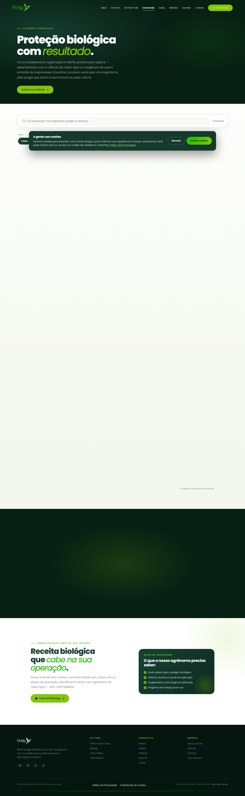

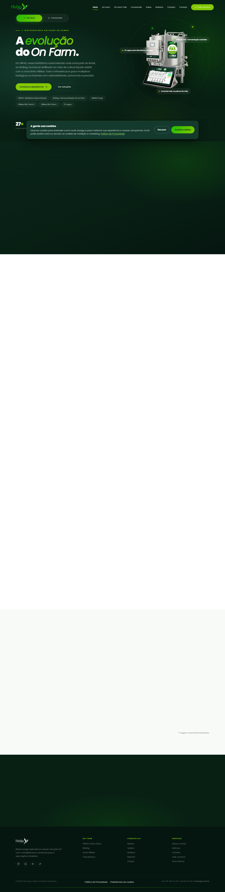

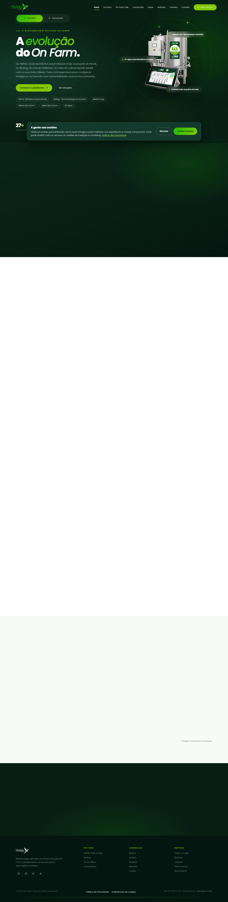


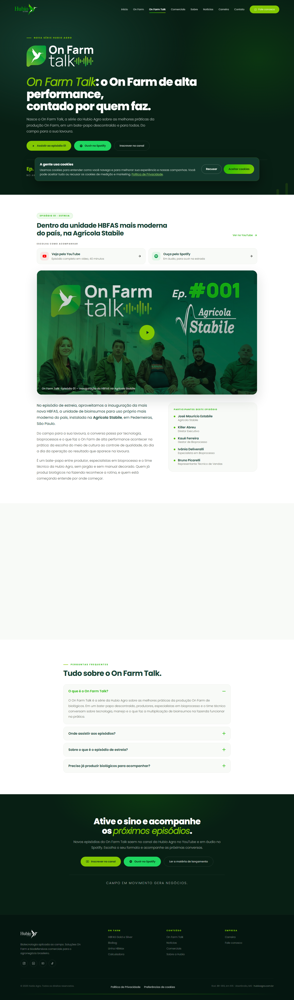

### Section Clips (screens/sections/)

*Clipped individual sections and components*

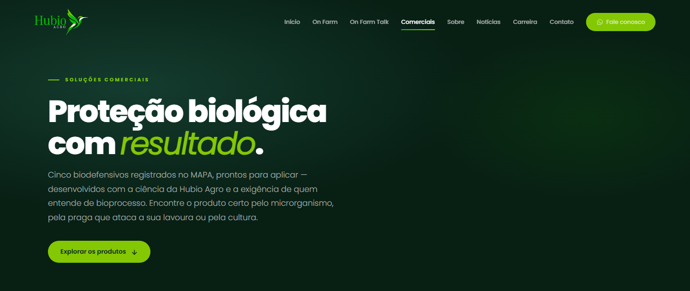

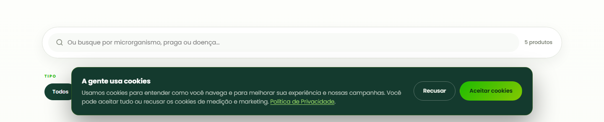

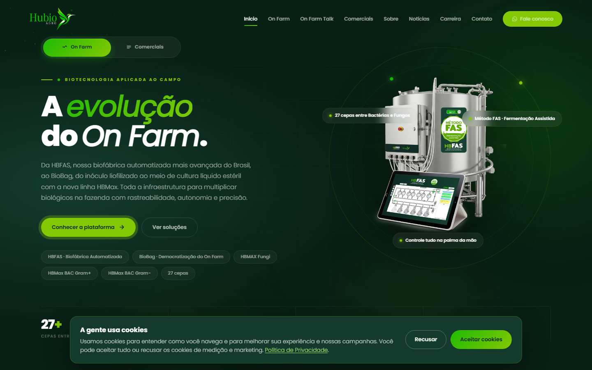

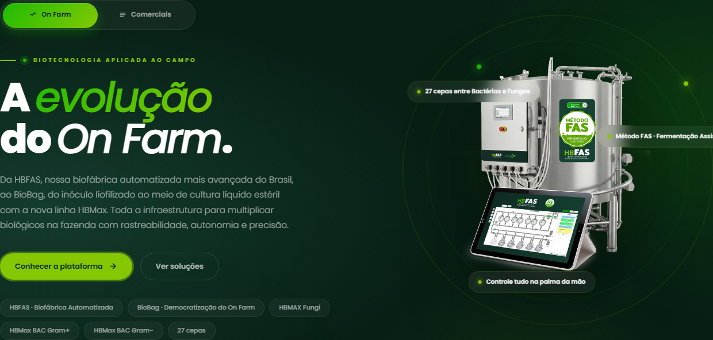

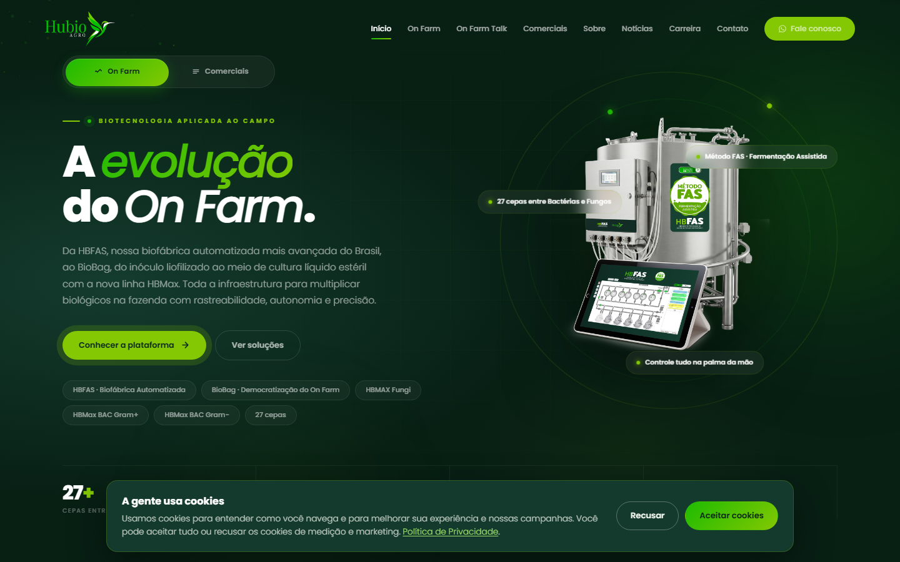

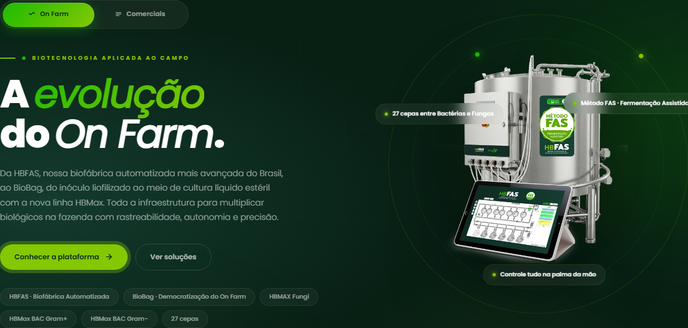

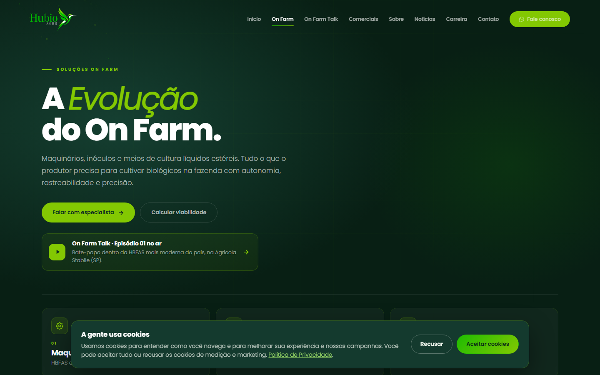

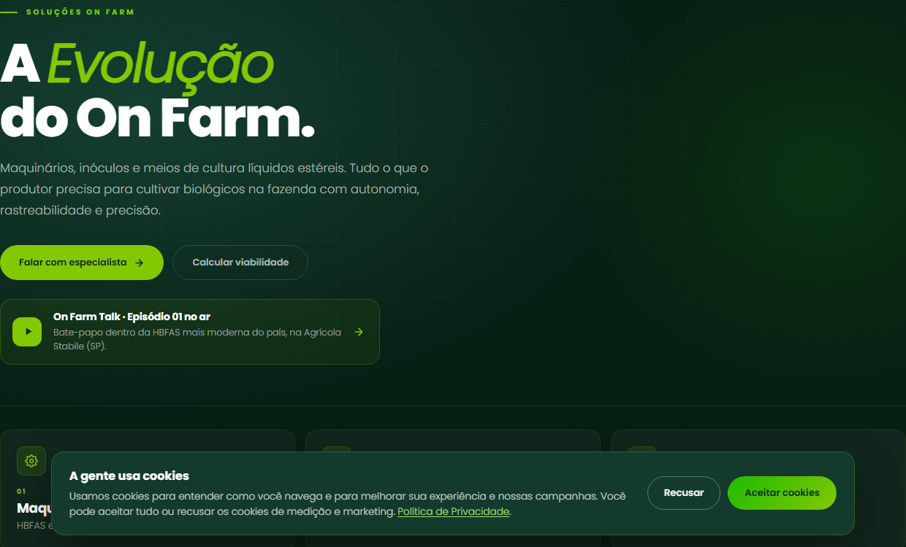

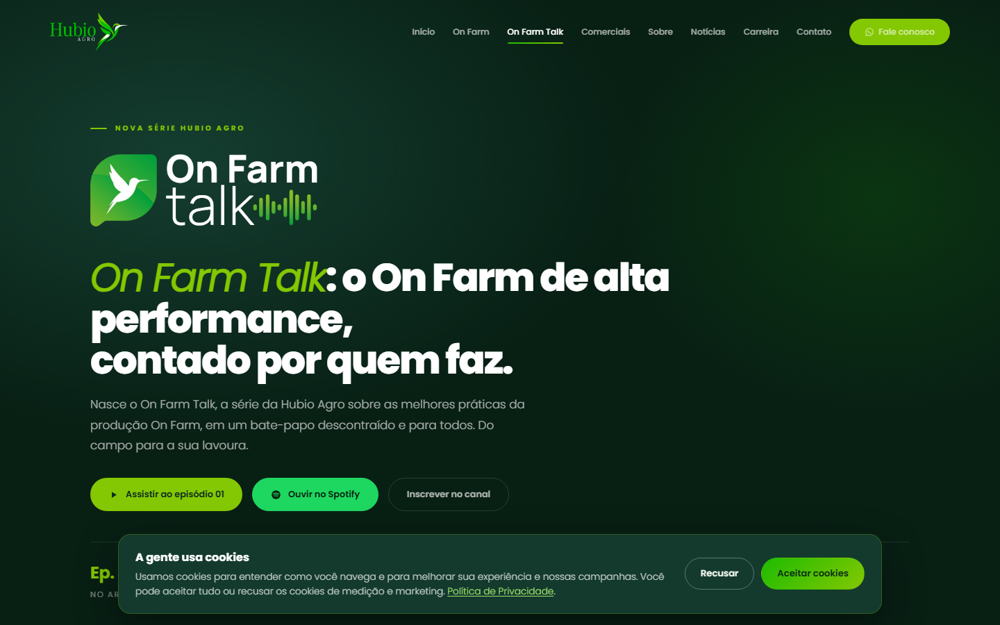

### Interaction States (screens/states/)

*Hover, focus, and active state captures*


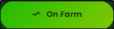


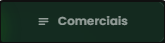

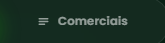


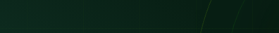

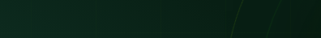

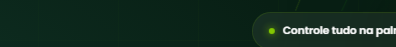

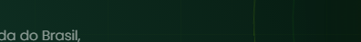

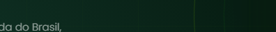

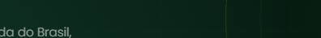

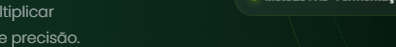

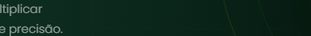

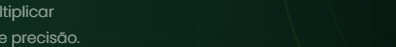


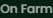


### Screenshot Index (screens/INDEX.md)

# Screenshot Index

## Scroll Journey

> Shows the cinematic state at each point of the page

| Scroll | Y Position | File |
|--------|-----------|------|
| 0% | 0px | `screens/scroll/scroll-000.png` |
| 17% | 812px | `screens/scroll/scroll-017.png` |
| 33% | 1576px | `screens/scroll/scroll-033.png` |
| 50% | 2389px | `screens/scroll/scroll-050.png` |
| 67% | 3201px | `screens/scroll/scroll-067.png` |
| 83% | 3965px | `screens/scroll/scroll-083.png` |
| 100% | 4777px | `screens/scroll/scroll-100.png` |

## Pages

| Page | URL | File |
|------|-----|------|
| Hubio Agro · Biológicos On Farm e Soluções Comerciais | `https://www.hubioagro.com.br/` | `screens/pages/home.png` |
| Hubio Agro · Biológicos On Farm e Soluções Comerciais | `https://www.hubioagro.com.br/index.html` | `screens/pages/index-html.png` |
| Soluções On Farm · Hubio Agro | `https://www.hubioagro.com.br/on-farm.html` | `screens/pages/on-farm-html.png` |
| On Farm Talk · A série da Hubio Agro sobre produção On Farm de biológicos | `https://www.hubioagro.com.br/on-farm-talk.html` | `screens/pages/on-farm-talk-html.png` |
| Soluções Comerciais · Hubio Agro | `https://www.hubioagro.com.br/comerciais.html` | `screens/pages/comerciais-html.png` |

## Sections

| Page | Section | File |
|------|---------|------|
| home | #1 (section) | `screens/sections/home-section-1.png` |
| home | #9 ([class*="hero"]) | `screens/sections/home-section-9.png` |
| index-html | #1 (section) | `screens/sections/index-html-section-1.png` |
| index-html | #9 ([class*="hero"]) | `screens/sections/index-html-section-9.png` |
| on-farm-html | #1 (section) | `screens/sections/on-farm-html-section-1.png` |
| on-farm-html | #8 ([class*="hero"]) | `screens/sections/on-farm-html-section-8.png` |
| on-farm-talk-html | #1 (section) | `screens/sections/on-farm-talk-html-section-1.png` |
| comerciais-html | #1 (section) | `screens/sections/comerciais-html-section-1.png` |
| comerciais-html | #2 (section) | `screens/sections/comerciais-html-section-2.png` |

## Homepage Screenshots (screenshots/)


