# solorico-design Design System

You are building UI for **solorico-design**. Dark-themed, neutral palette, sans-serif typography (sans-serif), compact density on a 4px grid, expressive motion.

## Visual Reference

**IMPORTANT**: Study ALL screenshots below before writing any UI. Match colors, typography, spacing, layout, and motion exactly as shown.

### Homepage

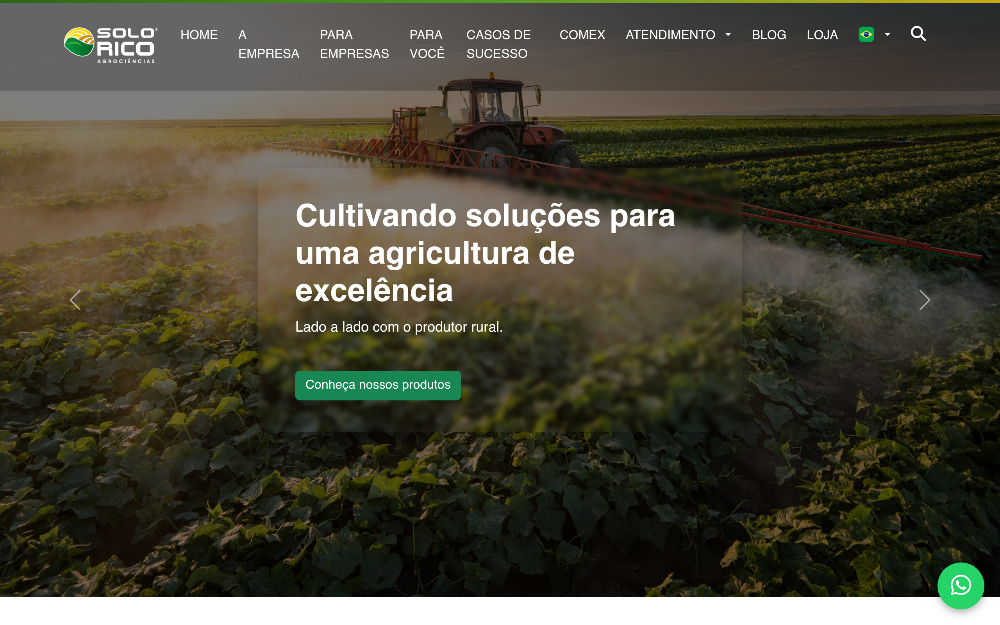

### Scroll Journey (Cinematic Visual States)

> These screenshots capture the website at different scroll depths. The design changes dramatically as you scroll — each frame shows a different cinematic state. Replicate these exact visual transitions.

#### 0% — Hero / Above the fold


#### 17% — Mid-page at 17% scroll


#### 33% — Mid-page at 33% scroll


#### 50% — Mid-page at 50% scroll


#### 67% — Mid-page at 67% scroll


#### 83% — Mid-page at 83% scroll


#### 100% — Footer / End of page


> Read `references/DESIGN.md` for full token details. Read `references/ANIMATIONS.md` for motion specs. Read `references/LAYOUT.md` for layout structure. Read `references/COMPONENTS.md` for component patterns.

## Ultra Reference Files

This package includes extended documentation. **Read these files before implementing:**

| File | Contents |
|------|----------|
| `references/DESIGN.md` | Full design system tokens, colors, typography, spacing |
| `references/VISUAL_GUIDE.md` | **START HERE** — Master visual guide with all screenshots embedded |
| `references/ANIMATIONS.md` | CSS keyframes, scroll triggers, motion library stack, video specs |
| `references/LAYOUT.md` | Flex/grid containers, page structure, spacing relationships |
| `references/COMPONENTS.md` | DOM component patterns, HTML structure, class fingerprints |
| `references/INTERACTIONS.md` | Hover/focus states with before/after style diffs |
| `screens/scroll/` | 7 scroll journey screenshots showing cinematic states |

## Design Philosophy

- **Layered depth** — use shadow tokens to create a sense of physical layering. Each elevation level has a specific shadow.
- **Gradient accents** — gradients are used thoughtfully for emphasis, not decoration.
- **Single typeface** — sans-serif carries all text. Hierarchy comes from size, weight, and color — never font mixing.
- **compact density** — 4px base grid. Every dimension is a multiple of 4.
- **neutral palette** — the color temperature runs neutral, matching the sans-serif typography.
- **Expressive motion** — animations are an integral part of the experience. Use spring physics and layout animations.

## Color System

### Core Palette

| Role | Token | Hex | Use |
|------|-------|-----|-----|
| Background | `--background` | `#1e1e1e` | Page/app background |
| Surface | `--surface` | `#333333` | Cards, panels, modals |
| Text Primary | `--text-primary` | `#f9f9f9` | Headings, body text |
| Text Muted | `--text-muted` | `#bfbfbf` | Captions, placeholders |
| Border | `--border` | `#555555` | Dividers, card borders |

### Status Colors

| Status | Hex | Use |
|--------|-----|-----|
| Success | `#28a745` | Confirmations, positive trends |
| Warning | `#ffc107` | Caution states, pending items |
| Danger | `#dc3545` | Errors, destructive actions |

### Extended Palette

- **bs-emphasis-color:** `#000000` — Deep background layer or shadow color
- **bs-table-border-color:** `#cccccc`
- **bs-primary:** `#0d6efd`
- **primary-green:** `#3b7d1c`
- **bs-secondary:** `#777777` — Secondary text, placeholder text
- `#666666`
- **bs-success:** `#198754` — Confirmations, positive trend indicators
- **bs-border-color:** `#e2e2e2` — Light surface or highlight color

### CSS Variable Tokens

```css
--primary-green: #3b7d1c;
--secondary-green: #6bbf34;
--primary-yellow: #f7d51c;
--bs-primary: #0d6efd;
--bs-secondary: #6c757d;
--bs-primary-rgb: 13,110,253;
--bs-secondary-rgb: 108,117,125;
--bs-primary-text: #0a58ca;
--bs-secondary-text: #6c757d;
--bs-primary-bg-subtle: #cfe2ff;
--bs-secondary-bg-subtle: #f8f9fa;
--bs-primary-border-subtle: #9ec5fe;
--bs-secondary-border-subtle: #e9ecef;
--bs-success-border-subtle: #a3cfbb;
--bs-info-border-subtle: #9eeaf9;
--bs-warning-border-subtle: #ffe69c;
--bs-danger-border-subtle: #f1aeb5;
--bs-light-border-subtle: #e9ecef;
--bs-dark-border-subtle: #adb5bd;
--bs-secondary-color: rgba(33,37,41,0.75);
```

## Typography

### Font Stack

- **sans-serif** — Heading 1, Heading 2, Heading 3, Body, Caption

### Type Scale

| Role | Family | Size | Weight |
|------|--------|------|--------|
| Heading 1 | sans-serif | 5rem | 700 |
| Heading 2 | sans-serif | 4.5rem | 700 |
| Heading 3 | sans-serif | 4rem | 700 |
| Body | sans-serif | 1rem | 400 |
| Caption | sans-serif | 1.25rem | 400 |

### Typography Rules

- All text uses **sans-serif** — never add another font family
- Max 3-4 font sizes per screen
- Headings: weight 600-700, body: weight 400
- Use color and opacity for text hierarchy, not additional font sizes
- Line height: 1.5 for body, 1.2 for headings

## Spacing & Layout

### Base Grid: 4px

Every dimension (margin, padding, gap, width, height) must be a multiple of **4px**.

### Spacing Scale

`2, 4, 6, 8, 10, 12, 14, 16, 20, 24, 26, 28` px

### Spacing as Meaning

| Spacing | Use |
|---------|-----|
| 4-8px | Tight: related items (icon + label, avatar + name) |
| 12-16px | Medium: between groups within a section |
| 24-32px | Wide: between distinct sections |
| 48px+ | Vast: major page section breaks |

### Border Radius

Scale: `.1em, .25rem, .25em, .375rem, .5rem, 1rem, 2em, 2px, 4px, 5px, 6px, 8px, 10px, 12px, 15px, 15px 15px 10px 10px, 20px, 24px, inherit`
Default: `5px`

### Container

Max-width: `991.98px`, centered with auto margins.

### Breakpoints

| Name | Value |
|------|-------|
| sm | 575.98px |
| sm | 576px |
| md | 767px |
| md | 767.98px |
| md | 768px |
| lg | 991px |
| lg | 991.98px |
| lg | 992px |
| xl | 1199.98px |
| xl | 1200px |
| 2xl | 1399.98px |
| 2xl | 1400px |

Mobile-first: design for small screens, layer on responsive overrides.

## Component Patterns

### Card

```css
.card {
  background: #333333;
  border: 1px solid #555555;
  border-radius: 5px;
  padding: 16px;
  box-shadow: 0 4px 6px rgba(0,0,0,0.1);
}
```

```html
<div class="card">
  <h3>Card Title</h3>
  <p>Card content goes here.</p>
</div>
```

### Button

```css
/* Primary */
.btn-primary {
  background: #444444;
  color: #f9f9f9;
  border-radius: 5px;
  padding: 8px 16px;
  font-weight: 500;
  transition: opacity 150ms ease;
}
.btn-primary:hover { opacity: 0.9; }

/* Ghost */
.btn-ghost {
  background: transparent;
  border: 1px solid #555555;
  color: #f9f9f9;
  border-radius: 5px;
  padding: 8px 16px;
}
```

```html
<button class="btn-primary">Get Started</button>
<button class="btn-ghost">Learn More</button>
```

### Input

```css
.input {
  background: #1e1e1e;
  border: 1px solid #555555;
  border-radius: 5px;
  padding: 8px 12px;
  color: #f9f9f9;
  font-size: 14px;
}
.input:focus { border-color: var(--accent); outline: none; }
```

```html
<input class="input" type="text" placeholder="Search..." />
```

### Badge / Chip

```css
.badge {
  display: inline-flex;
  align-items: center;
  padding: 4px 8px;
  border-radius: 9999px;
  font-size: 12px;
  font-weight: 500;
  background: #333333;
  color: #bfbfbf;
}
```

```html
<span class="badge">New</span>
<span class="badge">Beta</span>
```

### Modal / Dialog

```css
.modal-backdrop { background: rgba(0, 0, 0, 0.6); }
.modal {
  background: #333333;
  border: 1px solid #555555;
  border-radius: inherit;
  padding: 24px;
  max-width: 480px;
  width: 90vw;
  box-shadow: 0px 4px 10px rgba(0,0,0,0.2);
}
```

```html
<div class="modal-backdrop">
  <div class="modal">
    <h2>Dialog Title</h2>
    <p>Dialog content.</p>
    <button class="btn-primary">Confirm</button>
    <button class="btn-ghost">Cancel</button>
  </div>
</div>
```

### Table

```css
.table { width: 100%; border-collapse: collapse; }
.table th {
  text-align: left;
  padding: 8px 12px;
  font-weight: 500;
  font-size: 12px;
  color: #bfbfbf;
  text-transform: uppercase;
  letter-spacing: 0.05em;
  border-bottom: 1px solid #555555;
}
.table td {
  padding: 12px;
  border-bottom: 1px solid #555555;
}
```

```html
<table class="table">
  <thead><tr><th>Name</th><th>Status</th><th>Date</th></tr></thead>
  <tbody>
    <tr><td>Item One</td><td>Active</td><td>Jan 1</td></tr>
    <tr><td>Item Two</td><td>Pending</td><td>Jan 2</td></tr>
  </tbody>
</table>
```

### Navigation

```css
.nav {
  display: flex;
  align-items: center;
  gap: 8px;
  padding: 12px 16px;
  border-bottom: 1px solid #555555;
}
.nav-link {
  color: #bfbfbf;
  padding: 8px 12px;
  border-radius: 5px;
  transition: color 150ms;
}
.nav-link:hover { color: #f9f9f9; }
```

```html
<nav class="nav">
  <a href="/" class="nav-link active">Home</a>
  <a href="/about" class="nav-link">About</a>
  <a href="/pricing" class="nav-link">Pricing</a>
  <button class="btn-primary" style="margin-left: auto">Get Started</button>
</nav>
```

### Extracted Components

These components were found in the codebase:

**Button** (`html`)
- Variants: `success`, `sm`, `close`, `close-white`

**Card** (`html`)
- Variants: `custom`, `img`, `body`, `icon`, `title`

**Navigation** (`html`)

**Modal** (`html`)

**List** (`html`)

## Page Structure

The following page sections were detected:

- **Navigation** — Top navigation bar (19 items)
- **Hero** — Hero section (detected from heading structure)
- **Features** — Feature/benefit cards grid (16 items)
- **Footer** — Page footer with links and info (27 items)
- **Testimonials** — Testimonials/reviews section
- **Cta** — Call-to-action section

When building pages, follow this section order and structure.

## Animation & Motion

This project uses **expressive motion**. Animations are part of the design language.

### CSS Animations

- `fa-beat`
- `fa-bounce`
- `fa-fade`
- `fa-beat-fade`
- `fa-flip`

### Motion Tokens

- **Duration scale:** `0s`, `0ms`, `1ms`, `100ms`, `150ms`, `200ms`, `250ms`, `300ms`, `350ms`, `600ms`
- **Easing functions:** `ease`, `ease-in-out`, `linear`, `ease-out`
- **Animated properties:** `background-color`

### Motion Guidelines

- **Duration:** Use values from the duration scale above. Short (0s) for micro-interactions, long (600ms) for page transitions
- **Easing:** Use `ease` as the default easing curve
- **Direction:** Elements enter from bottom/right, exit to top/left
- **Reduced motion:** Always respect `prefers-reduced-motion` — disable animations when set

## Depth & Elevation

### Shadow Tokens

- Subtle: `inset 0-1px 0 rgba(0,0,0,0.15)`
- Subtle: `0 0 0 1px #fff,0 0 0 .25rem rgba(13,110,253,.25)`
- Raised (cards, buttons): `0 4px 6px rgba(0,0,0,0.1)`
- Raised (cards, buttons): `0 4px 8px rgba(0,0,0,0.1)`
- Raised (cards, buttons): `0 0 0 0.2rem rgba(40,167,69,0.25)`
- Raised (cards, buttons): `0 4px 8px rgba(0,0,0,0.2)`

### Z-Index Scale

`0, 1, 2, 3, 4, 5, 10, 20, 1000, 1020, 1030, 1040, 1050, 9999`

Use these exact values — never invent z-index values.

## Anti-Patterns (Never Do)

- **No blur effects** — no backdrop-blur, no filter: blur()
- **No zebra striping** — tables and lists use borders for separation
- **No invented colors** — every hex value must come from the palette above
- **No arbitrary spacing** — every dimension is a multiple of 4px
- **No extra fonts** — only sans-serif are allowed
- **No arbitrary border-radius** — use the scale: .1em, .25rem, .25em, .375rem, .5rem, 1rem, 2em, 2px, 4px, 5px
- **No opacity for disabled states** — use muted colors instead

## Workflow

1. **Read** `references/DESIGN.md` before writing any UI code
2. **Pick colors** from the Color System section — never invent new ones
3. **Set typography** — sans-serif only, using the type scale
4. **Build layout** on the 4px grid — check every margin, padding, gap
5. **Match components** to patterns above before creating new ones
6. **Apply elevation** — use shadow tokens
7. **Validate** — every value traces back to a design token. No magic numbers.

## Brand Spec

- **Favicon:** `assets/img/favicon.png`
- **Site URL:** `https://gruposolorico.com.br/`
- **Brand typeface:** sans-serif

## Quick Reference

```
Background:     #1e1e1e
Surface:        #333333
Text:           #f9f9f9 / #bfbfbf
Accent:         (not extracted)
Border:         #555555
Font:           sans-serif
Spacing:        4px grid
Radius:         5px
Components:     10 detected
```

## When to Trigger

Activate this skill when:
- Creating new components, pages, or visual elements for solorico-design
- Writing CSS, Tailwind classes, styled-components, or inline styles
- Building page layouts, templates, or responsive designs
- Reviewing UI code for design consistency
- The user mentions "solorico-design" design, style, UI, or theme
- Generating mockups, wireframes, or visual prototypes

---

# Full Reference Files

> Every output file is embedded below. Claude has full design system context from /skills alone.

## Design System Tokens (DESIGN.md)

# solorico-design DESIGN.md

> Auto-generated design system — reverse-engineered via static analysis by skillui.
> Frameworks: None detected
> Colors: 20 · Fonts: 1 · Components: 10
> Icon library: not detected · State: not detected
> Primary theme: dark · Dark mode toggle: no · Motion: expressive

## Visual Reference

**Match this design exactly** — study colors, fonts, spacing, and component shapes before writing any UI code.


---

## 1. Visual Theme & Atmosphere

This is a **dark-themed** interface with a neutral tone. Depth is expressed through layered shadows and subtle surface color variation. Typography uses **sans-serif** throughout — a clean, modern choice that maintains consistency. Spacing follows a **4px base grid** (compact density), with scale: 2, 4, 6, 8, 10, 12, 14, 16px. Motion is expressive — spring physics, layout animations, and staggered reveals are part of the visual language.

---

## 2. Color Palette & Roles

| Token | Hex | Role | Use |
|---|---|---|---|
| bs-body-color | `#1e1e1e` | background | Page background, darkest surface |
| text-dark | `#333333` | surface | Card and panel backgrounds |
| text-light | `#f9f9f9` | text-primary | Headings and body text |
| bs-btn-active-border-color | `#bfbfbf` | text-muted | Captions, placeholders, secondary info |
| bs-dark-text | `#555555` | border | Dividers, card borders, outlines |
| bs-danger | `#dc3545` | danger | Error states, destructive actions |
| success | `#28a745` | success | Success states, positive indicators |
| bs-warning | `#ffc107` | warning | Warning states, caution indicators |
| bs-primary | `#0d6efd` | info | Informational highlights |
| bs-emphasis-color | `#000000` | unknown | Palette color |
| bs-table-border-color | `#cccccc` | unknown | Palette color |
| primary-green | `#3b7d1c` | unknown | Palette color |
| bs-secondary | `#777777` | unknown | Palette color |
| unknown | `#666666` | unknown | Palette color |
| bs-success | `#198754` | unknown | Palette color |
| bs-border-color | `#e2e2e2` | unknown | Palette color |
| bs-info | `#0dcaf0` | unknown | Palette color |
| unknown | `#f4a51c` | unknown | Palette color |
| primary-yellow | `#f7d51c` | unknown | Palette color |
| secondary-green | `#6bbf34` | unknown | Palette color |

### CSS Variable Tokens

```css
--primary-green: #3b7d1c;
--secondary-green: #6bbf34;
--primary-yellow: #f7d51c;
--bs-primary: #0d6efd;
--bs-secondary: #6c757d;
--bs-primary-rgb: 13,110,253;
--bs-secondary-rgb: 108,117,125;
--bs-primary-text: #0a58ca;
--bs-secondary-text: #6c757d;
--bs-primary-bg-subtle: #cfe2ff;
--bs-secondary-bg-subtle: #f8f9fa;
--bs-primary-border-subtle: #9ec5fe;
--bs-secondary-border-subtle: #e9ecef;
--bs-success-border-subtle: #a3cfbb;
--bs-info-border-subtle: #9eeaf9;
--bs-warning-border-subtle: #ffe69c;
--bs-danger-border-subtle: #f1aeb5;
--bs-light-border-subtle: #e9ecef;
--bs-dark-border-subtle: #adb5bd;
--bs-secondary-color: rgba(33,37,41,0.75);
```


---

## 3. Typography Rules

**Font Stack:**
- **sans-serif** — Heading 1, Heading 2, Heading 3, Body, Caption

| Role | Font | Size | Weight |
|---|---|---|---|
| Heading 1 | sans-serif | 5rem | 700 |
| Heading 2 | sans-serif | 4.5rem | 700 |
| Heading 3 | sans-serif | 4rem | 700 |
| Body | sans-serif | 1rem | 400 |
| Caption | sans-serif | 1.25rem | 400 |

**Typographic Rules:**
- Use **sans-serif** for all text — do not mix font families
- Maintain consistent hierarchy: no more than 3-4 font sizes per screen
- Headings use bold (600-700), body uses regular (400)
- Line height: 1.5 for body text, 1.2 for headings
- Use color and opacity for secondary hierarchy, not additional font sizes


---

## 4. Component Stylings

### Layout (1)

**Footer** — `html`

### Navigation (1)

**Navigation** — `html`

### Data Display (3)

**Card** — `html`
- Variants: `custom`, `img`, `body`, `icon`, `title`

**Badge** — `html`

**List** — `html`

### Data Input (2)

**Button** — `html`
- Variants: `success`, `sm`, `close`, `close-white`
- Animation: 

**Input** — `html`
- State: :focus, :placeholder

### Overlay (1)

**Modal** — `html`

### Media (2)

**Image** — `html`

**Map/Canvas** — `html`


---

## 5. Layout Principles

- **Base spacing unit:** 4px
- **Spacing scale:** 2, 4, 6, 8, 10, 12, 14, 16, 20, 24, 26, 28
- **Border radius:** .1em, .25rem, .25em, .375rem, .5rem, 1rem, 2em, 2px, 4px, 5px, 6px, 8px, 10px, 12px, 15px, 15px 15px 10px 10px, 20px, 24px, inherit
- **Max content width:** 991.98px

**Spacing as Meaning:**
| Spacing | Use |
|---|---|
| 4-8px | Tight: related items within a group |
| 12-16px | Medium: between groups |
| 24-32px | Wide: between sections |
| 48px+ | Vast: major section breaks |


---

## 6. Depth & Elevation

### Flat — subtle depth hints

- `inset 0-1px 0 rgba(0,0,0,0.15)`
- `0 0 0 1px #fff,0 0 0 .25rem rgba(13,110,253,.25)`

### Raised — cards, buttons, interactive elements

- `0 4px 6px rgba(0,0,0,0.1)`
- `0 4px 8px rgba(0,0,0,0.1)`
- `0 0 0 0.2rem rgba(40,167,69,0.25)`

### Floating — dropdowns, popovers, modals

- `0px 4px 10px rgba(0,0,0,0.2)`
- `0px 6px 15px rgba(0,0,0,0.3)`
- `0 5px 15px rgba(0,0,0,0.1)`

### Overlay — full-screen overlays, top-level dialogs

- `0 8px 25px rgba(0,0,0,0.1)`
- `0 20px 45px rgba(0,0,0,0.35)`
- `inset 0 0 0 9999px var(--bs-table-accent-bg)`

### Z-Index Scale

`0, 1, 2, 3, 4, 5, 10, 20, 1000, 1020, 1030, 1040, 1050, 9999`


---

## 7. Animation & Motion

This project uses **expressive motion**. Animations are an integral part of the experience.

### CSS Animations

- `@keyframes fa-beat`
- `@keyframes fa-bounce`
- `@keyframes fa-fade`
- `@keyframes fa-beat-fade`
- `@keyframes fa-flip`
- `@keyframes fa-shake`
- `@keyframes fa-spin`
- `@keyframes progress-bar-stripes`

### Animated Components

- **Button**: 

### Motion Guidelines

- Duration: 150-300ms for micro-interactions, 300-500ms for page transitions
- Easing: `ease-out` for enters, `ease-in` for exits
- Always respect `prefers-reduced-motion`


---

## 8. Do's and Don'ts

### Do's

- Use `#1e1e1e` as the primary page background
- Use **sans-serif** for all UI text
- Follow the **4px** spacing grid for all margins, padding, and gaps
- Use the defined shadow tokens for elevation — see Section 6
- Use border-radius from the scale: .1em, .25rem, .25em, .375rem, .5rem
- Reuse existing components from Section 4 before creating new ones

### Don'ts

- Don't introduce colors outside this palette — extend the design tokens first
- Don't mix font families — use sans-serif consistently
- Don't use arbitrary spacing values — stick to multiples of 4px
- Don't create custom box-shadow values outside the system tokens
- Don't use arbitrary border-radius values — pick from the defined scale
- Don't duplicate component patterns — check Section 4 first
- Don't use backdrop-blur or blur effects

### Anti-Patterns (detected from codebase)

- No blur or backdrop-blur effects
- No zebra striping on tables/lists


---

## 9. Responsive Behavior

| Name | Value | Source |
|---|---|---|
| sm | 575.98px | css |
| sm | 576px | css |
| md | 767px | css |
| md | 767.98px | css |
| md | 768px | css |
| lg | 991px | css |
| lg | 991.98px | css |
| lg | 992px | css |
| xl | 1199.98px | css |
| xl | 1200px | css |
| 2xl | 1399.98px | css |
| 2xl | 1400px | css |

**Approach:** Use `@media (min-width: ...)` queries matching the breakpoints above.


---

## 10. Agent Prompt Guide

Use these as starting points when building new UI:

### Build a Card

```
Background: #333333
Border: 1px solid #555555
Radius: 5px
Padding: 16px
Font: sans-serif
Use shadow tokens from Section 6.
```

### Build a Button

```
Primary: bg var(--accent), text white
Ghost: bg transparent, border #555555
Padding: 8px 16px
Radius: 5px
Hover: opacity 0.9 or lighter shade
Focus: ring with var(--accent)
```

### Build a Page Layout

```
Background: #1e1e1e
Max-width: 991.98px, centered
Grid: 4px base
Responsive: mobile-first, breakpoints from Section 9
```

### Build a Stats Card

```
Surface: #333333
Label: #bfbfbf (muted, 12px, uppercase)
Value: #f9f9f9 (primary, 24-32px, bold)
Status: use success/warning/danger from Section 2
```

### Build a Form

```
Input bg: #1e1e1e
Input border: 1px solid #555555
Focus: border-color var(--accent)
Label: #bfbfbf 12px
Spacing: 16px between fields
Radius: 5px
```

### General Component

```
1. Read DESIGN.md Sections 2-6 for tokens
2. Colors: only from palette
3. Font: sans-serif, type scale from Section 3
4. Spacing: 4px grid
5. Components: match patterns from Section 4
6. Elevation: shadow tokens
```

## Visual Guide — Screenshots (VISUAL_GUIDE.md)

# solorico-design — Visual Guide

> Master visual reference. Study every screenshot carefully before implementing any UI.
> Match colors, layout, typography, spacing, and motion states exactly.

## Scroll Journey

The page has cinematic scroll animations. Each screenshot below shows the exact visual state at that scroll depth.
**Replicate these transitions precisely** — the design changes dramatically as you scroll.

### Hero — Above the fold

*Scroll position: 0px of 5276px total*


### 17% scroll depth

*Scroll position: 744px of 5276px total*


### 33% scroll depth

*Scroll position: 1444px of 5276px total*


### 50% scroll depth

*Scroll position: 2188px of 5276px total*


### 67% scroll depth

*Scroll position: 2932px of 5276px total*


### 83% scroll depth

*Scroll position: 3632px of 5276px total*


### Footer — End of page

*Scroll position: 4376px of 5276px total*


## Full Page Screenshots

### Solo Rico - Cultivando soluções para uma agricultura de excelência

*URL: `https://gruposolorico.com.br/`*


### Solo Rico - A Empresa | Soluções Agrícolas desde 1989

*URL: `https://gruposolorico.com.br/empresa`*


### Para Empresas

*URL: `https://gruposolorico.com.br/para-empresas`*


### Para Você

*URL: `https://gruposolorico.com.br/para-voce`*


### Casos de Sucesso - Solo Rico

*URL: `https://gruposolorico.com.br/casos-sucesso`*


## Section Screenshots

Clipped sections showing individual components in context.

### Section 1 — `section`

*1440×741px*


### Section 6 — `main > div`

*1440×855px*


### Section 1 — `section`

*1440×630px*


### Section 6 — `main > div`

*1440×855px*


### Section 1 — `section`

*1440×360px*


### Section 2 — `section`

*1440×552px*


### Section 1 — `section`

*1440×360px*


### Section 2 — `section`

*1440×489px*


### Section 1 — `section`

*1440×360px*


### Section 2 — `section`

*1440×272px*


### Section 3 — `section`

*1440×298px*


## Animations & Motion (ANIMATIONS.md)

# Animation Reference

> Cinematic motion design extracted from live DOM. Follow these specs exactly to recreate the experience.

## Motion Technology Stack

Pure CSS animations — no external animation libraries detected.

## Scroll Journey

The page is **5.276px** tall. Each frame below shows what the user sees at that scroll depth.

> **Use these screenshots to understand WHAT animates, WHEN it animates, and HOW it moves.**

### 0% — Top / Hero
Scroll position: 0px


### 17% — Opening Section
Scroll position: 744px


### 33% — First Feature Section
Scroll position: 1.444px


### 50% — Mid-Page
Scroll position: 2.188px


### 67% — Lower Content
Scroll position: 2.932px


### 83% — Near Footer
Scroll position: 3.632px


### 100% — Bottom / Footer
Scroll position: 4.376px


## Global Transition Declarations

These `transition` values were extracted from CSS rules across the site:

```css
transition: background-color 0.3s;
transition: color 0.3s;
transition: transform 0.3s, box-shadow 0.3s;
transition: filter 0.3s;
transition: transform 0.3s;
transition: 0.3s;
transition: transform 0.3s, color 0.3s;
transition: 0.2s ease-in-out;
```

## How to Recreate This Motion Design

### Step 2 — Scroll-Reveal Pattern

Elements that animate into view follow this pattern:

```css
/* Initial hidden state */
.reveal {
  opacity: 0;
  transform: translateY(40px);
  transition: opacity 0.3s cubic-bezier(0.4, 0, 0.2, 1),
              transform 0.3s cubic-bezier(0.4, 0, 0.2, 1);
}
.reveal.visible {
  opacity: 1;
  transform: translateY(0);
}
```

### Step 3 — Key Motion Principles

- **Duration scale:** `0.3s` — use these values, never invent new durations
- **Always add** `@media (prefers-reduced-motion: reduce) { * { animation-duration: 0.01ms !important; transition-duration: 0.01ms !important; } }`

### Step 4 — Scroll Journey Reference

Match what happens at each scroll position:

- **0%** (`0px`) → `screens/scroll/scroll-000.png`
- **17%** (`744px`) → `screens/scroll/scroll-017.png`
- **33%** (`1444px`) → `screens/scroll/scroll-033.png`
- **50%** (`2188px`) → `screens/scroll/scroll-050.png`
- **67%** (`2932px`) → `screens/scroll/scroll-067.png`
- **83%** (`3632px`) → `screens/scroll/scroll-083.png`
- **100%** (`4376px`) → `screens/scroll/scroll-100.png`

## Layout & Grid (LAYOUT.md)

# Layout Reference

> Auto-extracted from live DOM. Use this to understand how the site is structured spatially.

## Spacing System

**Base grid:** 4px

**Scale:** `2, 4, 6, 8, 10, 12, 14, 16, 20, 24, 26, 28, 30, 32, 36` px

| Spacing | Semantic Use |
|---------|-------------|
| 4px | Tight — within a component |
| 8px | Medium — between sibling items |
| 16px | Wide — between sections |
| 32px | Vast — major section breaks |

## Flex Layouts

| Element | Direction | Justify | Align | Gap | Children |
|---------|-----------|---------|-------|-----|----------|
| `nav.navbar.navbar-expand-lg` | row | start | center | — | 1 |
| `div.container` | row | space-between | center | — | 3 |
| `div.row.g-4` | row | — | — | — | 4 |
| `div.row.text-center` | row | — | — | — | 1 |
| `div.row` | row | — | — | — | 4 |
| `div.row.align-items-center` | row | — | center | — | 2 |
| `div.row.justify-content-center` | row | center | — | — | 1 |
| `div.row.mt-5` | row | center | — | — | 5 |
| `div.row.mt-4` | row | — | — | — | 3 |
| `div.row` | row | — | — | — | 3 |
| `div#navbarNav.collapse.navbar-collapse` | row | — | center | — | 1 |

## Structural Containers

### `<header>` (`header.navbar-section.fixed-top`)

```
display:          block
children:         1
```

### `<main>` 

```
display:          block
children:         6
```

### `<footer>` (`footer.footer-section.py-5`)

```
display:          block
padding:          48px 0px
children:         1
```

### `<nav>` (`nav.navbar.navbar-expand-lg`)

```
display:          flex
flex-direction:   row
justify-content:  start
align-items:      center
padding:          24px 0px
children:         1
```

### `<section>` (`section.agriculture-section.py-5`)

```
display:          block
padding:          80px 0px
children:         1
```

### `<section>` (`section.development-section.py-5`)

```
display:          block
padding:          80px 0px
children:         1
```

### `<section>` (`section.product-lines-section.py-5`)

```
display:          block
padding:          80px 0px
children:         1
```

### `<section>` (`section.news-blogs-section.py-5`)

```
display:          block
padding:          48px 0px
children:         1
```

## Layout Rules

- **Container max-width:** `1320px` — always center with `margin: auto`
- Primary layout system: **Flexbox**
- Every spacing value must be a multiple of **4px**
- Never use arbitrary margin/padding values outside the spacing scale

## Component Patterns (COMPONENTS.md)

# Component Reference

> Repeated DOM patterns detected by structural analysis. Each component appeared 3+ times.

## Detected Components

| Component | Category | Instances | Key Classes |
|-----------|----------|-----------|-------------|
| **Nav Item** | card | 8× | `.nav-item` |
| **Nav Link** | unknown | 8× | `.nav-link` |
| **Col 6** | unknown | 5× | `.col-6`, `.col-md`, `.custom-col-5` |
| **Product Card** | card | 5× | `.product-card` |
| **Image Wrapper** | unknown | 5× | `.image-wrapper` |
| **Product Image** | card | 5× | `.product-image` |
| **Product Title Overlay** | card | 5× | `.product-title-overlay` |
| **Col Md 3** | unknown | 4× | `.col-md-3` |
| **Text Decoration None** | unknown | 4× | `.text-decoration-none` |
| **Card Custom** | card | 4× | `.card-custom` |
| **Card Img** | card | 4× | `.card-img` |
| **Icon Top** | unknown | 4× | `.icon-top` |
| **Text Overlay** | unknown | 4× | `.text-overlay` |
| **Fw Bold** | unknown | 4× | `.fw-bold` |
| **Icon Bottom** | unknown | 4× | `.icon-bottom` |
| **Col 12** | unknown | 3× | `.col-12`, `.col-md-4`, `.mb-4` |
| **Blog Card** | card | 3× | `.blog-card`, `.border`, `.h-100` |
| **D Block** | unknown | 3× | `.d-block`, `.h-100`, `.text-dark` |
| **Blog Image** | unknown | 3× | `.blog-image`, `.img-fluid`, `.w-100` |
| **Blog Body** | unknown | 3× | `.blog-body` |

## Cards

### Nav Item

**Instances found:** 8

**CSS classes:** `.nav-item`

**HTML structure:**

```html
<li class="nav-item"><a class="nav-link" href="./">HOME</a></li>
```

**Base styles (from design tokens):**

```css
.nav-item {
  background: #333333;
  border: 1px solid #555555;
  border-radius: 5px;
  padding: 8px;
}```

### Product Card

**Instances found:** 5

**CSS classes:** `.product-card`

**HTML structure:**

```html
<a href="linha/titanium-foliar" class="product-card"> <div class="image-wrapper">  <div class="product-title-overlay">TITANIUM FOLIAR</div> </div> </a>
```

**Base styles (from design tokens):**

```css
.product-card {
  background: #333333;
  border: 1px solid #555555;
  border-radius: 5px;
  padding: 8px;
}```

### Product Image

**Instances found:** 5

**CSS classes:** `.product-image`

**HTML structure:**

```html

```

**Base styles (from design tokens):**

```css
.product-image {
  background: #333333;
  border: 1px solid #555555;
  border-radius: 5px;
  padding: 8px;
}```

### Product Title Overlay

**Instances found:** 5

**CSS classes:** `.product-title-overlay`

**HTML structure:**

```html
<div class="product-title-overlay">TITANIUM FOLIAR</div>
```

**Base styles (from design tokens):**

```css
.product-title-overlay {
  background: #333333;
  border: 1px solid #555555;
  border-radius: 5px;
  padding: 8px;
}```

### Card Custom

**Instances found:** 4

**CSS classes:** `.card-custom`

**HTML structure:**

```html
<div class="card-custom">  <div class="icon-top"></div> <div class="text-overlay"> <h5 class="fw-bold">TOP LIME PRO</h5> </div> <div class="icon-bottom">LINHA DE ADJUVANTES</div> </div>
```

**Base styles (from design tokens):**

```css
.card-custom {
  background: #333333;
  border: 1px solid #555555;
  border-radius: 5px;
  padding: 8px;
}```

### Card Img

**Instances found:** 4

**CSS classes:** `.card-img`

**HTML structure:**

```html

```

**Base styles (from design tokens):**

```css
.card-img {
  background: #333333;
  border: 1px solid #555555;
  border-radius: 5px;
  padding: 8px;
}```

### Blog Card

**Instances found:** 3

**CSS classes:** `.blog-card` `.border` `.h-100` `.rounded`

**HTML structure:**

```html
<div class="blog-card border rounded h-100"> <a href="blog/agricultura-regenerativa-como-cuidar-do-solo-e-aumentar-a-produtividade?lang=pt-br" class="text-decoration-none text-dark d-block h-100">  <div class="blog-body"> <span class="blog-badge">Sustentabilidade</span> <h5 class="blog-title">Agricultura Regenerativa: Como Cuidar do…</h5> <p class="blog-description">Entenda o que é agricultura regenerativa…</p> 
```

**Base styles (from design tokens):**

```css
.blog-card {
  background: #333333;
  border: 1px solid #555555;
  border-radius: 5px;
  padding: 8px;
}```

## Other Components

### Nav Link

**Instances found:** 8

**CSS classes:** `.nav-link`

**HTML structure:**

```html
<a class="nav-link" href="./">HOME</a>
```

**Base styles (from design tokens):**

```css
.nav-link {
  background: #333333;
  padding: 4px;
}```

### Col 6

**Instances found:** 5

**CSS classes:** `.col-6` `.col-md` `.custom-col-5`

**HTML structure:**

```html
<div class="col-6 col-md custom-col-5"> <a href="linha/titanium-foliar" class="product-card"> <div class="image-wrapper">  <div class="product-title-overlay">TITANIUM FOLIAR</div> </div> </a> </div>
```

**Base styles (from design tokens):**

```css
.col-6 {
  background: #333333;
  padding: 4px;
}```

### Image Wrapper

**Instances found:** 5

**CSS classes:** `.image-wrapper`

**HTML structure:**

```html
<div class="image-wrapper">  <div class="product-title-overlay">TITANIUM FOLIAR</div> </div>
```

**Base styles (from design tokens):**

```css
.image-wrapper {
  background: #333333;
  padding: 4px;
}```

### Col Md 3

**Instances found:** 4

**CSS classes:** `.col-md-3`

**HTML structure:**

```html
<div class="col-md-3"> <a href="produto/top-lime-pro" class="text-decoration-none"> <div class="card-custom">  <div class="icon-top"></div> <div class="text-overlay"> <h5 class="fw-bold">TOP LIME PRO</h5> </div> <div class="icon-bottom">LINHA DE ADJUVANTES</div> </div> </a> </div>
```

**Base styles (from design tokens):**

```css
.col-md-3 {
  background: #333333;
  padding: 4px;
}```

### Text Decoration None

**Instances found:** 4

**CSS classes:** `.text-decoration-none`

**HTML structure:**

```html
<a href="produto/top-lime-pro" class="text-decoration-none"> <div class="card-custom">  <div class="icon-top"></div> <div class="text-overlay"> <h5 class="fw-bold">TOP LIME PRO</h5> </div> <div class="icon-bottom">LINHA DE ADJUVANTES</div> </div> </a>
```

**Base styles (from design tokens):**

```css
.text-decoration-none {
  background: #333333;
  padding: 4px;
}```

### Icon Top

**Instances found:** 4

**CSS classes:** `.icon-top`

**HTML structure:**

```html
<div class="icon-top"></div>
```

**Base styles (from design tokens):**

```css
.icon-top {
  background: #333333;
  padding: 4px;
}```

### Text Overlay

**Instances found:** 4

**CSS classes:** `.text-overlay`

**HTML structure:**

```html
<div class="text-overlay"> <h5 class="fw-bold">TOP LIME PRO</h5> </div>
```

**Base styles (from design tokens):**

```css
.text-overlay {
  background: #333333;
  padding: 4px;
}```

### Fw Bold

**Instances found:** 4

**CSS classes:** `.fw-bold`

**HTML structure:**

```html
<h5 class="fw-bold">TOP LIME PRO</h5>
```

**Base styles (from design tokens):**

```css
.fw-bold {
  background: #333333;
  padding: 4px;
}```

### Icon Bottom

**Instances found:** 4

**CSS classes:** `.icon-bottom`

**HTML structure:**

```html
<div class="icon-bottom">LINHA DE ADJUVANTES</div>
```

**Base styles (from design tokens):**

```css
.icon-bottom {
  background: #333333;
  padding: 4px;
}```

### Col 12

**Instances found:** 3

**CSS classes:** `.col-12` `.col-md-4` `.mb-4`

**HTML structure:**

```html
<div class="col-12 col-md-4 mb-4"> <div class="blog-card border rounded h-100"> <a href="blog/agricultura-regenerativa-como-cuidar-do-solo-e-aumentar-a-produtividade?lang=pt-br" class="text-decoration-none text-dark d-block h-100">  <div class="blog-body"> <span class="blog-badge">Sustentabilidade</span> <h5 class="blog-title">Agricultura Regenerativa: Como Cuidar do…</h5> <p class="blog-description">Entenda o q
```

**Base styles (from design tokens):**

```css
.col-12 {
  background: #333333;
  padding: 4px;
}```

### D Block

**Instances found:** 3

**CSS classes:** `.d-block` `.h-100` `.text-dark` `.text-decoration-none`

**HTML structure:**

```html
<a href="blog/agricultura-regenerativa-como-cuidar-do-solo-e-aumentar-a-produtividade?lang=pt-br" class="text-decoration-none text-dark d-block h-100">  <div class="blog-body"> <span class="blog-badge">Sustentabilidade</span> <h5 class="blog-title">Agricultura Regenerativa: Como Cuidar do…</h5> <p class="blog-description">Entenda o que é agricultura regenerativa…</p> <small class="text-muted">18 Aug 2026</small>
```

**Base styles (from design tokens):**

```css
.d-block {
  background: #333333;
  padding: 4px;
}```

### Blog Image

**Instances found:** 3

**CSS classes:** `.blog-image` `.img-fluid` `.w-100`

**HTML structure:**

```html

```

**Base styles (from design tokens):**

```css
.blog-image {
  background: #333333;
  padding: 4px;
}```

### Blog Body

**Instances found:** 3

**CSS classes:** `.blog-body`

**HTML structure:**

```html
<div class="blog-body"> <span class="blog-badge">Sustentabilidade</span> <h5 class="blog-title">Agricultura Regenerativa: Como Cuidar do…</h5> <p class="blog-description">Entenda o que é agricultura regenerativa…</p> <small class="text-muted">18 Aug 2026</small> </div>
```

**Base styles (from design tokens):**

```css
.blog-body {
  background: #333333;
  padding: 4px;
}```

## Component Rules

- Match class names exactly from the patterns above
- Each component instance must be visually identical to others of its type
- Do not add extra wrappers or change the DOM structure
- Use `#555555` for all dividers within components

## Interactions & States (INTERACTIONS.md)

# Interaction Reference

> Micro-interactions extracted from live DOM. Recreate these exactly for authentic feel.

## Coverage

| Component Type | Count | States Captured |
|----------------|-------|----------------|
| Button | 2 | default, hover, focus |
| Role Button | 3 | default, hover, focus |
| Link | 3 | default, hover, focus |

## Transition System

These transition declarations were extracted from interactive elements:

```css
transition: opacity 0.15s;
transition: 0.2s ease-in-out;
transition: all;
```

Apply these to all interactive elements. Never invent new durations or easings.

## Button Interactions

### Button 1 — `Anterior`

**States:**

- Default: `../screens/states/button-1-default.png`
- Hover: `../screens/states/button-1-hover.png`
- Focus: `../screens/states/button-1-focus.png`

**On hover:**

```css
/* opacity: 0.5 → */ opacity: 0.9;
/* outline: rgb(255, 255, 255) none 3px → */ outline: rgb(255, 255, 255) none 0px;
```

**On focus:**

```css
/* opacity: 0.5 → */ opacity: 0.9;
/* outline: rgb(255, 255, 255) none 3px → */ outline: rgb(255, 255, 255) none 0px;
```

**Transition:** `opacity 0.15s`

### Button 2 — `Próximo`

**States:**

- Default: `../screens/states/button-2-default.png`
- Hover: `../screens/states/button-2-hover.png`
- Focus: `../screens/states/button-2-focus.png`

**On hover:**

```css
/* opacity: 0.5 → */ opacity: 0.9;
/* outline: rgb(255, 255, 255) none 3px → */ outline: rgb(255, 255, 255) none 0px;
```

**On focus:**

```css
/* opacity: 0.5 → */ opacity: 0.9;
/* outline: rgb(255, 255, 255) none 3px → */ outline: rgb(255, 255, 255) none 0px;
```

**Transition:** `opacity 0.15s`

## Role Button Interactions

### Role Button 1 — `ATENDIMENTO`

**States:**

- Default: `../screens/states/role-button-1-default.png`
- Hover: `../screens/states/role-button-1-hover.png`
- Focus: `../screens/states/role-button-1-focus.png`

**On focus:**

```css
/* color: rgb(255, 255, 255) → */ color: rgba(255, 255, 255, 0.75);
/* border-color: rgb(255, 255, 255) → */ border-color: rgba(255, 255, 255, 0.75);
/* outline: rgb(255, 255, 255) none 3px → */ outline: rgb(16, 16, 16) auto 1px;
/* outline-color: rgb(255, 255, 255) → */ outline-color: rgb(16, 16, 16);
```

**Transition:** `0.2s ease-in-out`

### Role Button 2 — `a`

**States:**

- Default: `../screens/states/role-button-2-default.png`
- Hover: `../screens/states/role-button-2-hover.png`
- Focus: `../screens/states/role-button-2-focus.png`

**On focus:**

```css
/* color: rgb(255, 255, 255) → */ color: rgba(255, 255, 255, 0.75);
/* border-color: rgb(255, 255, 255) → */ border-color: rgba(255, 255, 255, 0.75);
/* outline: rgb(255, 255, 255) none 3px → */ outline: rgb(16, 16, 16) auto 1px;
/* outline-color: rgb(255, 255, 255) → */ outline-color: rgb(16, 16, 16);
```

**Transition:** `0.2s ease-in-out`

### Role Button 3 — `Buscar`

**States:**

- Default: `../screens/states/role-button-3-default.png`
- Hover: `../screens/states/role-button-3-hover.png`
- Focus: `../screens/states/role-button-3-focus.png`

**On hover:**

```css
/* color: rgb(255, 255, 255) → */ color: rgb(247, 213, 28);
/* border-color: rgb(255, 255, 255) → */ border-color: rgb(247, 213, 28);
/* outline: rgb(255, 255, 255) none 3px → */ outline: rgb(247, 213, 28) none 3px;
/* outline-color: rgb(255, 255, 255) → */ outline-color: rgb(247, 213, 28);
```

**On focus:**

```css
/* color: rgb(255, 255, 255) → */ color: rgba(255, 255, 255, 0.75);
/* border-color: rgb(255, 255, 255) → */ border-color: rgba(255, 255, 255, 0.75);
/* outline: rgb(255, 255, 255) none 3px → */ outline: rgb(16, 16, 16) auto 1px;
/* outline-color: rgb(255, 255, 255) → */ outline-color: rgb(16, 16, 16);
```

**Transition:** `0.2s ease-in-out`

## Link Interactions

### Link 1 — `a`

**States:**

- Default: `../screens/states/link-1-default.png`
- Hover: `../screens/states/link-1-hover.png`
- Focus: `../screens/states/link-1-focus.png`

**On focus:**

```css
/* outline: rgb(255, 255, 255) none 3px → */ outline: rgb(16, 16, 16) auto 1px;
/* outline-color: rgb(255, 255, 255) → */ outline-color: rgb(16, 16, 16);
```

**Transition:** `all`

### Link 2 — `HOME`

**States:**

- Default: `../screens/states/link-2-default.png`
- Hover: `../screens/states/link-2-hover.png`
- Focus: `../screens/states/link-2-focus.png`

**On hover:**

```css
/* color: rgb(255, 255, 255) → */ color: rgb(247, 213, 28);
/* border-color: rgb(255, 255, 255) → */ border-color: rgb(247, 213, 28);
/* outline: rgb(255, 255, 255) none 3px → */ outline: rgb(247, 213, 28) none 3px;
/* outline-color: rgb(255, 255, 255) → */ outline-color: rgb(247, 213, 28);
```

**On focus:**

```css
/* color: rgb(255, 255, 255) → */ color: rgba(255, 255, 255, 0.75);
/* border-color: rgb(255, 255, 255) → */ border-color: rgba(255, 255, 255, 0.75);
/* outline: rgb(255, 255, 255) none 3px → */ outline: rgb(16, 16, 16) auto 1px;
/* outline-color: rgb(255, 255, 255) → */ outline-color: rgb(16, 16, 16);
```

**Transition:** `0.2s ease-in-out`

### Link 3 — `A EMPRESA`

**States:**

- Default: `../screens/states/link-3-default.png`
- Hover: `../screens/states/link-3-hover.png`
- Focus: `../screens/states/link-3-focus.png`

**On hover:**

```css
/* color: rgb(255, 255, 255) → */ color: rgb(247, 213, 28);
/* border-color: rgb(255, 255, 255) → */ border-color: rgb(247, 213, 28);
/* outline: rgb(255, 255, 255) none 3px → */ outline: rgb(247, 213, 28) none 3px;
/* outline-color: rgb(255, 255, 255) → */ outline-color: rgb(247, 213, 28);
```

**On focus:**

```css
/* color: rgb(255, 255, 255) → */ color: rgba(255, 255, 255, 0.75);
/* border-color: rgb(255, 255, 255) → */ border-color: rgba(255, 255, 255, 0.75);
/* outline: rgb(255, 255, 255) none 3px → */ outline: rgb(16, 16, 16) auto 1px;
/* outline-color: rgb(255, 255, 255) → */ outline-color: rgb(16, 16, 16);
```

**Transition:** `0.2s ease-in-out`

## Interaction Rules

- Hover effects use **opacity** changes, not color shifts
- Hover effects include **color transitions** — use the extracted values, not approximations
- Focus states use **outline** (not box-shadow) — always match the extracted focus ring
- Transition durations in use: `0.15s`, `0.2s`
- Always respect `prefers-reduced-motion` — set all transitions to `0s` when enabled

## Design Tokens — JSON Files

### tokens/colors.json
```json
{
  "$schema": "https://design-tokens.github.io/community-group/format/",
  "core": {
    "text-primary": {
      "value": "#f9f9f9",
      "role": "text-primary",
      "name": "text-light"
    },
    "background": {
      "value": "#1e1e1e",
      "role": "background",
      "name": "bs-body-color"
    },
    "surface": {
      "value": "#333333",
      "role": "surface",
      "name": "text-dark"
    },
    "text-muted": {
      "value": "#bfbfbf",
      "role": "text-muted",
      "name": "bs-btn-active-border-color"
    },
    "border": {
      "value": "#555555",
      "role": "border",
      "name": "bs-dark-text"
    }
  },
  "status": {
    "success": {
      "value": "#28a745",
      "role": "success"
    },
    "warning": {
      "value": "#ffc107",
      "role": "warning",
      "name": "bs-warning"
    },
    "danger": {
      "value": "#dc3545",
      "role": "danger",
      "name": "bs-danger"
    }
  },
  "extended": {
    "bs-emphasis-color": {
      "value": "#000000",
      "role": "unknown",
      "name": "bs-emphasis-color"
    },
    "bs-table-border-color": {
      "value": "#cccccc",
      "role": "unknown",
      "name": "bs-table-border-color"
    },
    "bs-primary": {
      "value": "#0d6efd",
      "role": "info",
      "name": "bs-primary"
    },
    "primary-green": {
      "value": "#3b7d1c",
      "role": "unknown",
      "name": "primary-green"
    },
    "bs-secondary": {
      "value": "#777777",
      "role": "unknown",
      "name": "bs-secondary"
    },
    "color-666666": {
      "value": "#666666",
      "role": "unknown"
    },
    "bs-success": {
      "value": "#198754",
      "role": "unknown",
      "name": "bs-success"
    },
    "bs-border-color": {
      "value": "#e2e2e2",
      "role": "unknown",
      "name": "bs-border-color"
    },
    "bs-info": {
      "value": "#0dcaf0",
      "role": "unknown",
      "name": "bs-info"
    },
    "color-f4a51c": {
      "value": "#f4a51c",
      "role": "unknown"
    },
    "primary-yellow": {
      "value": "#f7d51c",
      "role": "unknown",
      "name": "primary-yellow"
    },
    "secondary-green": {
      "value": "#6bbf34",
      "role": "unknown",
      "name": "secondary-green"
    }
  },
  "meta": {
    "theme": "dark",
    "extracted": "2026-08-25"
  }
}
```

### tokens/spacing.json
```json
{
  "base": {
    "value": "4px",
    "description": "Grid unit — all spacing must be multiples of this"
  },
  "unit": "px",
  "scale": {
    "xs": {
      "value": "2px",
      "px": 2
    },
    "sm": {
      "value": "4px",
      "px": 4
    },
    "md": {
      "value": "6px",
      "px": 6
    },
    "lg": {
      "value": "8px",
      "px": 8
    },
    "xl": {
      "value": "10px",
      "px": 10
    },
    "2xl": {
      "value": "12px",
      "px": 12
    },
    "3xl": {
      "value": "14px",
      "px": 14
    },
    "4xl": {
      "value": "16px",
      "px": 16
    },
    "5xl": {
      "value": "20px",
      "px": 20
    },
    "6xl": {
      "value": "24px",
      "px": 24
    }
  },
  "multipliers": {
    "1x": {
      "value": "4px",
      "raw": 4
    },
    "2x": {
      "value": "8px",
      "raw": 8
    },
    "3x": {
      "value": "12px",
      "raw": 12
    },
    "4x": {
      "value": "16px",
      "raw": 16
    },
    "5x": {
      "value": "20px",
      "raw": 20
    },
    "6x": {
      "value": "24px",
      "raw": 24
    },
    "7x": {
      "value": "28px",
      "raw": 28
    },
    "8x": {
      "value": "32px",
      "raw": 32
    },
    "9x": {
      "value": "36px",
      "raw": 36
    },
    "10x": {
      "value": "40px",
      "raw": 40
    },
    "11x": {
      "value": "44px",
      "raw": 44
    },
    "12x": {
      "value": "48px",
      "raw": 48
    },
    "13x": {
      "value": "52px",
      "raw": 52
    },
    "14x": {
      "value": "56px",
      "raw": 56
    },
    "15x": {
      "value": "60px",
      "raw": 60
    },
    "16x": {
      "value": "64px",
      "raw": 64
    }
  },
  "meta": {
    "totalValues": 15,
    "min": 2,
    "max": 36
  }
}
```

### tokens/typography.json
```json
{
  "families": [
    "sans-serif"
  ],
  "scale": {
    "heading-1": {
      "fontFamily": "sans-serif",
      "fontSize": "5rem",
      "fontWeight": "700",
      "lineHeight": null,
      "source": "css"
    },
    "heading-2": {
      "fontFamily": "sans-serif",
      "fontSize": "4.5rem",
      "fontWeight": "700",
      "lineHeight": null,
      "source": "css"
    },
    "heading-3": {
      "fontFamily": "sans-serif",
      "fontSize": "4rem",
      "fontWeight": "700",
      "lineHeight": null,
      "source": "css"
    },
    "body": {
      "fontFamily": "sans-serif",
      "fontSize": "1rem",
      "fontWeight": "400",
      "lineHeight": null,
      "source": "css"
    },
    "caption": {
      "fontFamily": "sans-serif",
      "fontSize": "1.25rem",
      "fontWeight": "400",
      "lineHeight": null,
      "source": "css"
    }
  },
  "fontFaces": [],
  "rules": {
    "maxSizesPerScreen": 4,
    "headingWeightRange": "600-700",
    "bodyWeight": 400,
    "lineHeightBody": 1.5,
    "lineHeightHeading": 1.2
  }
}
```

## Screenshots Inventory (screens/)

> Study all screenshots carefully before implementing any UI. Match every visual detail exactly.

### Scroll Journey (screens/scroll/)

*Cinematic scroll states — page visual at each scroll depth*


### Full Page Screenshots (screens/pages/)

*Full-page screenshots of each crawled URL*


### Section Clips (screens/sections/)

*Clipped individual sections and components*


### Interaction States (screens/states/)

*Hover, focus, and active state captures*


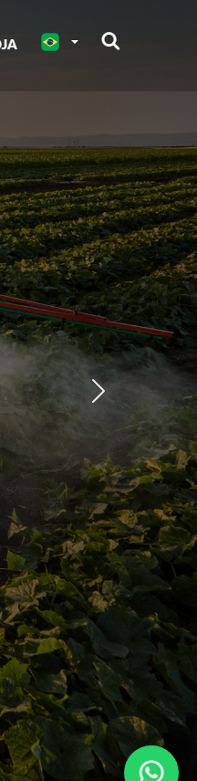


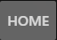


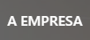

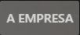


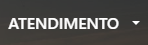

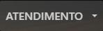


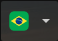

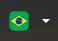


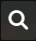

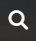

### Screenshot Index (screens/INDEX.md)

# Screenshot Index

## Scroll Journey

> Shows the cinematic state at each point of the page

| Scroll | Y Position | File |
|--------|-----------|------|
| 0% | 0px | `screens/scroll/scroll-000.png` |
| 17% | 744px | `screens/scroll/scroll-017.png` |
| 33% | 1444px | `screens/scroll/scroll-033.png` |
| 50% | 2188px | `screens/scroll/scroll-050.png` |
| 67% | 2932px | `screens/scroll/scroll-067.png` |
| 83% | 3632px | `screens/scroll/scroll-083.png` |
| 100% | 4376px | `screens/scroll/scroll-100.png` |

## Pages

| Page | URL | File |
|------|-----|------|
| Solo Rico - Cultivando soluções para uma agricultura de excelência | `https://gruposolorico.com.br/` | `screens/pages/home.png` |
| Solo Rico - A Empresa | Soluções Agrícolas desde 1989 | `https://gruposolorico.com.br/empresa` | `screens/pages/empresa.png` |
| Para Empresas | `https://gruposolorico.com.br/para-empresas` | `screens/pages/para-empresas.png` |
| Para Você | `https://gruposolorico.com.br/para-voce` | `screens/pages/para-voce.png` |
| Casos de Sucesso - Solo Rico | `https://gruposolorico.com.br/casos-sucesso` | `screens/pages/casos-sucesso.png` |

## Sections

| Page | Section | File |
|------|---------|------|
| home | #1 (section) | `screens/sections/home-section-1.png` |
| home | #6 (main > div) | `screens/sections/home-section-6.png` |
| empresa | #1 (section) | `screens/sections/empresa-section-1.png` |
| empresa | #6 (main > div) | `screens/sections/empresa-section-6.png` |
| para-empresas | #1 (section) | `screens/sections/para-empresas-section-1.png` |
| para-empresas | #2 (section) | `screens/sections/para-empresas-section-2.png` |
| para-voce | #1 (section) | `screens/sections/para-voce-section-1.png` |
| para-voce | #2 (section) | `screens/sections/para-voce-section-2.png` |
| casos-sucesso | #1 (section) | `screens/sections/casos-sucesso-section-1.png` |
| casos-sucesso | #2 (section) | `screens/sections/casos-sucesso-section-2.png` |
| casos-sucesso | #3 (section) | `screens/sections/casos-sucesso-section-3.png` |

## Homepage Screenshots (screenshots/)


