# solorico-design — Visual Guide

> Master visual reference. Study every screenshot carefully before implementing any UI.
> Match colors, layout, typography, spacing, and motion states exactly.

## Scroll Journey

The page has cinematic scroll animations. Each screenshot below shows the exact visual state at that scroll depth.
**Replicate these transitions precisely** — the design changes dramatically as you scroll.

### Hero — Above the fold

*Scroll position: 0px of 5276px total*

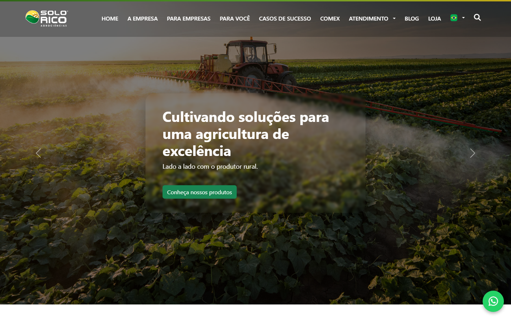

### 17% scroll depth

*Scroll position: 744px of 5276px total*

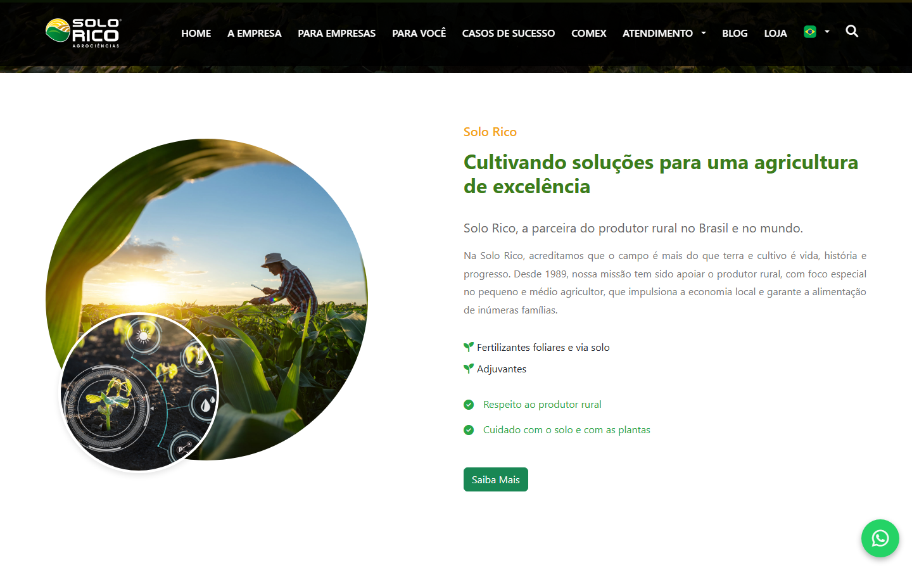

### 33% scroll depth

*Scroll position: 1444px of 5276px total*

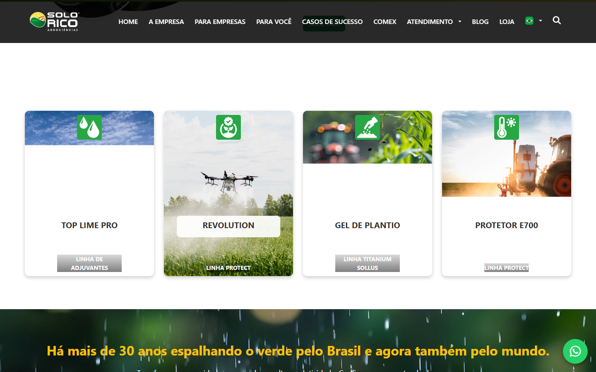

### 50% scroll depth

*Scroll position: 2188px of 5276px total*

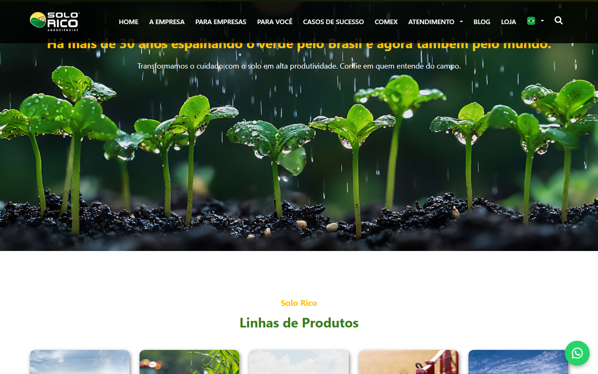

### 67% scroll depth

*Scroll position: 2932px of 5276px total*

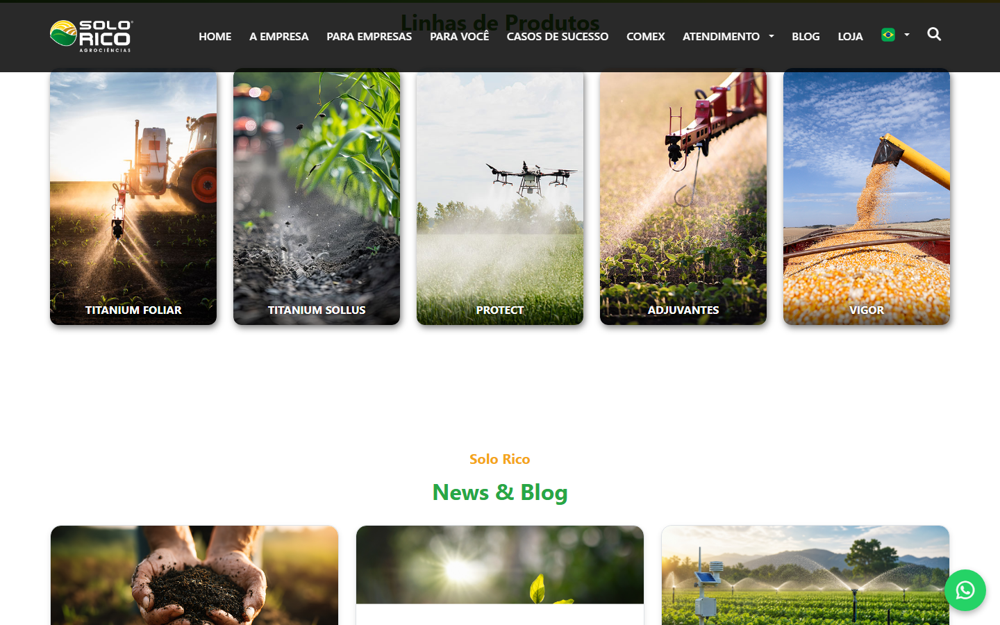

### 83% scroll depth

*Scroll position: 3632px of 5276px total*

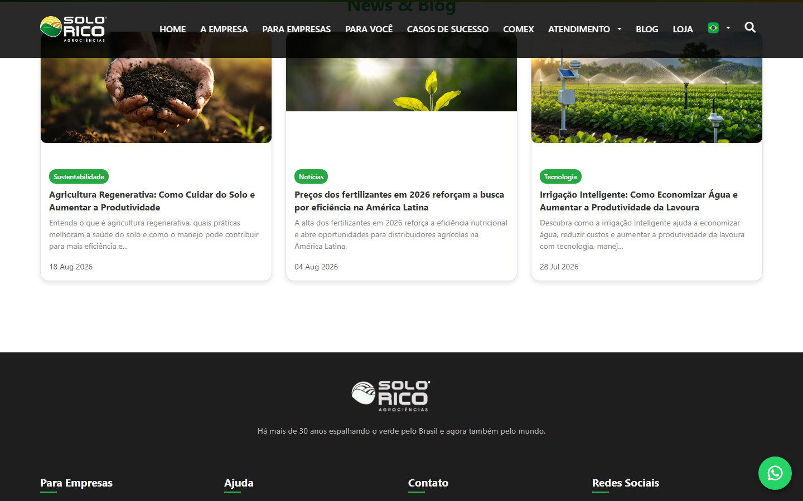

### Footer — End of page

*Scroll position: 4376px of 5276px total*

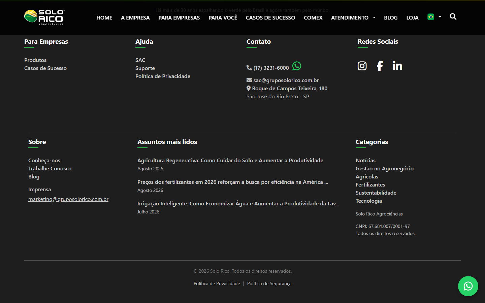

## Full Page Screenshots

### Solo Rico - Cultivando soluções para uma agricultura de excelência

*URL: `https://gruposolorico.com.br/`*

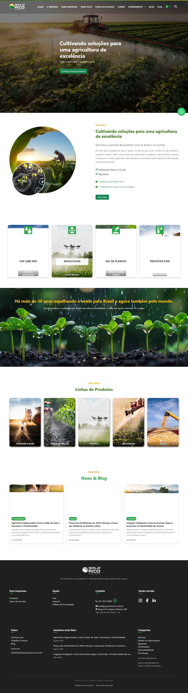

### Solo Rico - A Empresa | Soluções Agrícolas desde 1989

*URL: `https://gruposolorico.com.br/empresa`*

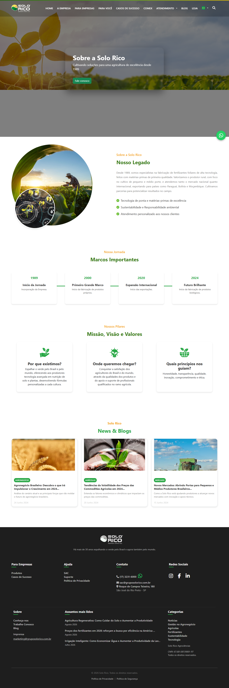

### Para Empresas

*URL: `https://gruposolorico.com.br/para-empresas`*

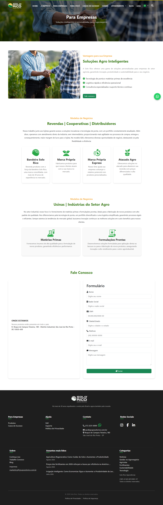

### Para Você

*URL: `https://gruposolorico.com.br/para-voce`*

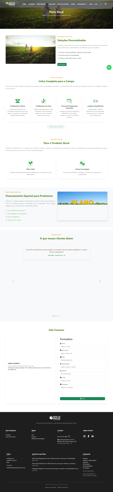

### Casos de Sucesso - Solo Rico

*URL: `https://gruposolorico.com.br/casos-sucesso`*

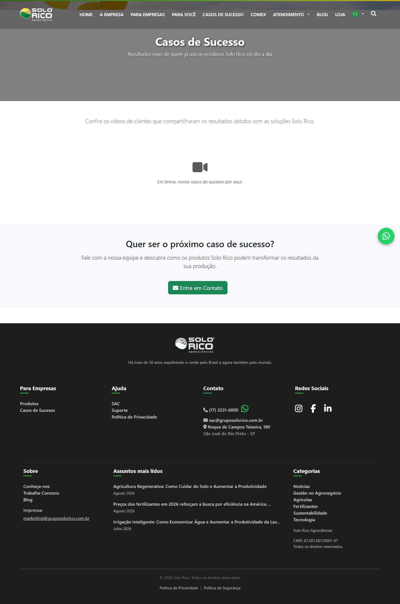

## Section Screenshots

Clipped sections showing individual components in context.

### Section 1 — `section`

*1440×741px*

### Section 6 — `main > div`

*1440×855px*

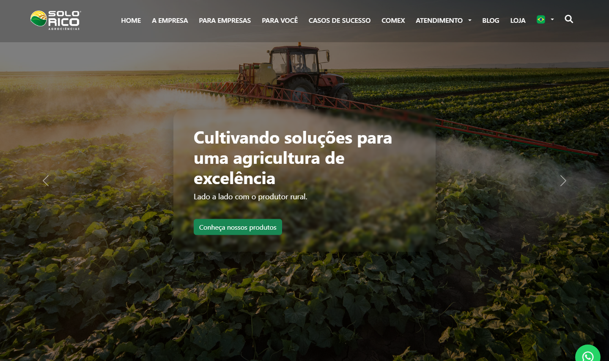

### Section 1 — `section`

*1440×630px*

### Section 6 — `main > div`

*1440×855px*

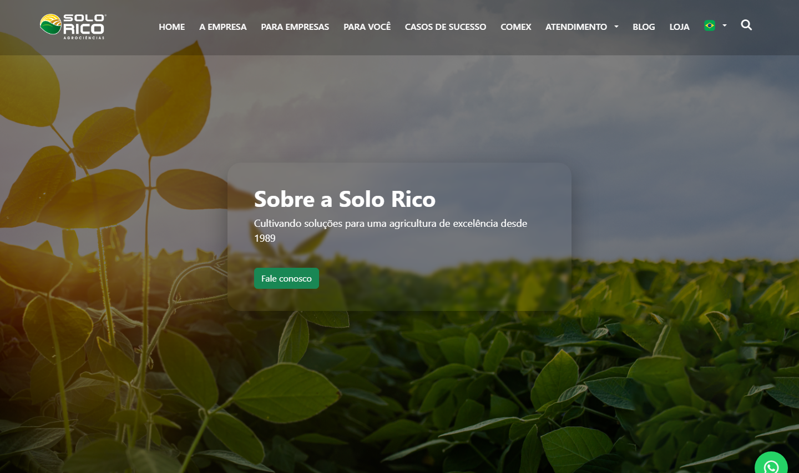

### Section 1 — `section`

*1440×360px*

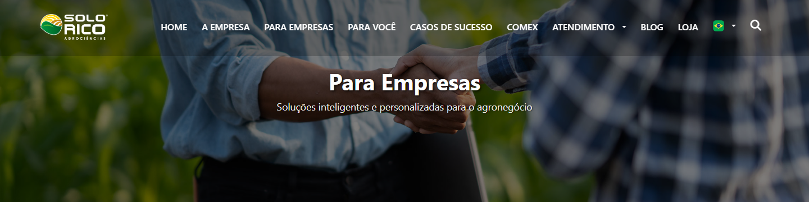

### Section 2 — `section`

*1440×552px*

### Section 1 — `section`

*1440×360px*

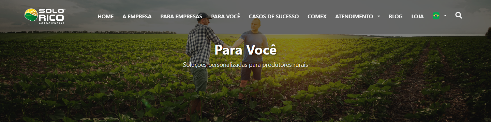

### Section 2 — `section`

*1440×489px*

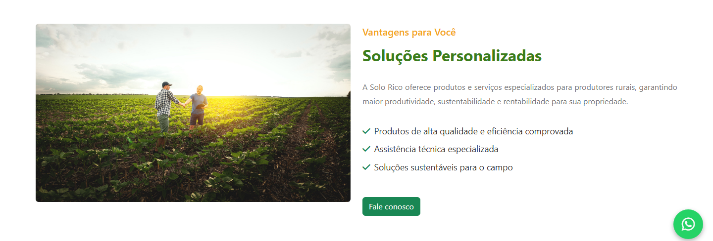

### Section 1 — `section`

*1440×360px*

### Section 2 — `section`

*1440×272px*

### Section 3 — `section`

*1440×298px*

